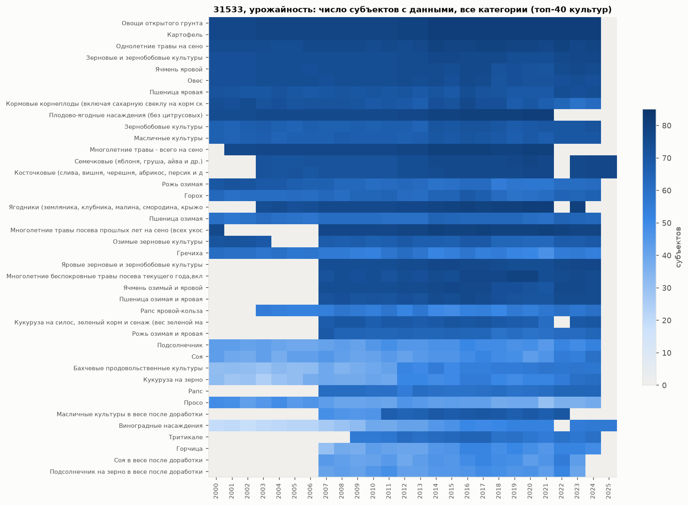
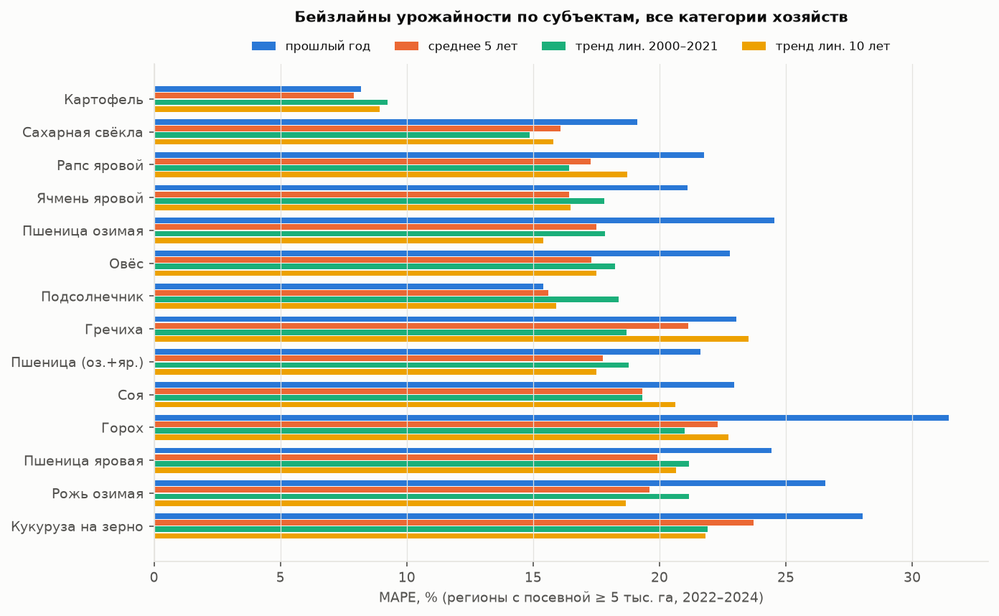
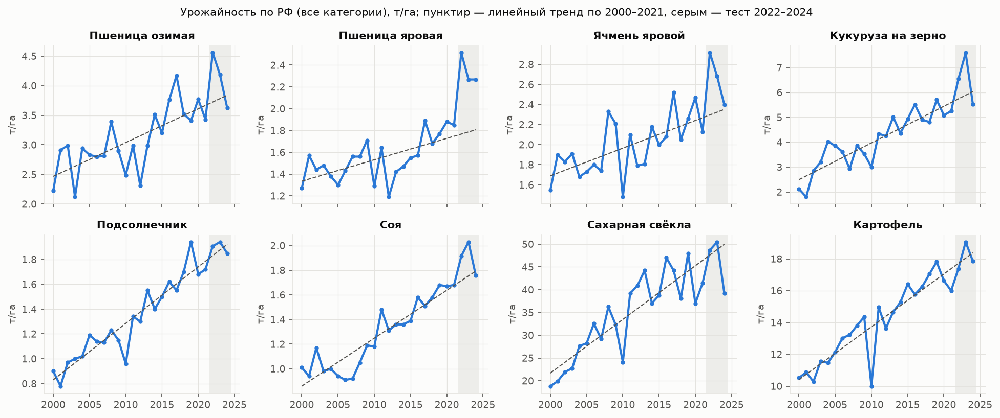
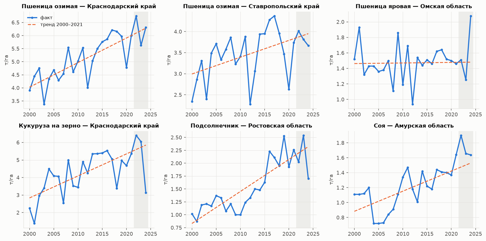
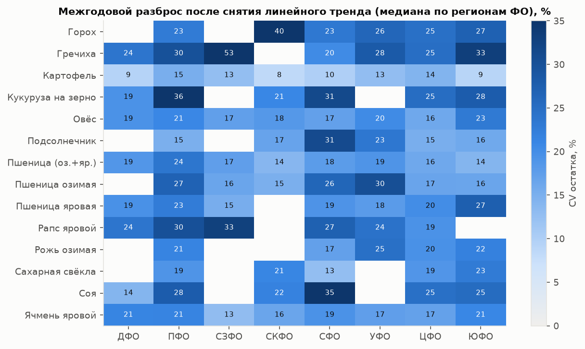

# EDA данных ЕМИСС: урожайность, площади, цены, удобрения

*25.10.2026. Код: [src/data/parse_emiss.py](../src/data/parse_emiss.py) (SDMX → parquet) и [src/data/eda_emiss.py](../src/data/eda_emiss.py) (весь анализ). Таблицы лежат в [reports/tables/](tables/), графики — в [reports/figures/](figures/). Чтобы пересобрать:*

```bash
uv run python -I -X utf8 src/data/parse_emiss.py
```
```bash
uv run python -I -X utf8 src/data/eda_emiss.py
```

## 0. Коротко

| | |
|---|---|
| Урожайность 31533 | **2000–2024** по полевым культурам. В 2025 году есть только плодово-ягодные и виноград. Итоги за 2025 выйдут не раньше 06.04.2027 (дата из заголовка выгрузки). |
| Территории | 81 субъект с данными, плюс ФО, РФ и 12 старых экономических районов. ДНР, ЛНР, Запорожской и Херсонской областей **нет**, Крым и Севастополь есть с 2014 г. |
| Культуры | 75 кодов после склейки дублей. Основные полевые культуры есть в 60–80 субъектах (соя, подсолнечник и кукуруза — в 30–40 с длинным рядом). |
| Категории хозяйств | 4 категории: все категории, с/х организации (СХО), КФХ и ИП, хозяйства населения. По зерновым и масличным покрытие у «всех категорий» и у СХО почти одинаковое. |
| Ряды ≥15 лет подряд (2000–2024) | Пшеница озимая — 59 субъектов, пшеница яровая — 67, ячмень яровой — 72, картофель — 78, подсолнечник — 40, кукуруза на зерно — 34, соя — 34, сахарная свёкла — 21. Регионы с такими рядами дают **96–100 % посевной площади РФ** по каждой культуре. |
| Простой тренд, субъекты, 2022–2024 | MAPE **15–21 %** по зерновым, 15–18 % по подсолнечнику и сахарной свёкле, около 19 % по сое, около 22 % по кукурузе, 8–9 % по картофелю. По РФ в целом — 3–15 %. |
| Что остаётся погоде | После линейного тренда остаётся **40–70 % межгодовой дисперсии** у зерновых, 21 % у подсолнечника и около 40 % у кукурузы и сои. CV остатка — 15–27 %. Примерно половина остатка общая для регионов одного ФО, то есть похожа на погодный сигнал. |
| Проблемы данных | 1 871 значение «999999999» (так Росстат помечает конфиденциальные данные, в основном 2018–2021), 1 115 нулей, единичные явные ошибки (Липецкая обл., ячмень озимый 2022 = 33 748 ц/га). Смена кода РФ в 2023 г. Ряд «пшеница всего» начинается только с 2007 г. |
| Валовой сбор 30950 *(обновлено 26.10)* | 1986–**2025**. За 2025 есть все основные культуры, кроме подсолнечника. Урожайность из 31533 со сбором согласована. По сбору и посевной 2025 года урожайность восстанавливается с медианной ошибкой 1–3 % (раздел 3). |
| Цены 31454 + 57693 *(обновлено 26.10)* | Цены по годам непрерывно за **1999–2026**: 31454 — 1999–2016, 57693 — 2017–2026. Годы не пересекаются, на стыке разрыва нет. |
| Чего нет | Годовой **убранной площади нет**: 33784 — это только оперативные данные СХО за 2023–2026. |

## 1. Парсер и что он чистит

`parse_emiss.py` читает `data/raw/emiss/<id>/data.xml` потоково (`lxml.iterparse`, файл на 180 МБ разбирается примерно за 20 с). Если полной выгрузки нет, берёт `data_<год>.xml`. Недокачанные файлы без закрывающего `</GenericData>` пропускает. Результат пишет в `data/processed/emiss/<id>.parquet`.

Колонки: `indicator_id, okato, region, region_level, fo, year, crop_code, crop, farm_category_code, farm_category, unit, period, value, confidential, dup_conflict`. Для показателей в ц/га добавлена колонка `value_t_ha`. Если у показателя другие измерения, они идут парами `<концепт>_code` + `<концепт>`: например, у цен это `s_OKPD2` (продукт) и `s_OKEI` (единица).

Что он обрабатывает:
- **`region_level`** — уровень территории: `rf` (643), `rf_part` (643001 — РФ без Крыма и Севастополя; 643004.АГ — РФ без новых субъектов, с 2023 г.), `fo`, `subject`, `subject_part`, `other` (экономические районы 050–061).
  - `subject_part` — это коды «без АО» и сами АО: 11001… (Архангельская без НАО), 71001… (Тюменская без ХМАО и ЯНАО), 11100…, 71100…, 71140…, а также бывшие округа (Агинский, Коми-Пермяцкий и т. п.). Субъекты «с АО» (11000…, 71000…) остаются на уровне `subject`. Если нужна склейка с геометрией из `regions.csv`, для Тюмени берите код 71001…
- **Ряд РФ:** код `643` заканчивается в 2022 г., с 2023 г. тот же ряд идёт под кодом `643004.АГ`. Функция `rf_series()` в `eda_emiss.py` их склеивает.
- **Дубли.** Коды вида `w2:p_kultur:3100009` — это второй справочник культур с теми же числами (18 944 наблюдения в 31533, расхождений 0). Парсер сводит их к базовому коду и удаляет копии. Дублей с разными значениями нет ни в одном файле.
- **Конфиденциальные значения.** `999999999` превращаются в NaN, а `confidential=True` (31533 — 1 871, 31328 — 1 327). Из основных культур на уровне субъектов затронуто 85 точек по всем категориям и 138 по СХО (соя, кукуруза, рапс, рыжик, лён). Без этой правки площади «Тритикале» складывались в 3·10⁹ тыс. га.
- **Единицы** берутся из атрибута `EI`: 31533 — ц/га, 31328 и 33784 — тыс. га, 30964 — кг на 1 га, 57693 — руб. за единицу ОКЕИ (почти везде за тонну).

Обработанные файлы: 31533, 31328, 30950 (частично), 33784, 34022, 57693, 30964, 33919, 37662, 33978, 34165.

## 2. Покрытие



Число субъектов с урожайностью > 0 (все категории):

| культура | 2000 | 2005 | 2010 | 2015 | 2019 | 2020 | 2021 | 2022 | 2023 | 2024 |
|---|---|---|---|---|---|---|---|---|---|---|
| Пшеница озимая | 60 | 59 | 61 | 64 | 63 | 61 | 60 | 65 | 64 | 63 |
| Пшеница яровая | 72 | 70 | 71 | 69 | 69 | 69 | 69 | 74 | 73 | 74 |
| Пшеница озимая и яровая | — | — | 72 | 74 | 72 | 71 | 71 | 75 | 75 | 75 |
| Ячмень яровой | 73 | 74 | 74 | 74 | 73 | 72 | 71 | 75 | 76 | 75 |
| Кукуруза на зерно | 32 | 31 | 40 | 50 | 49 | 52 | 52 | 55 | 60 | 61 |
| Подсолнечник | 43 | 39 | 45 | 47 | 47 | 48 | 44 | 52 | 49 | 53 |
| Соя | 43 | 42 | 41 | 46 | 48 | 43 | 46 | 55 | 54 | 60 |
| Сахарная свёкла | 34 | 29 | 26 | 23 | 24 | 22 | 21 | 25 | 24 | 25 |
| Картофель | 77 | 78 | 78 | 81 | 81 | 81 | 81 | 81 | 81 | 81 |
| Рапс яровой | — | 53 | 54 | 49 | 56 | 54 | 57 | 60 | 57 | 60 |

- Матрица для СХО — [coverage_crop_year_cat2.png](figures/coverage_crop_year_cat2.png), по картине почти та же. Полные матрицы по всем культурам: `tables/coverage_crop_year_cat{1,2}.csv`.
- Матрица «регион × год» (сколько из 8 основных культур есть в регионе): [coverage_region_year_core.png](figures/coverage_region_year_core.png), таблица `tables/coverage_region_year_core.csv`.
- «Пшеница озимая и яровая», «ячмень озимый и яровой» и прочие «яровые/озимые всего» начинаются с **2007**. Тритикале — с 2009. Ряды «в весе после доработки» по масличным идут 2007/2011 – 2022/2023 и **обрываются**. Подсолнечник и соя без доработки идут до 2024.
- Овощи по видам (капуста, морковь, лук и т. д.) есть только в 2000–2006.
- **2025:** только семечковые, косточковые, «плоды и ягоды» и виноград.

**Топ по посевной площади** (31328, все категории, среднее за 2020–2024, тыс. га) и длина рядов урожайности (`tables/top_crops_by_area.csv`, `tables/series_run15_by_crop.csv`):

| культура | площадь, тыс. га | субъектов с рядом ≥15 лет | из них с посевом ≥5 тыс. га | доля площади РФ 2024 в этих регионах |
|---|---|---|---|---|
| Пшеница озимая | 16 238 | 59 | 52 | 98 % |
| Пшеница яровая | 12 968 | 67 | 54 | 100 % |
| Подсолнечник | 9 493¹ | 40 | 32 | 99 % |
| Ячмень яровой | 7 220 | 72 | 61 | 100 % |
| Соя | 3 487 | 34 | 29 | 98 % |
| Кукуруза на зерно | 2 800 | 34 | 30 | 96 % |
| Овёс | 2 075 | 72 | 55 | 100 % |
| Горох | 1 734 | 55 | 37 | 99 % |
| Рапс яровой | 1 627 | 41 | 32 | 98 % |
| Лён масличный | 1 554 | 19 | 16 | 69 % |
| Картофель | 1 104 | 78 | 63 | 100 % |
| Гречиха | 1 078 | 47 | 25 | 100 % |
| Сахарная свёкла | 1 033 | 21 | 19 | 99 % |
| Рожь озимая | 868 | 56 | 26 | 100 % |

¹ В 31328 с 2022 г. появился код «Подсолнечник на зерно» (3080100, около 10,1 млн га), параллельно с «Подсолнечником» (3080000). В урожайности используется 3080000. При склейке площадей это нужно учитывать.

Для СХО цифры почти те же: 58 / 65 / 69 субъектов с рядом ≥15 лет у пшеницы озимой, пшеницы яровой и ячменя; 34 у подсолнечника, 34 у кукурузы, 31 у сои.

## 3. Согласованность

**Сбор, урожайность и посевная (обновлено 26.10, после докачки 30950)** — скрипт [eda_gross_prices.py](../src/data/eda_gross_prices.py). Годовой убранной площади нет, поэтому проверяется доля убранной площади h = сбор / (урожайность × посевная). Регионы с посевом ≥5 тыс. га, 2000–2024 (`tables/harvest_share_*.csv`):

| культура | медиана h | 5 % | доля h > 1,02 (урожайность выше, чем позволяют сбор и посевная) | доля h < 0,8 (большая гибель) |
|---|---|---|---|---|
| Пшеница озимая | 0,988 | 0,83 | 0,5 % | 4 % |
| Пшеница яровая | 0,971 | 0,68 | 0,2 % | 11 % |
| Ячмень яровой | 0,971 | 0,67 | 0,3 % | 11 % |
| Кукуруза на зерно | 0,944 | 0,51 | 1,7 % | 20 % |
| Подсолнечник | 0,960 | 0,59 | 0,8 % | 13 % |
| Соя | 0,970 | 0,57 | **7,1 %** | 15 % |
| Сахарная свёкла | 0,976 | 0,82 | 0 % | 4 % |
| Картофель | 0,997 | 0,95 | 1,9 % | 0,3 % |

- Три показателя согласованы. Исключение — соя, у которой в 7 % случаев h > 1,02. Вероятная причина: урожайность считается «в весе после доработки», а сбор — нет, или наоборот.
- Годы, когда h падает, — это годы гибели посевов: 2010 (зерновые около 0,8), 2023–2024 (горох 0,89–0,94, ячмень 0,93). Значит, **урожайность «на убранную площадь» занижает настоящий ущерб от засухи**: погибшие площади в неё не попадают. Для калькулятора («сколько соберу с моего поля») правильнее считать сбор / посевная, то есть урожайность × h. Это стоит отразить в ТЗ.
- **Урожайность 2025 по сбору.** y ≈ сбор / (посевная × медиана h региона за 5 предыдущих лет). На 2015–2024, где ответ известен, медианная ошибка: пшеница озимая 1,0 %, пшеница яровая 2,5 %, ячмень 2,2 %, кукуруза 3,7 %, соя 1,9 %, свёкла 1,1 %, картофель 0,4 %; 90-й перцентиль — 7–23 %. Регионов с оценкой за 2025: пшеница озимая 63, пшеница яровая 74, ячмень 74, кукуруза 59, соя 58, свёкла 24. Таблица: `data/processed/yield_proxy.parquet`. По РФ (модельные регионы) получается: пшеница всего — 3,47 т/га (2024 — 3,04), ячмень — 2,94 (2,40), кукуруза — 5,90 (5,52), соя — 2,08 (1,76), свёкла — 41,3 (39,2). В модели 2025 год используется как дополнительный тестовый.

Ещё три проверки:

1. **Агрегация.** Сравнил урожайность РФ со средней по субъектам, взвешенной посевной площадью. Медианное расхождение 0,1–0,9 %, максимальное 1–13 %; больше всего у кукурузы и ячменя в засушливые годы, когда убранная площадь заметно меньше посевной. Регионы и РФ согласованы.
2. **Оперативные данные против итоговых** (33978, СХО, «на 1 ноября», против 31533, СХО) — [oper_vs_final.png](figures/oper_vs_final.png), `tables/oper_vs_final.csv`:

   | | 2023: медиана ошибки / медиана модуля | 2024 |
   |---|---|---|
   | Подсолнечник | −2,6 % / 3,4 % | −0,3 % / 2,1 % |
   | Картофель | +0,2 % / 3,8 % | +0,1 % / 2,6 % |
   | Сахарная свёкла | −8,0 % / 8,0 % | −6,3 % / 7,7 % |
   | Зерновые (опер. без кукурузы; итог с кукурузой) | −3,2 % / 3,5 % | −3,3 % / 4,1 % |

   По зерновым сравнение неточное: оперативный ряд идёт без кукурузы, итоговый — с ней. Вывод: **оперативные данные на 1 ноября за 2025 и 2026 можно брать как предварительный тест** с поправкой около −3 % для зерновых и около −7 % для сахарной свёклы, потому что к 1 ноября свёкла ещё не убрана.
3. **Выбросы** (`tables/outliers_main_crops.csv`): нули, отклонение больше чем в 3 раза от медианы ряда, скачок год к году больше чем в 3 раза. Помечено 1 259 точек из 38 тыс. (3,3 %), из них только 400 — в регионах с посевом ≥5 тыс. га. Почти всё это ранние годы (2000–2011) в регионах, где культуры тогда почти не было (соя в Пензенской обл. 2002 = 0,5 ц/га, затем 7,7). Плюс реальные провалы: засуха 2010, свёкла 2024. Явные ошибки: **Липецкая обл., ячмень озимый 2022 = 33 748 ц/га** (видимо, лишние знаки), Калужская обл., кормовые корнеплоды 2023 = 2 954 ц/га, одно отрицательное значение (Ленинградская обл., кукуруза на силос, КФХ, 2023). Нули (1 115 в 31533) лучше считать пропусками.

## 4. Трендовые бейзлайны (обучение 2000–2021, тест 2022–2024)

Выборка — субъекты, где есть все три тестовых года и не меньше 15 лет в обучении (для «пшеницы всего» — 12 лет, с 2007 г.). В метрики вошли только регионы со средней посевной за 2017–2021 ≥ 5 тыс. га. Методы:
- линейный тренд по 2000–2021;
- линейный тренд по последним 10 годам (2012–2021);
- тренд Тейла–Сена;
- скользящий тренд, который переобучается на данных до t−1;
- «прошлый год» (берётся фактическое значение t−1);
- «среднее 5 лет» (t−5…t−1).



**Все категории, субъекты, 2022–2024** (MAE в т/га, MAPE в %; полные таблицы — `tables/baseline_metrics*.csv`):

| культура | n рег. | ср. т/га | прошлый год MAE / MAPE | среднее 5 лет | тренд 2000–21 | тренд 10 лет | скользящий тренд |
|---|---|---|---|---|---|---|---|
| Пшеница озимая | 53 | 3,67 | 0,83 / 24,6 | 0,63 / 17,5 | 0,65 / 17,9 | **0,53 / 15,4** | 0,62 / 17,3 |
| Пшеница яровая | 54 | 2,81 | 0,66 / 24,4 | 0,56 / 19,9 | 0,58 / 21,2 | 0,54 / 20,7 | **0,53 / 19,1** |
| Пшеница (оз.+яр.) | 65 | 3,19 | 0,64 / 21,6 | 0,55 / 17,8 | 0,55 / 18,8 | **0,50 / 17,5** | 0,51 / 17,2 |
| Ячмень яровой | 61 | 2,77 | 0,56 / 21,1 | 0,45 / 16,4 | 0,48 / 17,8 | **0,43 / 16,5** | 0,44 / 16,2 |
| Кукуруза на зерно | 31 | 6,22 | 1,60 / 28,1 | 1,44 / 23,7 | 1,28 / 21,9 | 1,33 / 21,8 | **1,24 / 21,4** |
| Подсолнечник | 33 | 2,03 | **0,29 / 15,4** | 0,31 / 15,6 | 0,37 / 18,4 | 0,33 / 15,9 | 0,34 / 17,1 |
| Соя | 29 | 1,76 | 0,36 / 23,0 | 0,32 / 19,3 | **0,30 / 19,3** | 0,31 / 20,6 | 0,30 / 19,4 |
| Сахарная свёкла | 20 | 45,2 | 8,0 / 19,1 | 7,3 / 16,1 | **6,0 / 14,9** | 7,4 / 15,8 | 6,1 / 15,1 |
| Картофель | 63 | 17,6 | 1,50 / 8,2 | **1,49 / 7,9** | 1,63 / 9,3 | 1,57 / 8,9 | 1,50 / 8,5 |
| Рапс яровой | 32 | 1,78 | 0,35 / 21,8 | 0,30 / 17,3 | **0,28 / 16,4** | 0,31 / 18,7 | 0,28 / 16,6 |
| Овёс | 55 | 2,22 | 0,48 / 22,8 | 0,38 / 17,3 | 0,41 / 18,2 | **0,37 / 17,5** | 0,37 / 16,9 |

- По СХО ошибки на 1–3 п. п. выше: пшеница озимая — 15,7–18 %, кукуруза — 23–26 %, картофель — 13,5–17,8 %. Картофель в СХО почти вдвое изменчивее, чем в «всех категориях», где большую часть дают хозяйства населения со сглаженной статистикой.
- MAPE, взвешенный по площади, близок к обычному (пшеница озимая — 13,9–17,4 %, подсолнечник — 11,8–15,3 %).
- **Тест смещён особыми годами.** 2022 — рекордный урожай: тренд недооценил зерновые на 0,5–0,7 т/га. 2024 — заморозки и засуха на юге: у сахарной свёклы ошибка +8,4 т/га, у сои и кукурузы MAPE 26–30 %. Три тестовых года — это мало. Для ТЗ советую дополнить оценку скользящим окном: прогноз t по данным до t−1 для t = 2015…2024.
- **По РФ в целом** (`tables/baseline_rf_mape.csv`), лучший простой метод (обычно тренд за 10 лет): картофель — 3 %, подсолнечник — 3–4 %, соя — 8 %, пшеница всего — 9–10 %, ячмень — 10–12 %, пшеница яровая — 11 %, сахарная свёкла — 11–13 %, кукуруза — 15 %. На уровне страны ошибки регионов взаимно гасятся, поэтому региональная модель — гораздо более трудная задача.

**Ориентир для модели с погодой:** по субъектам MAE около 0,5 т/га, MAPE около 15–17 % для пшеницы и ячменя; около 1,2 т/га и около 21 % для кукурузы; около 0,3 т/га и около 15 % для подсолнечника; около 0,3 т/га и около 19 % для сои.




## 5. Сколько вариации остаётся погоде

Для каждого ряда «культура × субъект» с длиной ≥20 лет (для «пшеницы всего» — ≥15) и посевом ≥5 тыс. га снят линейный тренд по 2000–2024. Посчитано:
- **доля остатка** = 1 − R² тренда;
- **CV остатка** = σ(остатка) / среднее;
- **согласованность внутри ФО** — r² между относительной аномалией региона и средней аномалией остальных регионов того же ФО. Это грубая оценка той части остатка, которая похожа на крупномасштабную погоду.

Таблицы: `tables/residual_variance_by_crop.csv`, `tables/residual_cv_crop_fo.csv`.

| культура (все категории) | n | R² тренда | доля остатка | CV остатка | σ остатка, т/га | r² с ФО |
|---|---|---|---|---|---|---|
| Пшеница озимая | 52 | 0,45 | **0,55** | 21 % | 0,54 | 0,52 |
| Пшеница яровая | 54 | 0,51 | 0,49 | 20 % | 0,36 | 0,52 |
| Пшеница (оз.+яр., 2007+) | 65 | 0,43 | 0,57 | 18 % | 0,40 | 0,53 |
| Ячмень яровой | 61 | 0,46 | 0,54 | 18 % | 0,35 | 0,44 |
| Кукуруза на зерно | 30 | 0,61 | 0,39 | 27 % | 0,95 | 0,34 |
| Подсолнечник | 32 | 0,79 | **0,21** | 16 % | 0,24 | 0,27 |
| Соя | 29 | 0,60 | 0,41 | 25 % | 0,31 | 0,32 |
| Сахарная свёкла | 20 | 0,64 | 0,36 | 19 % | 6,5 | 0,64 |
| Картофель | 63 | 0,57 | 0,43 | 14 % | 1,85 | 0,33 |
| Рапс яровой | 31 | 0,58 | 0,42 | 26 % | 0,29 | 0,27 |
| Овёс | 55 | 0,32 | 0,69 | 18 % | 0,31 | 0,50 |
| Горох | 38 | 0,33 | 0,67 | 24 % | 0,42 | 0,54 |



Выводы:
- **Зерновым есть что объяснять погодой.** Тренд снимает только около половины дисперсии, межгодовой разброс — около 20 %. Около половины остатка общая для регионов одного ФО, то есть это крупномасштабный сигнал, а погода (ERA5) как раз такой масштаб и ловит.
- **Подсолнечник** почти целиком описывается трендом (R² = 0,79). Ожидаемый выигрыш от погоды мал, при этом это вторая культура по площади. Её стоит взять, но выигрыш против тренда для неё лучше не обещать.
- **Кукуруза и соя** — разброс большой (CV 25–27 %), но согласованность внутри ФО ниже (r² около 0,3). Больше локальных факторов: орошение, технологии, быстрый рост площадей.
- Самый сильный разброс по ФО: кукуруза в ПФО (36 %) и СФО (31 %), соя в СФО (35 %), пшеница озимая в ПФО, УФО и СФО (26–30 %), пшеница яровая в ЮФО (27 %). Самые стабильные: картофель (8–15 %) и пшеница в ЮФО и СКФО (14–16 %).

## 6. Цены производителей и удобрения

**31454 + 57693 (обновлено 26.10).** 31454 докачан и охватывает 1999–2016, 57693 — 2017–2026. Годы не пересекаются и вместе дают непрерывный ряд. В обоих есть годовая цена «январь-декабрь» в руб./т. Названия продуктов различаются: «Свекла сахарная» в 31454 и «Корнеплоды свеклы сахарной» в 57693.

| продукт | 31454: субъектов, годы | 57693: субъектов, годы |
|---|---|---|
| Пшеница | 73, 1999–2016 | 70, 2017–2025 |
| Ячмень | 74, 1999–2016 | 68, 2017–2025 |
| Кукуруза | 33, 1999–2016 | 36, 2017–2025 |
| Семена подсолнечника | 33, 1999–2016 | 35, 2017–2025 |
| Бобы соевые | 23, 2005–2016 | 30, 2017–2025 |
| Сахарная свёкла | 25, 1999–2016 | 22, 2017–2025 |
| Картофель | 74, 1999–2016 | 70, 2017–2025 |
| Семена рапса | 25, 2012–2016 | 43, 2017–2025 |

Годовые цены по РФ за 1999–2025 — в `tables/prices_rf_1999_2026.csv`, график — [prices_rf_1999_2025.png](figures/prices_rf_1999_2025.png). Для 2026 есть месячные цены по сентябрь включительно. Сценарии цен для оптимизации можно брать из 27 лет, но в реальных ценах: номинальные надо дефлировать, например индексом цен 31110/57740.

Ниже — исходный разбор 57693 (25.10):

**57693:** руб./т, 2017 — сентябрь 2026. Периоды — каждый месяц и накопленные («январь-…», включая «январь-декабрь» как годовую цену). В 2026 г. последний месяц — сентябрь. Число субъектов с данными (`tables/prices_57693_products.csv`):

| продукт | субъектов | годы |
|---|---|---|
| Пшеница (и «кроме твёрдой») | 70 | 2017–2026 |
| Пшеница мягкая 3 / 4 / 5 класса | 60 / 54 / 63 | 2019–2026 |
| Ячмень | 69 | 2017–2026 |
| Картофель | 70 | 2017–2026 |
| Семена рапса | 43 | 2017–2026 |
| Кукуруза | 38 | 2017–2026 |
| Семена подсолнечника | 35 | 2017–2026 |
| Бобы соевые | 31 | 2017–2026 |
| Корнеплоды сахарной свёклы | 23 | 2017–2026 |

Цена по РФ за год («январь-декабрь», руб./т): пшеница — 7 304 (2017), 14 265 (2021), 10 847 (2023), 13 248 (2025); подсолнечник — 17 033 → 38 728 → 24 164 → 37 003; соя — 21 138 → 40 909 → 33 109 → 32 799. Подробнее — `tables/prices_rf_annual.csv`. Межгодовой разброс цен сопоставим с разбросом урожайности или больше его, это важно для оптимизации структуры посевов.

**30964 — минеральные удобрения** (кг действующего вещества на 1 га посевной, только СХО), 1993–2025 (`tables/fertilizer_30964_coverage.csv`):
- зерновые без кукурузы — 79 субъектов, 1993–2025;
- картофель — 80;
- подсолнечник — 53;
- сахарная свёкла — 42;
- рапс — 58 (только 2022–2025);
- кормовые — 81;
- «всего» — 2019 г. и раньше, с 2020 г. — «с/х культуры всего».

Отдельно по кукурузе, сое и пшенице данных **нет**. По РФ: зерновые — 45 кг/га (2015) → 81–83 (2021–2025); подсолнечник — 25 → 42–48; сахарная свёкла — около 300; картофель — 330 → 553. Удобрения годятся как региональный признак интенсивности (лаг 0–1 год) для групп культур, но не для каждой культуры отдельно.

## 7. Рекомендации для ТЗ

1. **Культуры: 5 основных и 1 дополнительная.**
   - Основные: **пшеница озимая, пшеница яровая, ячмень яровой, подсолнечник, кукуруза на зерно**. Это пять крупнейших по площади культур (около 49 млн га), у них самые длинные ряды и, кроме подсолнечника, явный погодный сигнал.
   - Шестая — **соя** (3,5 млн га, ДФО и ЦФО, быстро растёт).
   - Пшеницу лучше моделировать раздельно (озимая и яровая): у них разные погодные окна, и ряды идут с 2000 г. «Пшеница всего» начинается только с 2007-го.
   - Сахарная свёкла (20 регионов) и картофель (слабый погодный сигнал у «всех категорий», статистика хозяйств населения) — по желанию, во вторую очередь. Рапс яровой — запасной вариант вместо сои.
2. **Регионы.** Брать субъекты, где ряд по культуре ≥15 лет подряд и средний посев ≥5 тыс. га. Это около 52–61 регион для пшеницы и ячменя, около 30 для кукурузы, подсолнечника и сои, и они покрывают 96–100 % площади РФ. Ряды короче 15 лет оставить для инференса, но не для валидации. Новых субъектов в урожайности нет: в ТЗ так и записать. Для Архангельской и Тюменской областей брать коды «с АО» (для урожайности это неважно: в АО пашни почти нет), а для геометрии — «без АО».
3. **Период.**
   - Обучение — **2000–2021**, тест — **2022–2024** (итоговые данные 31533).
   - Дополнительно — оценка скользящим окном (t = 2015…2024), потому что три тестовых года нетипичны: рекорд 2022 года и провалы 2024 года.
   - **2025 и 2026** — только предварительный тест на оперативных данных: 33978 (СХО, срез на 1 ноября для 2025 г., на 1 октября для 2026 г.) и 34165. Учитывать известное смещение: зерновые около −3 %, свёкла около −7 %. Итоги 2025 г. ожидаются после 06.04.2027.
4. **Категория хозяйств.**
   - Целевая — **«хозяйства всех категорий»**: она совпадает с официальной статистикой и валовым сбором, и покрытие у неё лучшее.
   - **СХО** — вторая цель или проверка. Оперативные данные 2025–2026 есть только по СХО, а для зерновых и масличных ряды СХО почти совпадают с «всеми категориями».
5. **Целевая переменная и метрики.**
   - Цель — отклонение от тренда. Для тренда — линейная регрессия по последним 10 годам или скользящая (до t−1). Тренд по всему периоду 2000–2021 не лучше и сильнее занижает 2022 г.
   - Метрики — MAE в т/га и MAPE по субъектам, плюс MAPE, взвешенный по площади, и ошибка по РФ.
   - Требование к модели: обойти лучший бейзлайн культуры (см. таблицу в разделе 4) хотя бы на 15–20 % по MAE на скользящей валидации.
6. **Чего опасаться.**
   - `999999999` = скрыто. Уже убраны в NaN, но это пропуски в 2018–2021 по сое, кукурузе и рапсу, особенно у СХО.
   - Нули считать пропусками.
   - Явные ошибки ввода: фильтр «больше чем в 3 раза от медианы ряда».
   - Смена кода РФ в 2023 г.
   - Смена кодов культур: «подсолнечник на зерно» в 31328 с 2022 г.; ряды «в весе после доработки» обрываются в 2022–2023 гг.
   - Посевная площадь ≠ убранной: годовой убранной площади нет, а потери посевов в засуху велики.
   - Цены до 2017 г. отсутствуют, а цены по свёкле, сое и подсолнечнику есть лишь в 23–35 субъектах. Для экономики нужен fallback на цену ФО или РФ.

## 8. Чего нет в этом отчёте

- Погода, почвы, NDVI и первая модель с погодой — в отдельном отчёте [model_weather.md](model_weather.md) (26.10).
- Ноутбук не делал: всё воспроизводится двумя скриптами.
