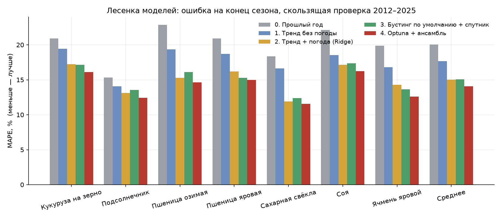
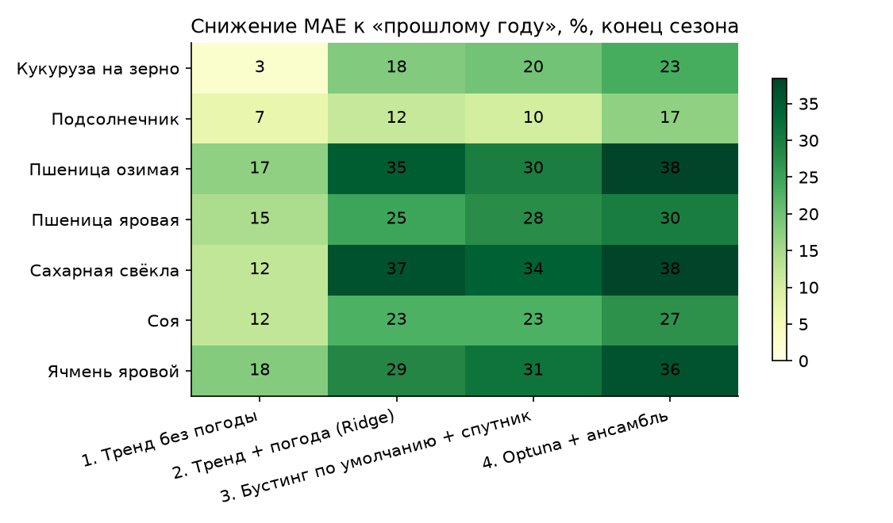
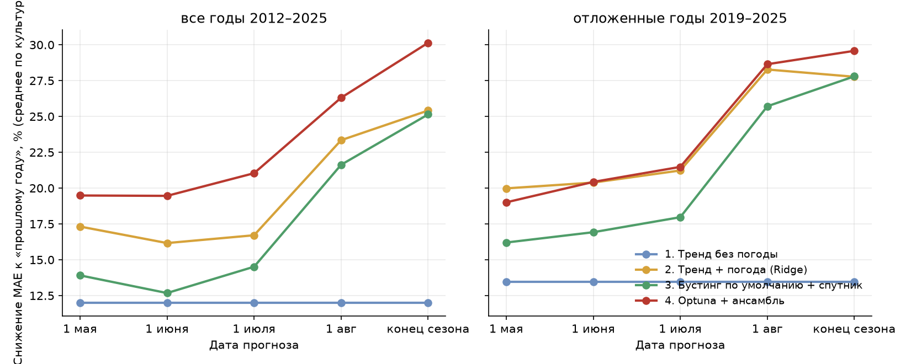

# Лесенка моделей

Пять ступеней оцениваются на **одной и той же** скользящей проверке: для каждого года T от 2012 до 2025 модель обучается только на сезонах до T, прогноз сравнивается с фактом на одних и тех же парах «субъект × год». Выборка: субъекты с посевом ≥ 5 тыс. га и рядом ≥ 15 лет. 2025 год — урожайность восстановлена как сбор / посевная (итогов Росстата нет), поэтому все ступени ошибаются относительно одной и той же «правды».

| ступень | что это |
|---|---|
| 0. Прошлый год | урожайность прошлого сезона без каких-либо поправок |
| 1. Тренд без погоды | лучший из «среднее 5 лет» и линейного тренда 10 лет (выбор по годам 2012–2018) |
| 2. Тренд + погода (Ridge) | линейная модель на аномалиях погоды и окне культуры, цель «отклонение от среднего 5 лет» |
| 3. Бустинг по умолчанию + спутник | LightGBM с параметрами по умолчанию на погоде, почвах, NDVI, спутнике MODIS (LAI, FPAR, LST), рельефе и прошлых отклонениях |
| 4. Optuna + ансамбль | лучшая конфигурация перебора на каждую культуру и дату (подбор гиперпараметров и признаков, среднее лучших моделей); выбор по годам 2012–2018 |

## Итог на конец сезона

| step                           |   MAE, т/га (среднее по культурам) |   RMSE, т/га |   MAPE, % |   снижение MAE к ступени 0, % |
|:-------------------------------|-----------------------------------:|-------------:|----------:|------------------------------:|
| Прошлый год                    |                               1.48 |         1.87 |     20.05 |                          0.00 |
| Тренд без погоды               |                               1.30 |         1.68 |     17.65 |                         11.99 |
| Тренд + погода (Ridge)         |                               0.99 |         1.30 |     15.02 |                         25.41 |
| Бустинг по умолчанию + спутник |                               1.01 |         1.33 |     15.08 |                         25.14 |
| Optuna + ансамбль              |                               0.95 |         1.26 |     14.08 |                         30.14 |

### MAE по культурам, т/га

| crop_name         |   0. Прошлый год |   1. Тренд без погоды |   2. Тренд + погода (Ridge) |   3. Бустинг по умолчанию + спутник |   4. Optuna + ансамбль |
|:------------------|-----------------:|----------------------:|----------------------------:|------------------------------------:|-----------------------:|
| Кукуруза на зерно |             1.00 |                  0.97 |                        0.82 |                                0.80 |                   0.76 |
| Подсолнечник      |             0.24 |                  0.22 |                        0.21 |                                0.22 |                   0.20 |
| Пшеница озимая    |             0.66 |                  0.55 |                        0.43 |                                0.47 |                   0.41 |
| Пшеница яровая    |             0.46 |                  0.39 |                        0.34 |                                0.33 |                   0.32 |
| Сахарная свёкла   |             7.23 |                  6.36 |                        4.58 |                                4.74 |                   4.45 |
| Соя               |             0.32 |                  0.28 |                        0.25 |                                0.25 |                   0.23 |
| Ячмень яровой     |             0.43 |                  0.35 |                        0.30 |                                0.29 |                   0.27 |

### Снижение MAE к ступени 0, %

| crop_name         |   1. Тренд без погоды |   2. Тренд + погода (Ridge) |   3. Бустинг по умолчанию + спутник |   4. Optuna + ансамбль |
|:------------------|----------------------:|----------------------------:|------------------------------------:|-----------------------:|
| Кукуруза на зерно |                  2.72 |                       18.31 |                               19.62 |                  23.47 |
| Подсолнечник      |                  7.15 |                       11.60 |                               10.20 |                  17.08 |
| Пшеница озимая    |                 17.12 |                       35.07 |                               29.77 |                  38.47 |
| Пшеница яровая    |                 14.57 |                       24.76 |                               27.68 |                  30.01 |
| Сахарная свёкла   |                 12.10 |                       36.67 |                               34.39 |                  38.45 |
| Соя               |                 12.07 |                       22.92 |                               22.89 |                  27.08 |
| Ячмень яровой     |                 18.16 |                       28.57 |                               31.46 |                  36.42 |

## Качество по датам прогноза

Среднее по семи культурам снижение MAE к «прошлому году», %. Все годы 2012–2025:

| step_name                      |   1 мая |   1 июня |   1 июля |   1 авг |   конец сезона |
|:-------------------------------|--------:|---------:|---------:|--------:|---------------:|
| Прошлый год                    |    0.00 |     0.00 |     0.00 |    0.00 |           0.00 |
| Тренд без погоды               |   11.99 |    11.99 |    11.99 |   11.99 |          11.99 |
| Тренд + погода (Ridge)         |   17.32 |    16.17 |    16.71 |   23.34 |          25.41 |
| Бустинг по умолчанию + спутник |   13.91 |    12.68 |    14.51 |   21.63 |          25.14 |
| Optuna + ансамбль              |   19.48 |    19.46 |    21.04 |   26.31 |          30.14 |

Отложенные годы 2019–2025 (в подборе гиперпараметров не участвовали):

| step_name                      |   1 мая |   1 июня |   1 июля |   1 авг |   конец сезона |
|:-------------------------------|--------:|---------:|---------:|--------:|---------------:|
| Прошлый год                    |    0.00 |     0.00 |     0.00 |    0.00 |           0.00 |
| Тренд без погоды               |   13.46 |    13.46 |    13.46 |   13.46 |          13.46 |
| Тренд + погода (Ridge)         |   19.98 |    20.38 |    21.23 |   28.28 |          27.77 |
| Бустинг по умолчанию + спутник |   16.20 |    16.92 |    17.97 |   25.71 |          27.80 |
| Optuna + ансамбль              |   19.01 |    20.43 |    21.48 |   28.64 |          29.58 |

Полные таблицы с RMSE и MAPE по культурам и датам — `reports/tables/ladder_by_crop_date.csv`.

## Примечания

- Ступени 0–1 не зависят от даты: к любой дате они известны одинаково.
- Ступень 4 выбирается по DEV-годам 2012–2018, поэтому отложенные годы дают честную оценку.
- Ступени 2–3 зафиксированы заранее (конфигурация не подбиралась под результат), чтобы показать вклад каждого шага.
