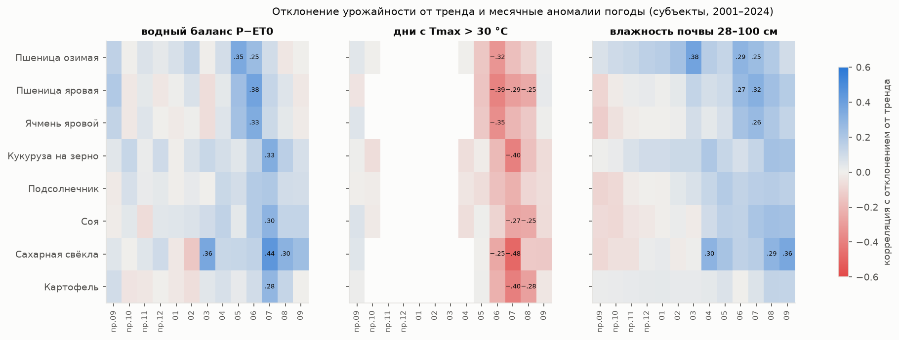
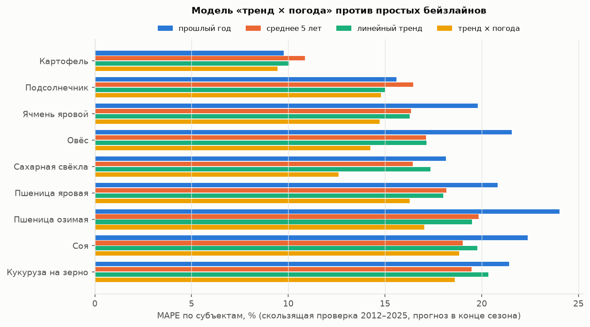
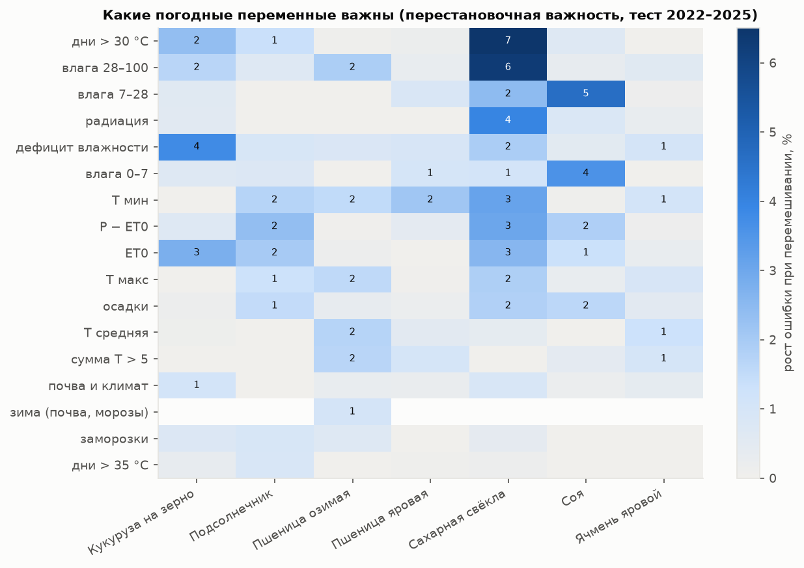
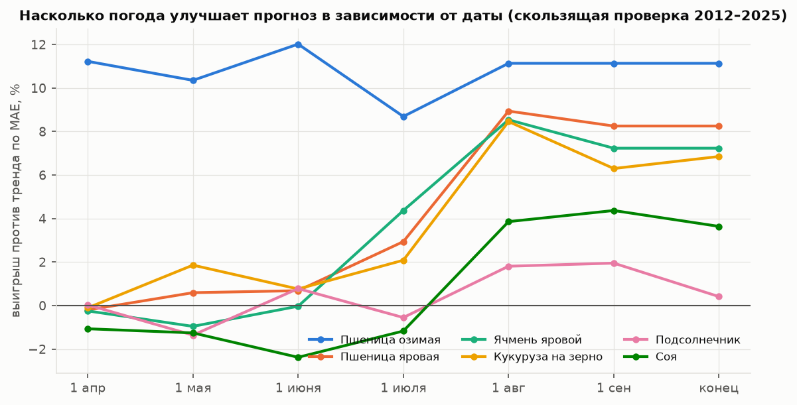

# Погода, почвы, NDVI и первая модель «тренд × погода»

*26.10.2026, ночь. Продолжение [eda_emiss.md](eda_emiss.md). Код лежит в `src/data/`, таблицы — в `reports/tables/`, графики — в `reports/figures/`, промежуточные данные — в `data/processed/{weather,ndvi,features,model}/`.*

Пересборка (по порядку; первые три шага занимают несколько минут, модели — 15–35 минут каждая):

```bash
uv run python -I -X utf8 src/data/build_weather_daily.py
```
```bash
uv run python -I -X utf8 src/data/build_ndvi.py
```
```bash
uv run python -I -X utf8 src/data/build_features.py
```
```bash
uv run python -I -X utf8 src/data/eda_gross_prices.py
```
```bash
uv run python -I -X utf8 src/data/model_experiments.py
```
```bash
uv run python -I -X utf8 src/data/model_leadtime.py ens lin
```
```bash
uv run python -I -X utf8 src/data/forecast_2026.py ens lin
```
```bash
uv run python -I -X utf8 src/data/report_model_figures.py
```

Ещё есть `eda_weather.py` (корреляции), `model_weather.py` (первый прогон: фиксированная и скользящая проверка, hgb и ridge по отдельности) и `model_experiments2.py` (форма тренда и лаги).

## 0. Коротко

1. **Погоды хватает.** ERA5-Land и ERA5 почасово, 450 точек на пашне, 2000-01-01 — 2026-10-22 без пропусков в нужных переменных. Сезон 2026 года закрыт.
2. **Сигнал погоды есть и агрономически осмысленный.** Озимая пшеница зависит от запаса влаги в почве в марте и температуры мая. Яровые колосовые — от жары и водного баланса июня. Кукуруза, свёкла, соя и картофель — от июля. Корреляция отклонения урожайности от тренда с месячными аномалиями — до |0,4–0,5|.
3. **Модель «тренд × (1 + погодное отклонение)»** — ансамбль Ridge и бустинга на месячных аномалиях погоды. На скользящей проверке 2012–2025 (около 5 600 прогнозов «регион × год») MAE против лучшего простого бейзлайна снижается:
   - сахарная свёкла −26 %, овёс −13 %, **пшеница озимая −11 %**;
   - пшеница яровая −8 %, ячмень −7 %, кукуруза −7 %;
   - соя −4 %, картофель −3 %, подсолнечник 0 %.

   MAPE по субъектам — 13–19 %, по РФ — 3–13 %.
4. **Улучшение умеренное, и это честный результат для региональной статистики.** Корреляция предсказанного отклонения с фактическим 0,45–0,64. Основная остаточная ошибка — уровень тренда (технологии, структура посевов), а не погода.
5. **Даты.** Для озимой пшеницы погода даёт выигрыш около 11 % **уже 1 апреля**. Для яровых — только с 1 июля – 1 августа, для свёклы — с августа. Весенний прогноз яровых не лучше тренда.
6. **Неопределённость большая.** Откалиброванный 80-процентный интервал — ±20–35 % от прогноза даже в конце сезона, попаданий около 80 %. Интервал только по погодным сценариям сильно занижает разброс: весной в него попадает 30–60 % фактов.
7. **2025** (урожайность, восстановленная по сбору) модель предсказывает лучше тренда. По **2026** модель ставит юг выше тренда из-за прохладного влажного июля. Оперативные данные на 1 октября показывают для подсолнечника и свёклы обратное. Итоговых данных за 2026 ещё нет, вывод предварительный.

## 1. Данные

### Погода — ERA5-Land + ERA5 (бакет Open-Meteo)

Скрипт [build_weather_daily.py](../src/data/build_weather_daily.py): почасовые данные переводятся в сутки по местному солнечному времени (сдвиг UTC на round(долгота/15) ч), затем — среднее по точкам региона с весом доли пашни вокруг точки.
- **ERA5-Land (0,1°):** температура (среднее, максимум, минимум), точка росы, влажность почвы 0–7 / 7–28 / 28–100 см, минимальная температура почвы 0–7 см, высота снега.
- **ERA5 (0,25°):** осадки, радиация, скорость ветра (из u и v), снегопад; температура — запасной источник для прибрежных ячеек.
- **ET0** считается по FAO-56 (Penman–Monteith) из Tmax, Tmin, Td, радиации, ветра и высоты. Также считается дефицит влажности воздуха (VPD).
- **Результат:** 450 точек × 9 792 дня, 89 регионов. Пропусков в рабочих переменных нет, кроме снега за 2022 г. (3,8 %).
- **Проверка:** по Краснодару годовые осадки около 600 мм, ET0 около 1 040 мм, июль 2010 г. на 1,5 °C теплее нормы. По Самаре июль 2010 г. на 4,8 °C теплее нормы. Средняя месячная температура совпадает с NASA POWER с r = 0,997.

**Пробелы в сырых данных:**
- в ERA5 нет влажности почвы за 14.09–06.12.2023 и облачности за 2022 г.;
- в ERA5-Land нет высоты снега за 2022 г.

Поэтому влажность почвы берётся из ERA5-Land.

**NASA POWER не используется:** у колонки `PRECTOTCORR` неверный масштаб (в среднем 43 мм/сут, в отдельные дни до 3 700 мм). Похоже, сдвинуты подписи колонок или перепутаны единицы. Замечание записано в общую заметку для сессии загрузки.

### NDVI MODIS

[build_ndvi.py](../src/data/build_ndvi.py): 220 точек (по 1–3 на регион, rank ≤ 2), 602 16-дневных композита, 2000-02-18 – 2026-09-30. Берутся только надёжные пиксели (reliability 0 или 1) и среднее по окну 3×3 (около 750 м). Доля годных значений: апрель 85 %, май–август 94–98 %, зима 10–15 % (снег). Связь с отклонением урожайности слабее погодной (r = 0,25–0,35 в июне–августе): точка на пашне — не обязательно поле нужной культуры. В модели **NDVI ничего не добавил** (разница в пределах 0,1 п. п. MAPE).

### Почвы SoilGrids

450 точек, 11 свойств, пропусков 0,9 % (вода или город). На уровне региона используются средневзвешенные clay, sand, soc, pH, N, CEC, bdod за 0–30 см и запас углерода (ocs). Слоёв влагоёмкости (wv*) в SoilGrids на сервере нет. В модели почвы играют небольшую роль (важность ≤ 1 %): цель модели — отклонение от тренда региона, а постоянные свойства региона тренд уже поглощает.

### Признаки ([build_features.py](../src/data/build_features.py))

- **Сезон Y** — сентябрь–декабрь года Y−1 и январь–сентябрь года Y.
- **Месячные значения:** T средняя, максимальная и минимальная; осадки; ET0; P−ET0; радиация; VPD; влажность почвы на трёх глубинах; дни с Tmax > 30 и > 35 °C; сумма температур выше 5 °C; заморозки.
- **Зима:** минимальная температура почвы, дни с морозом ниже −20 °C, снег, оттепели.
- **NDVI** по месяцам.
- Всё переводится в **аномалии** относительно нормы региона за 2001–2021 годы. Добавляются климат региона (T, P, ET0) и почвы.
- Итого 423 признака на 2 314 пар «регион × сезон». В модели культуры используются только месяцы её сезона: от 75 признаков у яровых до 128 у озимой пшеницы.

## 2. Связь погоды с отклонением урожайности



Корреляция отклонения от линейного тренда (субъекты, 2001–2024) с месячной аномалией (`tables/weather_corr.csv`). Самые сильные связи:

| культура | 1-я | 2-я | 3-я |
|---|---|---|---|
| Пшеница озимая | T мая −0,43 | влага 28–100 см в марте +0,38 | T июня −0,36 |
| Пшеница яровая | T июня −0,43 | дни > 30 °C в июне −0,39 | P−ET0 июня +0,38 |
| Ячмень яровой | T июня −0,40 | дни > 30 °C в июне −0,35 | P−ET0 июня +0,33 |
| Кукуруза на зерно | дни > 30 °C в июле −0,40 | P−ET0 июля +0,33 | |
| Подсолнечник | дни > 30 °C в июле −0,22 | P−ET0 июля +0,19 | |
| Соя | P−ET0 июля +0,30 | дни > 30 °C в июле −0,27 | |
| Сахарная свёкла | дни > 30 °C в июле −0,48 | P−ET0 июля +0,44 | |
| Картофель | дни > 30 °C в июле −0,40 | | |

Зима для озимой пшеницы: дни с морозом ниже −20 °C −0,28, минимальная температура почвы +0,18.

## 3. Модель и проверка

**Схема.** Для каждого региона и культуры строится линейный тренд урожайности по годам обучения. Цель модели — r = y / тренд − 1. Модель — **среднее Ridge (α = 300, стандартизация) и HistGradientBoosting** (глубина 3, 300 деревьев, lr 0,04, не меньше 25 объектов в листе), отдельная модель на каждую культуру, данные всех регионов в одной выборке. Прогноз = тренд × (1 + r̂).

**Выборка.** Субъекты со средней посевной ≥ 5 тыс. га, «все категории хозяйств». Число регионов:

| культура | регионов |
|---|---|
| Пшеница озимая | 54 |
| Пшеница яровая | 54 |
| Ячмень яровой | 62 |
| Овёс | 55 |
| Кукуруза на зерно | 34 |
| Подсолнечник | 34 |
| Соя | 29 |
| Сахарная свёкла | 20 |
| Картофель | 63 |

2025 год добавлен как урожайность, восстановленная по сбору и посевной (раздел 3 [eda_emiss.md](eda_emiss.md)).

**Проверка — скользящая.** Для каждого t = 2012…2025 модель и тренд обучаются только на сезонах ≤ t−1, прогноз делается на t. Это и есть режим будущего калькулятора.



**Скользящая проверка 2012–2025, прогноз в конце сезона** (MAE в т/га / MAPE в %; `tables/model_summary_rolling_table.csv`):

| культура | прошлый год | среднее 5 лет | линейный тренд | **тренд × погода** | выигрыш к лучшему простому |
|---|---|---|---|---|---|
| Пшеница озимая | 0,669 / 24,0 | 0,581 / 19,8 | 0,563 / 19,5 | **0,500 / 17,0** | **−11 %** |
| Пшеница яровая | 0,454 / 20,8 | 0,406 / 18,2 | 0,397 / 18,0 | **0,364 / 16,3** | −8 % |
| Ячмень яровой | 0,429 / 19,8 | 0,365 / 16,3 | 0,358 / 16,3 | **0,332 / 14,7** | −7 % |
| Овёс | 0,380 / 21,6 | 0,308 / 17,1 | 0,307 / 17,1 | **0,268 / 14,2** | −13 % |
| Кукуруза на зерно | 1,031 / 21,4 | 0,985 / 19,5 | 0,961 / 20,3 | **0,895 / 18,6** | −7 % |
| Подсолнечник | 0,244 / 15,6 | 0,277 / 16,5 | 0,241 / 15,0 | **0,240 / 14,8** | 0 % |
| Соя | 0,315 / 22,4 | 0,280 / 19,0 | 0,272 / 19,8 | **0,262 / 18,8** | −4 % |
| Сахарная свёкла | 7,12 / 18,1 | 6,62 / 16,4 | 6,42 / 17,3 | **4,73 / 12,6** | **−26 %** |
| Картофель | 1,524 / 9,8 | 1,769 / 10,9 | 1,549 / 10,0 | **1,483 / 9,4** | −3 % |

**Тот же прогноз, только тестовые годы 2022–2025** (сопоставимо с бейзлайнами из EDA), MAPE: пшеница озимая 15,7 % (тренд 17,9 %), пшеница яровая 20,4 (21,0), ячмень 17,0 (17,9), кукуруза 19,1 (22,3), подсолнечник 16,3 (17,8), соя 16,8 (19,3), свёкла 12,7 (18,1), картофель 8,1 (8,5).

**Уровень РФ** — средняя по модельным регионам с весами площади, MAPE за 2012–2025: картофель 2,7 % (тренд 4,3), кукуруза 6,8 (11,0), свёкла 7,3 (12,9), подсолнечник 5,6 (5,9), соя 6,4 (4,9), ячмень 9,5 (10,2), пшеница озимая 10,2 (11,6), пшеница яровая 13,0 (12,8).

**Что попробовано и не помогло** (`tables/model_experiments*.csv`; средний выигрыш против тренда по 9 культурам в скобках):

| вариант | результат |
|---|---|
| Ансамбль Ridge + бустинг, полный набор признаков | **+9,0 % — выбран** |
| Только Ridge (α = 300…1000) | +7,7…8,2 % |
| Ridge на сокращённом наборе (7 ключевых переменных) | +8,2 % |
| Только бустинг (глубина 2–3) | +5,6…6,1 % |
| + отклонения прошлых лет (лаги r) | +9,9 %: подсолнечнику и кукурузе +2…5 п. п., озимой пшенице и ячменю −0,5…−1 п. п. Можно оставить как опцию. |
| Веса по площади | хуже (+5…7 %) |
| Тренд по последним 10 / 15 годам | хуже: короткий тренд шумный, а цель для обучения становится шумной |
| Лог-линейный тренд (рост в % в год) | сильно хуже (−4 %): экспонента переоценивает рост |
| + NDVI (точечный) | без изменений |

**Систематическое занижение.** Медианная ошибка тренда — от −4 до −8 % для зерновых (2014–2017, 2019, 2022–2023, 2025), у модели — от −5 до −10 %. Урожайность в последние 10 лет растёт быстрее линейного тренда от 2001 года. Медиана меньше нуля ещё и потому, что распределение отклонений скошено: засуха даёт большие минусы, и модель, оптимизирующая квадрат ошибки, «страхуется». Это главный резерв точности, но он не про погоду. Варианты: тренд с изломом, тренд по технологическим показателям (удобрения, сорта), квантильная функция потерь.

**Важность** (перестановочная, по группам признаков; модель обучена до 2021, тест 2022–2025):



По месяцам (рост ошибки при перемешивании всех признаков месяца):
- кукуруза — июль +11,5 %;
- свёкла — июль +42 %, апрель +9 %;
- подсолнечник — июль +7 %, май +5 %;
- соя — июль +8 %;
- пшеница озимая — март +5 %, май +3,5 %;
- ячмень — июнь +4 %; пшеница яровая — июнь +3 %.

Важности небольшие: сигнал размазан по многим скоррелированным признакам.

## 4. Прогноз по ходу сезона и неопределённость

[model_leadtime.py](../src/data/model_leadtime.py). На дату D известные месяцы берутся из факта. Остальные месяцы заменяются аномалиями каждого из прошлых сезонов (2001…t−1), так что получается ансамбль из 11–24 погодных сценариев. Прогноз — среднее по сценариям. Режим тот же, что в калькуляторе.



Выигрыш против тренда по MAE, % (`tables/leadtime_metrics_ens_lin.csv`):

| культура | 1 апр | 1 мая | 1 июня | 1 июля | 1 авг | 1 сен | конец |
|---|---|---|---|---|---|---|---|
| Пшеница озимая | **11** | 10 | 12 | 9 | 11 | 11 | 11 |
| Пшеница яровая | 0 | 1 | 1 | 3 | **9** | 8 | 8 |
| Ячмень яровой | 0 | −1 | 0 | 4 | **9** | 7 | 7 |
| Овёс | 0 | −1 | 0 | 9 | 12 | 13 | 13 |
| Кукуруза на зерно | 0 | 2 | 1 | 2 | **9** | 6 | 7 |
| Подсолнечник | 0 | −1 | 1 | −1 | 2 | 2 | 0 |
| Соя | −1 | −1 | −2 | −1 | 4 | 4 | 4 |
| Сахарная свёкла | 0 | 2 | 4 | 3 | 13 | 17 | **26** |
| Картофель | −1 | −2 | −4 | −1 | 3 | 4 | 4 |

**Интервалы** (`tables/intervals_calibrated.csv`). Разброс одних погодных сценариев слишком узкий: в 80-процентный интервал попадает 30–60 % фактов 1 апреля и 0–30 % к августу. Причина — сценарии не учитывают ошибку самой модели. Если сложить разброс сценариев с эмпирическими квантилями ошибки модели (по остальным годам), попаданий становится около 80 % на любой дате. Ширина такого интервала (P90−P10, % от прогноза):

| культура | 1 апр | 1 июля | конец |
|---|---|---|---|
| Картофель | 32 | 31 | 29 |
| Сахарная свёкла | 47 | 43 | 37 |
| Овёс | 54 | 50 | 48 |
| Ячмень яровой | 53 | 49 | 48 |
| Пшеница яровая | 59 | 55 | 53 |
| Пшеница озимая | 59 | 57 | 56 |
| Подсолнечник | 58 | 56 | 54 |
| Кукуруза на зерно | 74 | 71 | 67 |
| Соя | 79 | 76 | 71 |

То есть для региона «озимая пшеница 4,0 т/га» честный 80-процентный интервал — около ±28 %, примерно 2,9–5,1 т/га, и к концу сезона он почти не сужается.

## 5. 2025 и 2026

**2025** (урожайность по сбору, все регионы кроме подсолнечника) входит в скользящую проверку. Медианная ошибка в 2025 г.: у тренда −9,1 %, у модели −5,6 %. Модель частично уловила хороший год.

**2026** ([forecast_2026.py](../src/data/forecast_2026.py), `tables/forecast_2026_rf.csv`). Модель обучена на сезонах ≤ 2025, погода сезона — до 22.10.2026. Средние по модельным регионам с весами посевной 2025 г., т/га:

| культура | 2023 | 2024 | 2025 | тренд 2026 | **прогноз 2026** | к тренду |
|---|---|---|---|---|---|---|
| Пшеница озимая | 4,21 | 3,63 | 3,94 | 4,04 | **4,33** | +7 % |
| Пшеница яровая | 2,23 | 2,29 | 2,76 | 2,27 | **2,11** | −7 % |
| Ячмень яровой | 2,59 | 2,40 | 2,92 | 2,53 | **2,48** | −2 % |
| Овёс | 1,95 | 2,05 | 2,32 | 2,02 | **1,85** | −8 % |
| Кукуруза на зерно | 7,61 | 5,54 | 5,92 | 6,59 | **7,23** | +10 % |
| Подсолнечник | 1,95 | 1,86 | — | 2,07 | **2,23** | +8 % |
| Соя | 2,05 | 1,78 | 2,09 | 2,04 | **2,20** | +8 % |
| Сахарная свёкла | 50,9 | 39,0 | 41,3 | 49,4 | **52,5** | +6 % |
| Картофель | 19,4 | 18,0 | 19,9 | 19,6 | **20,4** | +4 % |

Почему так: на юге (Краснодар, Ставрополь, Ростов) июль 2026 г. был прохладным (−0,6…−1,2 °C, на 4–9 дней меньше жарких дней) и влажнее нормы. В Центре и Поволжье июль очень влажный (Липецк +87 мм осадков). В Сибири июнь жаркий и сухой (Алтай: +4,8 °C, P−ET0 −78 мм), отсюда минус по яровым.

**Сверка с оперативными данными** (33978, СХО, «на 1 октября»; `tables/forecast_2026_vs_oper*.csv`, [forecast_2026_vs_oper.png](figures/forecast_2026_vs_oper.png)). Оперативный срез — не итог: убрано не всё, и данные только по СХО. Поэтому он умножается на медианное отношение «итог / срез на 1 октября» за 2023–2025: зерно 1,00, подсолнечник 1,03, свёкла 1,10, картофель 0,73. Медиана модуля расхождения с этой «ожидаемой итоговой» урожайностью:

| | модель | тренд |
|---|---|---|
| Зерновые без кукурузы (68 регионов) | 8,8 % (медиана −5,5 %) | 7,4 % (−3,3 %) |
| Подсолнечник (32) | 25 % (+19 %) | 19 % (+10 %) |
| Сахарная свёкла (19) | 19 % (+18 %) | 18 % (+10 %) |
| Картофель (61) | 12 % (+5 %) | 12 % (+3 %) |

По оперативным данным 2026 год по подсолнечнику и свёкле хуже тренда, а модель по благоприятному июлю ставила его выше. Возможные причины:
- поздняя уборка в 2026 г.: срез на 1 октября занижен сильнее, чем в 2023–2025;
- факторы вне погоды: болезни, переувлажнение при уборке, структура посевов;
- модель не ловит вред избытка влаги: связь «больше влаги — лучше» она выучила на засушливых годах.

Проверить можно будет по итогам за 2026 г. (апрель 2027) или по оперативному срезу на 1 ноября, если он появится в ЕМИСС.

## 6. Что это значит для ТЗ

1. **Подход «тренд × погодное отклонение» рабочий**, но обещать стоит честные цифры: на уровне субъекта погода снижает ошибку тренда на 7–13 % для зерновых, на 26 % для свёклы и почти не помогает для подсолнечника и сои. MAPE по субъектам 13–19 %, по стране 3–13 %.
2. **Главная ценность калькулятора — распределение, а не точка.** Интервал ±25–35 % в норме. Интервал надо строить как «погодные сценарии + ошибка модели». Одни сценарии дают ложную уверенность.
3. **Даты прогноза.** Озимая пшеница — с 1 апреля (выигрыш на ранних датах). Яровые, кукуруза, свёкла — полезный погодный прогноз с июля–августа. Весной для них прогноз равен тренду с широким интервалом, и именно это стоит показывать пользователю в момент планирования посевов.
4. **Для оптимизации структуры посевов** важнее не точность прогноза, а **совместное распределение урожайностей культур по сценариям**: засуха бьёт по всем сразу, но по-разному. Модель это даёт: один исторический сезон → прогноз по всем культурам региона. Как сильно сценарии разводят культуры между собой, пока не проверялось. Это первый шаг для модуля оптимизации.
5. **Урожайность «на убранную площадь» не видит гибели посевов** (до 20 % площади в засуху). Для расчёта дохода с гектара посева лучше моделировать сбор / посевная или умножать прогноз на сценарную долю уборки h (eda_emiss, раздел 3).
6. **Чего пока нет и что даст точность:** тренд с учётом смены технологий (резерв — систематическое занижение на 5–8 %); окна по фенологии культуры вместо календарных месяцев (календари GGCMI скачаны, ещё не использованы); маска культур для NDVI; CatBoost и SHAP для объяснений — по идее проекта, текущий ансамбль sklearn этого не исключает.
