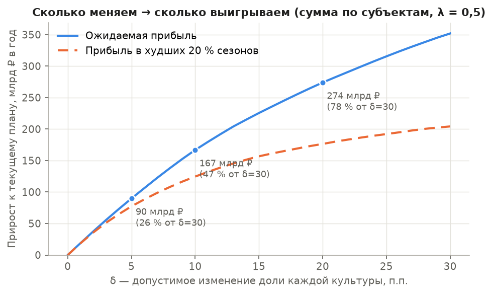
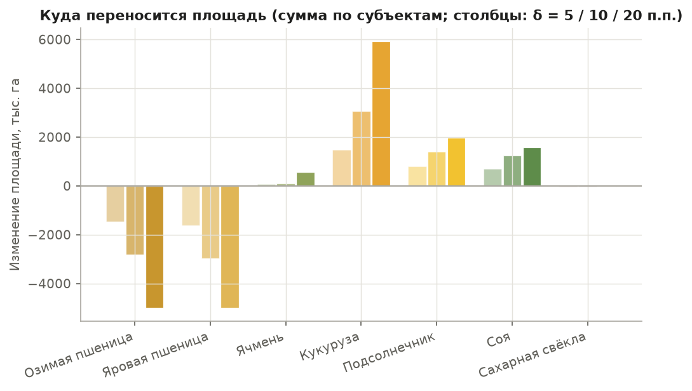
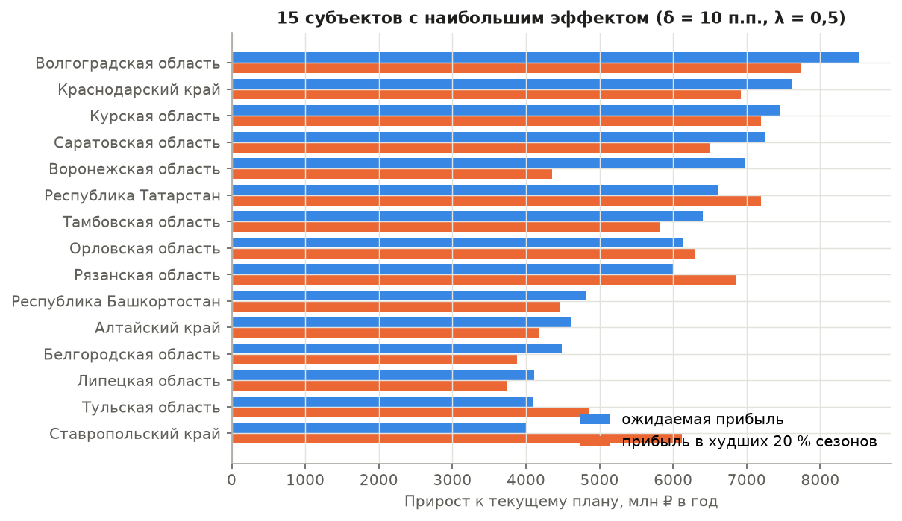
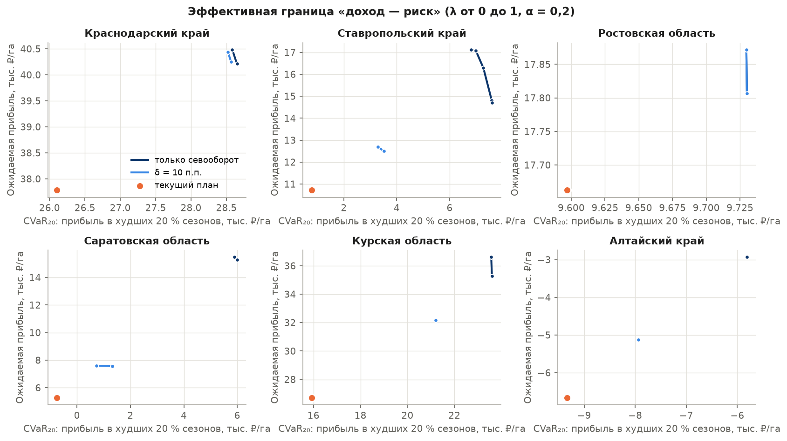
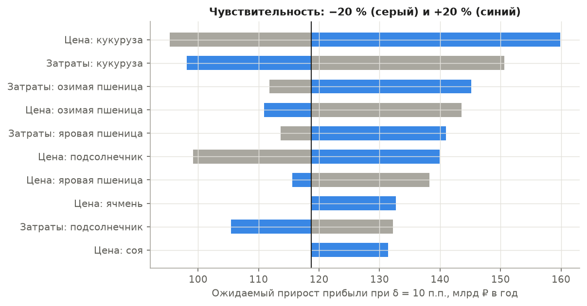
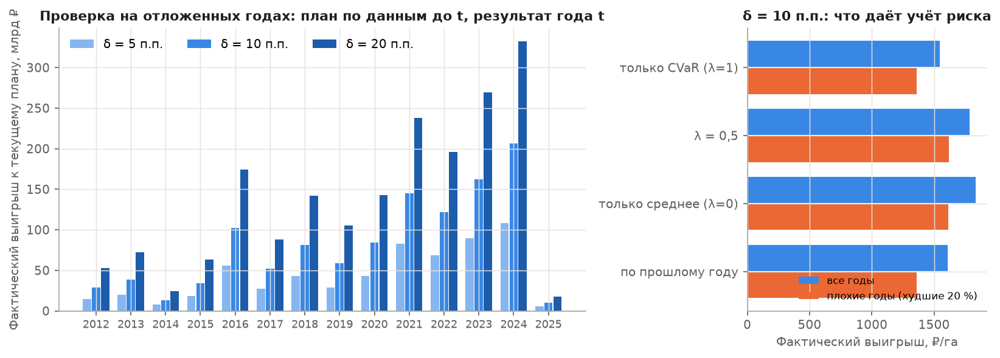

# Оптимизация структуры посевов по погодным сценариям

*28.10.2026. Код — `src/optimize/`, допущения — [`src/optimize/config.toml`](../src/optimize/config.toml), тесты — `tests/test_optimize.py`, таблицы — `reports/tables/optimization_*.csv`, графики — `reports/figures/optimization_*.png`, выгрузка на сайт — `web/data/optimization.json` (формат — [docs/06_ui_data_contract.md](../docs/06_ui_data_contract.md)).*

```bash
uv run python -I -X utf8 src/optimize/run.py all                     # ~1,5 мин: сценарии, расчёты, проверка, графики, сайт
uv run python -I -X utf8 src/optimize/run.py all --scenarios final   # сценарии итоговой модели из data/model/final/
uv run pytest -q tests/test_optimize.py
```

## Коротко

- **Постановка:** сценарная стохастическая оптимизация структуры посевов с риск-мерой CVaR и ограничением на отклонение от текущего плана (risk-aware scenario-based crop-mix optimization, minimal-intervention). Это линейная программа, её решает HiGHS.
- **Масштаб:** 70 субъектов, 51,3 млн га посевов семи культур прототипа (озимая и яровая пшеница, ячмень, кукуруза, подсолнечник, соя, сахарная свёкла), 20 погодных сценариев (сезоны 2005–2024).
- **Эффект малых изменений.** Если долю каждой культуры менять не больше чем на **5 п.п.**, ожидаемая прибыль растёт на **+1,75 тыс. ₽/га** (+20 % к текущим 8,6 тыс. ₽/га). Прибыль в худших 20 % сезонов растёт на **+1,5 тыс. ₽/га**, худший сезон становится лучше в 58 субъектах из 70. В сумме по субъектам это около 90 млрд ₽ в год. При 10 п.п. эффект +3,3 тыс. ₽/га, около 167 млрд ₽ в год.
- **Проверка на отложенных годах 2012–2025** (913 пар «субъект × год»; план выбран только по данным до года t). Фактический выигрыш плана с δ = 5 п.п. составил **+961 ₽/га**, это 78 % обещанного. План оказывался лучше текущего в 74 % случаев. В плохие годы выигрыш сохраняется: +860 ₽/га.
- **Честная оговорка.** Затраты на гектар — допущения, а выигрыш держится в основном на разнице маржи культур: чаще всего это перевод части пшеницы под кукурузу, сою и подсолнечник там, где позволяет севооборот. Сильнее всего результат зависит от цены и затрат кукурузы: ±20 % меняют эффект от 120 до 220 млрд ₽ при δ = 10 п.п. Проверка на прошлых годах подтверждает выигрыш при неопределённости урожайности и цен. Ошибку самих допущений о затратах она не проверяет.
- **Учёт риска (λ)** на прошлых годах почти ничего не добавил к плану «по среднему». Оптимизация только по CVaR (λ = 1) дала результат хуже, в том числе в плохие годы. Причина в том, что по 20 сценариям хвост оценивается грубо, а «выгодные» культуры часто и менее рискованные. Подробности — в разделе 5.

## 1. Постановка

**Решение** — доли площади культур x_c в пуле субъекта (сумма площадей семи культур). Для хозяйства площадью A результат тот же: задача однородна по площади, и прибыль хозяйства равна A × прибыль на 1 га.

**Сценарии.** Сценарий s — сезон-цель при погоде года s. Урожайность y_{c,s} у всех культур субъекта берётся из одного и того же года, поэтому совместность сохраняется: засуха бьёт по всем культурам сразу. Веса p_s по умолчанию равные.

**Прибыль на 1 га пула** в сценарии s:

  π_s(x) = Σ_c x_c · R_{c,s},  R_{c,s} = y_{c,s} · p_c − cost_c.

**Цель** — взвешенная сумма средней прибыли и прибыли в худших α долях сезонов:

  max_x (1 − λ) · Σ_s p_s π_s(x) + λ · CVaR_α(π(x)), α = 0,2, λ = 0,5.

Здесь CVaR_α(π) — средняя прибыль в худших 20 % сезонов (для 20 сценариев это четыре худших). По Рокафеллару–Урясеву (2000):

  CVaR_α(π) = − min_η { η + (1/α) Σ_s p_s · max(0, −π_s − η) },

поэтому задача сводится к линейной программе со вспомогательными переменными η и u_s ≥ 0:

  min −(1 − λ) Σ_s p_s π_s(x) + λ (η + (1/α) Σ_s p_s u_s),
  u_s ≥ −π_s(x) − η, u_s ≥ 0,
  Σ_c x_c = 1, x_c ≥ 0,
  |x_c − x_c⁰| ≤ δ  (δ = 5 / 10 / 20 п.п.; без δ — «только севооборот»),
  x_c ≤ u_c^{пул}, Σ_{c∈G} x_c ≤ g_G (севооборот, раздел 2).

По желанию можно ограничить и общий перенос площади: ½ Σ_c |x_c − x_c⁰| ≤ τ (параметр `turnover` в `lp.solve`). Именно так устроен ползунок «менять не больше X %» на сайте.

**Почему линейное программирование и HiGHS (`scipy.optimize.linprog`).** Формулировка Рокафеллара–Урясева даёт точную линейную программу без аппроксимаций. Задача маленькая: до 7 долей, 20 сценариев и около 30 переменных, одна задача решается за миллисекунды. HiGHS уже входит в SciPy, а это зависимость проекта. cvxpy дал бы удобный синтаксис ценой тяжёлой зависимости с компилируемыми решателями, ничего не добавив по точности. Матрица задачи собирается явно в `src/optimize/lp.py` (около 100 строк), её легко проверить.

**Текущий план x⁰** — структура посевных площадей пула в году t − 1 (для сезона 2026 — площади 2025 г., ЕМИСС 31328). Если площадь культуры за 2025 г. пропущена (так с подсолнечником в части субъектов), берётся последнее значение за три года. Текущий план всегда допустим: если доля уже выше нормы севооборота, верхняя граница равна текущей доле. При δ = 0 решение совпадает с текущим планом (это проверяет тест).

## 2. Данные и допущения

| что | откуда | статус |
|---|---|---|
| Сценарии урожайности | Сейчас — история: тренд сезона × (1 + отклонение от тренда в году s). Тренд линейный, по годам t − 10…t − 1 (как `tr_lin10`); отклонение обрезано до ±80 %. Пропуск отклонения в году s заменяется медианой ФО по культуре в том же году. Источник — ЕМИСС 31533 (все категории хозяйств), за 2025 г. — расчётная урожайность «сбор / посевная» с поправкой на отношение «на убранную / на посевную» этого ряда. Вход оптимизатора — одна таблица `okato, crop_code, scenario_year, yield_t_ha[, weight]`. Итоговая модель «тренд × погода» подставляется без изменения кода (`--scenarios final` или `web`) | данные |
| Цены | ЕМИСС 31454/57693 из `data/clean/prices.parquet`, подстановка «субъект → ФО → РФ». На 2026 г. — январь–сентябрь | данные |
| Затраты на 1 га | `config.toml`, база 2026 г.: озимая пшеница 46, яровая 34, ячмень 32, кукуруза 58, подсолнечник 44, соя 42, свёкла 115 тыс. ₽/га. Ориентиры — отраслевые обзоры и технологические карты 2024–2025 гг.; построчно с документами не сверялись | **допущение** |
| Региональная поправка затрат | 60 % затрат постоянны, 40 % пропорциональны уровню урожайности субъекта к РФ (удобрения, уборка, сушка, транспорт); множитель от 0,6 до 1,5 | **допущение** |
| Проверка масштаба затрат | Производственная себестоимость продукции растениеводства СХО (ЕМИСС 42381) на 1 га посевной площади СХО (31328) — 43,5 тыс. ₽/га в 2025 г. Средневзвешенные допущения по площадям пула — 43,3 тыс. ₽/га (табл. `optimization_cost_calibration.csv`). Масштаб совпадает, но в себестоимость Росстата входят и овощи, и кормовые | проверка |
| Индекс затрат для проверки на прошлых годах | Тот же ряд «себестоимость / га», 2011–2025, нормирован к 2026 (рост 2026 г. — 7 %, допущение) | данные + допущение |
| Нормы севооборота | Доля во всей посевной площади субъекта (31328: код 6 до 2021 г., 8200000 с 2022 г.): подсолнечник ≤ 15 % (возврат через 7–8 лет), свёкла ≤ 20 %, соя ≤ 30 %, кукуруза ≤ 40 %, озимая и яровая пшеница ≤ 50 %, ячмень ≤ 40 %. Зерновые вместе с зерновыми вне пула (рожь, овёс…) ≤ 70 %, подсолнечник + соя ≤ 35 % (общие болезни, склеротиниоз). Источники: учебник «Земледелие» (Баздырев, Лошаков и др., 2008), раздел «Севообороты»; зональные системы земледелия — как ориентиры | **допущение** |
| Сахарная свёкла | Площадь не увеличиваем: она ограничена мощностью заводов и контрактами | **допущение** |

**Пул культур субъекта:** культура входит в пул, если её средняя площадь за 5 лет не меньше 1 тыс. га и есть хотя бы 10 лет урожайности. В пуле должно быть не меньше двух культур. Так отобрано 70 субъектов. Новые для субъекта культуры не вводятся: по ним нет рядов урожайности.

## 3. Результаты на сезон 2026

### Эффект малых изменений

Ниже — суммы по 70 субъектам и средние на гектар, взвешенные по площади пула (`optimization_recommendations.csv`, `optimization_delta_curve.csv`). Текущий план даёт 8 648 ₽/га в среднем и −3 049 ₽/га в худших 20 % сезонов.

| δ, п.п. | перенос площади | ожидаемая прибыль, ₽/га | худшие 20 % сезонов, ₽/га | млрд ₽ в год (среднее / худшие 20 %) | худший сезон лучше, субъектов |
|---|---|---|---|---|---|
| 5 | 10 % | **+1 751** (+20 %) | **+1 508** | 90 / 77 | 58 из 70 |
| 10 | 18 % | +3 254 (+38 %) | +2 430 | 167 / 125 | 57 |
| 20 | 31 % | +5 345 (+62 %) | +3 441 | 274 / 176 | 54 |
| только севооборот | 57 % | +9 014 | +4 128 | 462 / 212 | 53 |



Кривая вогнутая: первые 10 п.п. дают половину эффекта, достижимого при 30 п.п. Прибыль в плохие сезоны растёт медленнее средней и почти выходит на плато после 15 п.п. Большие перестройки покупают среднюю прибыль ценой риска. Малые изменения улучшают обе величины почти поровну.

Проценты к средней прибыли большие, потому что база мала: при выбранных затратах средняя маржа пула — всего 8,6 тыс. ₽/га, а в 28 субъектах из 70 текущий план убыточен в среднем. Надёжнее смотреть на рубли на гектар.

### Куда переносится площадь



В сумме по субъектам площадь уходит из озимой и яровой пшеницы в кукурузу, подсолнечник (там, где он ниже нормы 15 %) и сою. Ячмень и свёкла почти не меняются. Регионы различаются: на Кубани план, наоборот, сокращает кукурузу и сою в пользу озимой пшеницы.

### Рекомендации по субъектам (δ = 5 п.п., λ = 0,5)

| субъект | ожидаемая прибыль, ₽/га | худшие 20 %, ₽/га | худший сезон, ₽/га | что менять, п.п. |
|---|---|---|---|---|
| Краснодарский край | 26 373 → 28 414 | 15 072 → 16 753 | 7 897 → 8 221 | кукуруза −5, соя −5; озимая пшеница +5, подсолнечник +3, ячмень +2 |
| Курская обл. | 25 267 → 28 240 | 5 631 → 8 112 | −11 041 → −9 932 | озимая и яровая пшеница −5, соя −5; ячмень, кукуруза, подсолнечник +5 |
| Саратовская обл. | 6 658 → 8 176 | −4 827 → −3 605 | −13 469 → −12 409 | озимая и яровая пшеница −5; ячмень +5, кукуруза +5 |
| Ставропольский край | 6 809 → 7 954 | −5 619 → −3 883 | −10 920 → −9 387 | озимая пшеница −5, кукуруза −4, ячмень −1; подсолнечник +5, соя +5 |
| Ростовская обл. | 10 746 → 10 964 | −1 316 → −802 | −6 035 → −5 247 | ячмень −3, кукуруза −2; яровая пшеница +5 |
| Алтайский край | −4 258 → −2 462 | −10 022 → −9 277 | −11 349 → −9 826 | яровая пшеница −5, ячмень −3, озимая пшеница −2; кукуруза +5, соя +5 |

Полная таблица по всем субъектам и δ — `optimization_recommendations.csv` (колонка `change`). Наибольший суммарный эффект при δ = 10 п.п. дают крупные зерновые регионы: Алтайский край, Саратовская и Оренбургская области, Татарстан, Краснодарский край, Волгоградская область, Башкортостан.



### Эффективная граница «доход — риск»



У каждого показанного субъекта текущий план (оранжевая точка) лежит внутри границы, далеко от неё: можно одновременно поднять и среднюю прибыль, и прибыль в плохие сезоны. Сама граница короткая — смена λ от 0 до 1 мало меняет план. Компромисс «доход — риск» проявляется только при большой свободе (только севооборот) и в субъектах с сильной погодной изменчивостью, например в Алтайском крае. Обычно же выгодная культура там и менее рискованная.

### Чувствительность



Изменение цены или затрат каждой культуры на ±20 % при δ = 10 п.п. (`optimization_sensitivity.csv`, база — 167 млрд ₽ в год):

- **Кукуруза** определяет результат больше всего: цена ±20 % даёт от 119 до 221 млрд ₽, затраты ±20 % — от 122 до 206 млрд ₽. Расширение кукурузы — главный и самый хрупкий источник эффекта.
- Далее идут затраты и цена озимой пшеницы (157–197 млрд ₽) и цена подсолнечника (144–192 млрд ₽).
- Свёкла и ячмень почти не влияют.
- Доля худших сезонов α = 0,1 / 0,3 даёт 158 / 167 млрд ₽.
- Вес риска: λ = 0 даёт 169 млрд ₽ средней прибыли и +117 млрд ₽ в худших сезонах, λ = 1 — 128 и +139 млрд ₽.

Вывод: знак эффекта устойчив, во всех вариантах он больше 119 млрд ₽, но величина зависит от экономики кукурузы. Перед практическим применением затраты нужно заменить на данные хозяйства.

## 4. Проверка на отложенных годах (backtest)

Для каждого года t = 2012…2025 и каждого субъекта решение принимается **только по данным до t**:

- сценарии — отклонения от тренда за годы < t (окно до 20 лет, не раньше 2006 г.);
- тренд сезона — по годам t − 10…t − 1;
- пул культур и текущий план — по площадям t − 1;
- цены — года t − 1, индекс затрат — года t − 1.

Результат плана считается по **фактической урожайности и ценам года t** и сравнивается с текущим планом (структурой t − 1). Пара «субъект × год» входит в проверку, если по всем культурам с ненулевой долей есть факт урожайности. Таких пар 913. Средние взвешены по площади пула (`optimization_backtest_summary.csv`, `optimization_backtest_by_year.csv`).

| план | перенос | обещано, ₽/га | факт, ₽/га | факт, млрд ₽/год | лучше текущего | факт в плохие годы, ₽/га |
|---|---|---|---|---|---|---|
| δ = 5 п.п. | 10 % | +1 227 | **+961** | 44 | 74 % | **+861** |
| δ = 10 п.п. | 18 % | +2 267 | +1 788 | 81 | 74 % | +1 619 |
| δ = 20 п.п. | 31 % | +3 834 | +3 009 | 137 | 75 % | +2 809 |
| только севооборот | 57 % | +6 813 | +5 127 | 234 | 74 % | +5 218 |
| *контроль, δ = 10 п.п.:* | | | | | | |
| только среднее (λ = 0) | 19 % | +2 333 | +1 832 | 84 | 74 % | +1 616 |
| только CVaR (λ = 1) | 18 % | +1 988 | +1 544 | 70 | 72 % | +1 362 |
| «по прошлому году» (один сценарий t − 1) | 19 % | +1 914 | +1 612 | 73 | 69 % | +1 362 |

«Плохие годы» — в каждом субъекте худшие 20 % его лет по фактической прибыли текущего плана.



Что показывает проверка:

1. **Выигрыш не иллюзия при неопределённости погоды и цен.** Факт составляет 75–80 % обещанного, план лучше текущего в трёх случаях из четырёх, суммарный выигрыш положителен в каждом году 2012–2025. Обещание систематически завышено примерно на 20 %: так выглядит «проклятие оптимизатора», когда выбирается то, что по оценке выглядит лучше, чем есть.
2. **В плохие годы выигрыш почти такой же, как в среднем** (+861 против +961 ₽/га при δ = 5): малые изменения не покупают доход ценой риска.
3. **Много сценариев лучше одного прошлого года.** План «по прошлому году» выигрывает реже (69 % против 74 %) и меньше в плохие годы (+1 362 против +1 619 ₽/га).
4. **Учёт риска через CVaR на этих данных ничего не добавил.** λ = 0,5 практически совпадает с λ = 0, а λ = 1 хуже и в среднем, и в плохие годы. Причины: (а) хвост распределения по 20 сценариям — это 4 точки, оценка CVaR шумная; (б) культуры с большей маржой в среднем не более рискованны, поэтому граница короткая; (в) риск цены не моделируется (см. раздел 6). Оставляем λ = 0,5 как разумный компромисс, а не как доказанно лучший выбор.
5. **Чего проверка не ловит.** В «факт» подставляются те же допущения о затратах, поэтому ошибку самих затрат проверка не проверяет. Не видны и ограничения, которых нет в модели: техника, сбыт, сушильные мощности под кукурузу, агротехнические сроки. То, что хозяйства годами не делают перенос, который модель считает выгодным, — повод сомневаться в части эффекта. Обещанные цифры корректнее читать как верхнюю оценку при принятых затратах.

## 5. Ограничения

- Затраты — допущения среднего уровня интенсивности. Проверена только их средняя величина по РФ, не соотношение между культурами.
- Цены детерминированы (2026 г.), не зависят от сценария. В реальности большой урожай снижает цену, и это естественное страхование: риск выручки меньше риска урожайности.
- Урожайность на новой площади считается равной средней по субъекту. На деле расширяемая культура уходит на худшие участки и худших предшественников. Ограничение δ частично это компенсирует.
- Сценарии пока исторические (тренд × отклонения прошлых лет), а не прогон итоговой модели «тренд × погода» на погоде годов-аналогов. Код готов принять таблицу модели одной командой (`--scenarios final`), результаты пересчитываются за ~1,5 мин.
- Ошибка модели (интервалы прогноза) в сценариях не учтена: сейчас разброс — только межгодовой.
- Уровень — субъект, все категории хозяйств. Для конкретного хозяйства сайт пересчитывает задачу по его плану и поправкам (почва, сорт, технология) — эвристикой переносов по 0,5–1 п.п. с той же целью. Точное LP — в Python.
- Пул ограничен семью культурами прототипа. Рожь, овёс, рапс, кормовые и пар учитываются только в групповом ограничении на зерновые.

## 6. Что можно развить дальше

1. **Сценарии от итоговой модели** вместо исторических отклонений, а при наличии — с ошибкой модели: каждому погодному сценарию добавить остатки из скользящей проверки (бутстреп), чтобы CVaR учитывал и неточность прогноза.
2. **Совместные сценарии цены и урожайности.** Связать цену года s с урожаем РФ в году s (эластичность по ЕМИСС 31454/57693), добавить экспортные цены. Это даст более честный риск и, вероятно, сдвиг в пользу культур с устойчивой ценой.
3. **Убывающая отдача при расширении.** Квадратичный штраф (на сайте уже есть, β·Δ²/2·выручка) или кусочно-линейная урожайность новой площади. Задача останется выпуклой (QP или LP с разбиением).
4. **Ограничения хозяйства:** техника и пиковая нагрузка на уборке, сушка кукурузы, сроки сева, контракты, кредитный лимит. Это уже смешанно-целочисленная задача (PuLP/HiGHS MIP).
5. **Многолетняя постановка с севооборотом** — переходы «предшественник → культура» с поправками урожайности, горизонт 3–5 лет (многоэтапная стохастическая программа или скользящее окно).
6. **Устойчивые веса сценариев:** аналоги по сходству текущего сезона (влагозапас осени, снежный покров, прогноз ENSO) вместо равных весов; distributionally robust CVaR (шар Вассерштейна вокруг эмпирического распределения) против шумного хвоста из 20 точек.
7. **Затраты из технологических карт** конкретных регионов или данные хозяйства через форму на сайте. Тогда backtest станет проверкой и экономики.
8. **Субсидии и страхование:** погектарная поддержка, агрострахование с господдержкой как дополнительный инструмент управления риском наряду со структурой посевов.
9. **Точное LP на сайте** (например, HiGHS в WebAssembly) вместо эвристики переносов, чтобы цифры хозяйства и субъекта считались одним методом.

## Файлы

| файл | что |
|---|---|
| `src/optimize/config.toml` | все допущения: затраты, нормы севооборота, α, λ, δ, окно сценариев |
| `src/optimize/lp.py` | CVaR (эмпирический), задача и LP Рокафеллара–Урясева (HiGHS) |
| `src/optimize/inputs.py` | урожайность, тренды, исторические сценарии, загрузка сценариев модели, цены, затраты, площади |
| `src/optimize/problems.py` | сборка задачи субъекта: пул, текущий план, нормы севооборота |
| `src/optimize/analysis.py` | рекомендации, граница, кривая δ, чувствительность, проверка на прошлых годах |
| `src/optimize/run.py` | CLI; `figures.py`, `export_web.py` — графики и выгрузка на сайт |
| `reports/tables/optimization_recommendations.csv` | субъект × δ: прибыль, CVaR, худший сезон, эффект, текст изменений |
| `reports/tables/optimization_delta_curve.csv` | сумма эффекта по δ = 0…30 п.п. |
| `reports/tables/optimization_sensitivity.csv` | цены и затраты ±20 %, α, λ |
| `reports/tables/optimization_backtest_summary.csv`, `_by_year.csv` | проверка на отложенных годах |
| `reports/tables/optimization_costs.csv`, `_cost_calibration.csv` | допущения по затратам и сверка с Росстатом |

Источник метода: Rockafellar R. T., Uryasev S. Optimization of conditional value-at-risk // Journal of Risk. 2000. Vol. 2, № 3. P. 21–41.
