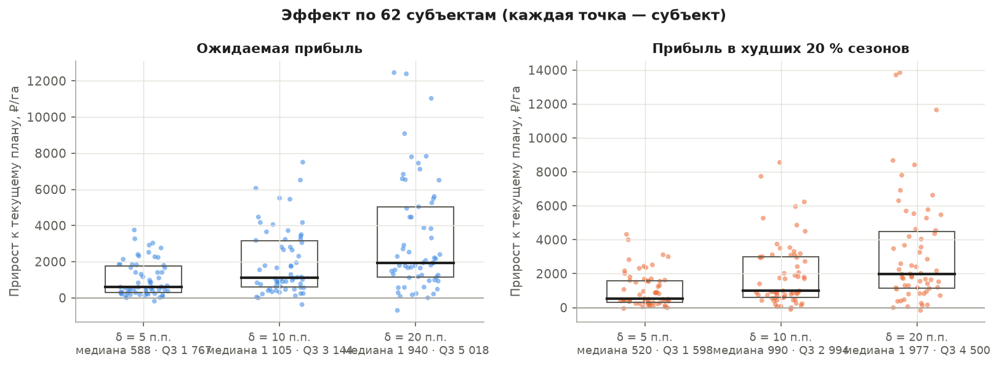

# Оптимизация структуры посевов по погодным сценариям

*28.10.2026. Код — `src/optimize/`, допущения — [`src/optimize/config.toml`](../src/optimize/config.toml), тесты — `tests/test_optimize.py`, таблицы — `reports/tables/optimization_*.csv`, графики — `reports/figures/optimization_*.png`, выгрузка на сайт — `web/data/optimization.json` (формат — [docs/06_ui_data_contract.md](../docs/06_ui_data_contract.md)).*

```bash
uv run python -I -X utf8 src/optimize/run.py all                    # ~2 мин: сценарии, расчёты, проверка, графики, сайт
uv run python -I -X utf8 src/optimize/run.py all --scenarios hist   # исторические сценарии вместо модели
uv run pytest -q tests/test_optimize.py
```

## Коротко

- **Постановка:** сценарная стохастическая оптимизация структуры посевов с риск-мерой CVaR и ограничением на отклонение от текущего плана (risk-aware scenario-based crop-mix optimization, minimal-intervention). Это линейная программа, её решает HiGHS.
- **Сценарии** берутся из итоговой модели «тренд × погода» (`data/model/final/scenarios.parquet`, дата `pre_season`): урожайность 2026 г. при погоде каждого из 21 сезона-аналога 2005–2025. Охват — 62 субъекта и 50,1 млн га посевов семи культур прототипа.
- **Эффект малых изменений** (доля каждой культуры меняется не больше чем на δ = 5 п.п.):
  - средневзвешенно +1 301 ₽/га ожидаемой прибыли (+15 % к текущим 8,7 тыс. ₽/га) и **+1 272 ₽/га в худших 20 % сезонов**;
  - по субъектам: медиана **+588 ₽/га**, верхний квартиль +1 767 ₽/га; в процентах (там, где текущая прибыль положительна) медиана +10 %, верхний квартиль +25 %;
  - выигрыш у **97 % субъектов**, худший сезон становится лучше у **90 %**, в сумме около 65 млрд ₽ в год;
  - **каждый перенесённый гектар даёт около 14 тыс. ₽ в год** — в 1,6 раза больше средней маржи гектара.
- **Эффект не занижен ошибкой, его сдерживают нормы севооборота.** Без них прирост при δ = 10 п.п. был бы втрое больше (340 против 119 млрд ₽ в год), но ценой 3,2 млн га сахарной свёклы и 4,3 млн га подсолнечника сверх агрономических норм. Исторические сценарии на тех же 62 субъектах дают эффект на треть выше (89 против 65 млрд ₽ при δ = 5). Порядок величины устойчив.
- **Краснодарский край** — пример, где эффект скромный по существу. Для края в целом (LP) при δ = 10 п.п.: ожидаемая прибыль +7,0 % (37,8 → 40,4 тыс. ₽/га), CVaR +9,3 %. Для типового хозяйства с той же структурой калькулятор даёт +1,1 % и +0,5 % в плохой год. Самые маржинальные культуры хозяйства (озимая пшеница 60 %, подсолнечник 15 %, свёкла) уже на пределе норм, и переносить площадь почти некуда. Это честный вывод «ваш план уже близок к лучшему», а не дефект расчёта (раздел 4).
- **Проверка на отложенных годах 2012–2025** (913 пар «субъект × год», только данные до года t; исторический генератор сценариев). Фактический выигрыш плана с δ = 5 п.п. — **+961 ₽/га**, 78 % обещанного. План был лучше текущего в 74 % случаев, в плохие годы выигрыш +860 ₽/га.
- **Честные оговорки:**
  - Затраты на гектар — допущения. Выигрыш опирается на разницу маржи культур, и сильнее всего он зависит от экономики кукурузы и подсолнечника (±20 % цены дают 95–160 млрд ₽ при δ = 10 п.п.).
  - Вес риска λ на прошлых годах почти не изменил результат: выгодные культуры обычно и менее рискованны.
  - Главная сильная сторона малых изменений не в «+N % прибыли», а в том, что **они одновременно поднимают доход в плохой год**. CVaR растёт почти так же, как среднее, а при отрицательной или малой базе это заметно.

## 1. Постановка

**Решение** — доли площади культур x_c в пуле субъекта (сумма площадей семи культур). Для хозяйства площадью A результат тот же: задача однородна по площади, и прибыль хозяйства равна A × прибыль на 1 га.

**Сценарии.** Сценарий s — сезон-цель при погоде года s. Урожайность y_{c,s} у всех культур субъекта берётся из одного и того же года, поэтому совместность сохраняется: засуха бьёт по всем культурам сразу. Веса p_s по умолчанию равные.

**Прибыль на 1 га пула** в сценарии s:

  π_s(x) = Σ_c x_c · R_{c,s},  R_{c,s} = y_{c,s} · p_c − cost_c.

**Цель:**

  max_x (1 − λ) · Σ_s p_s π_s(x) + λ · CVaR_α(π(x)), α = 0,2, λ = 0,5.

Здесь CVaR_α(π) — средняя прибыль в худших 20 % сезонов (для 21 сценария это 4,2 худших; дробная доля учитывается точно). По Рокафеллару–Урясеву (2000):

  CVaR_α(π) = − min_η { η + (1/α) Σ_s p_s · max(0, −π_s − η) },

поэтому задача — линейная программа со вспомогательными η и u_s ≥ 0:

  min −(1 − λ) Σ_s p_s π_s(x) + λ (η + (1/α) Σ_s p_s u_s),
  u_s ≥ −π_s(x) − η, u_s ≥ 0,
  Σ_c x_c = 1, x_c ≥ 0,
  |x_c − x_c⁰| ≤ δ  (δ = 5 / 10 / 20 п.п.; без δ — «только севооборот»),
  x_c ≤ u_c^{пул}, Σ_{c∈G} x_c ≤ g_G  (севооборот, раздел 2).

По желанию можно ограничить и общий перенос площади: ½ Σ_c |x_c − x_c⁰| ≤ τ (параметр `turnover` в `lp.solve`). Так устроен ползунок «менять не больше X %» на сайте.

**Почему линейное программирование и HiGHS (`scipy.optimize.linprog`).** Формулировка Рокафеллара–Урясева даёт точную линейную программу без аппроксимаций. Задача маленькая: до 7 долей, 21 сценарий и около 30 переменных, одна задача решается за миллисекунды. HiGHS уже входит в SciPy, а это зависимость проекта. cvxpy дал бы удобный синтаксис ценой тяжёлой зависимости с компилируемыми решателями, ничего не добавив по точности. Матрица задачи собирается явно в `src/optimize/lp.py` (около 100 строк), её легко проверить.

**Текущий план x⁰** — структура посевных площадей пула в году t − 1 (для сезона 2026 — площади 2025 г., ЕМИСС 31328). Если площадь культуры за 2025 г. пропущена (так с подсолнечником в части субъектов), берётся последнее значение за три года. Текущий план всегда допустим: если доля уже выше нормы, верхней границей служит текущая доля. При δ = 0 решение совпадает с текущим планом (это проверяет тест).

## 2. Данные и допущения

| что | откуда | статус |
|---|---|---|
| Сценарии урожайности (основной расчёт) | Итоговая модель «тренд × погода» (`src/model/final.py`, `data/model/final/scenarios.parquet`). Конфигурация «конец сезона», в которой **все** погодные признаки 2026 г. заменены значениями года-аналога s = 2005…2025 (`forecast_date = pre_season`). План посевов выбирают до сезона, когда о погоде 2026 г. ничего не известно. Другие даты файла (1 мая … конец сезона) смешивают известные месяцы 2026 г. с аналогами — они для оперативной корректировки, не для плана | данные + модель |
| Сценарии для проверки устойчивости и backtest | «Тренд сезона × (1 + отклонение от тренда в году s)» по фактической урожайности ЕМИСС 31533. Тренд линейный, по годам t − 10…t − 1; отклонение обрезано до ±80 %; пропуск отклонения заменяется медианой ФО в том же году. Генератор использует только годы < t, поэтому годится для честной проверки на прошлом | данные |
| Цены | ЕМИСС 31454/57693 из `data/clean/prices.parquet`, подстановка «субъект → ФО → РФ». На 2026 г. — январь–сентябрь | данные |
| Затраты на 1 га | `config.toml`, база 2026 г.: озимая пшеница 46, яровая 34, ячмень 32, кукуруза 58, подсолнечник 44, соя 42, свёкла 115 тыс. ₽/га. Ориентиры — отраслевые обзоры и технологические карты 2024–2025 гг.; построчно с документами не сверялись | **допущение** |
| Региональная поправка затрат | 60 % затрат постоянны, 40 % пропорциональны уровню урожайности субъекта к РФ; множитель от 0,6 до 1,5 | **допущение** |
| Проверка масштаба затрат | Производственная себестоимость продукции растениеводства СХО (ЕМИСС 42381) на 1 га посевной площади СХО — 43,5 тыс. ₽/га в 2025 г. Средневзвешенные допущения — 43,3 тыс. ₽/га (`optimization_cost_calibration.csv`). Масштаб совпадает, но в себестоимость Росстата входят и овощи, и кормовые | проверка |
| Индекс затрат для backtest | Тот же ряд «себестоимость / га», 2011–2025, нормирован к 2026 (рост 2026 г. — 7 %, допущение) | данные + допущение |
| Нормы севооборота | Доля во всей посевной площади субъекта (31328): подсолнечник ≤ 15 % (возврат через 7–8 лет), свёкла ≤ 20 %, соя ≤ 30 %, кукуруза ≤ 40 %, озимая и яровая пшеница ≤ 50 %, ячмень ≤ 40 %. Зерновые вместе с зерновыми вне пула ≤ 70 %, подсолнечник + соя ≤ 35 % (общие болезни, склеротиниоз). Источники: учебник «Земледелие» (Баздырев, Лошаков и др., 2008), раздел «Севообороты»; зональные системы земледелия — как ориентиры | **допущение** |
| Сахарная свёкла | Площадь не увеличиваем: она ограничена мощностью заводов и контрактами | **допущение** |

**Пул культур субъекта:** культура входит в пул, если её средняя площадь за 5 лет не меньше 1 тыс. га и есть хотя бы 10 лет урожайности. В пуле должно быть не меньше двух культур. Модель даёт сценарии для 68 субъектов, из них 62 проходят эти фильтры.

**Модель и история дают разный разброс.** Медианный коэффициент вариации урожайности по сценариям у модели 6–15 % (по культурам), у истории — 19–28 %. Модель объясняет только погодную часть колебаний, а остаток (болезни, уборка, экономика, ошибки статистики) в сценарии не попадает. Средние уровни модели по культурам на 5–14 % ниже исторических трендов (у свёклы на 8 % выше). Корреляция сценариев модели и истории по годам — 0,84 (медиана по рядам). Поэтому риск в основном расчёте скорее занижен. Расчёт на исторических сценариях приведён рядом как проверка устойчивости (раздел 4).

## 3. Результаты на сезон 2026 (сценарии модели)

### Эффект малых изменений

Средние взвешены по площади пула (`optimization_recommendations.csv`, `optimization_delta_curve.csv`). Текущий план даёт 8 729 ₽/га в среднем и 1 543 ₽/га в худших 20 % сезонов.

| δ, п.п. | перенос площади | ожидаемая прибыль, ₽/га | худшие 20 % сезонов, ₽/га | млрд ₽ в год (среднее / худшие 20 %) | на перенесённый гектар, ₽ | худший сезон лучше |
|---|---|---|---|---|---|---|
| 5 | 9 % | **+1 301** (+15 %) | **+1 272** | 65 / 64 | 14 100 | 56 из 62 |
| 10 | 17 % | +2 367 (+27 %) | +2 284 | 119 / 115 | 13 900 | 55 |
| 20 | 28 % | +3 825 (+44 %) | +3 567 | 192 / 179 | 13 800 | 56 |
| только севооборот | — | +6 430 | +5 248 | 322 / 263 | — | 56 |

**Распределение по субъектам** (`optimization_effect_stats.csv`). Проценты считаются только для субъектов с положительной текущей прибылью (32 из 62) или положительным CVaR (21 из 62): при отрицательной базе процент не имеет смысла.

| δ, п.п. | прирост, ₽/га: медиана / Q3 | прирост, %: медиана / Q3 | прирост CVaR, ₽/га: медиана / Q3 | прирост CVaR, %: медиана / Q3 | субъектов с выигрышем | выигрыш ≥ 1 % | CVaR выше | худший сезон лучше |
|---|---|---|---|---|---|---|---|---|
| 5 | **588** / 1 767 | **10** / 25 | 520 / 1 598 | 17 / 31 | 97 % | 91 % | 97 % | 90 % |
| 10 | 1 105 / 3 144 | 17 / 50 | 990 / 2 994 | 25 / 61 | 97 % | 94 % | 97 % | 89 % |
| 20 | 1 940 / 5 018 | 32 / 91 | 1 977 / 4 500 | 42 / 85 | 97 % | 94 % | 97 % | 90 % |




Кривая вогнутая: первые 10 п.п. дают половину эффекта, достижимого при 30 п.п. Отдача на перенесённый гектар почти постоянна, около 14 тыс. ₽ в год, и медленно падает: сначала переносится самое выгодное. Средняя прибыль и прибыль в плохие сезоны растут почти поровну, то есть малые изменения не покупают доход ценой риска.

### Куда переносится площадь


При δ = 10 п.п. в сумме по субъектам площадь уходит из озимой (−2,9 млн га) и яровой пшеницы (−2,6 млн га) в кукурузу (+2,2), подсолнечник (+1,5, только там, где он ниже нормы 15 %), сою (+1,2) и ячмень (+0,7). Свёкла не меняется. Регионы различаются: на Кубани план, наоборот, сокращает кукурузу и сою в пользу озимой пшеницы.

### Рекомендации по субъектам (δ = 5 п.п., λ = 0,5)

| субъект | ожидаемая прибыль, ₽/га | худшие 20 %, ₽/га | худший сезон, ₽/га | что менять, п.п. |
|---|---|---|---|---|
| Краснодарский край | 37 780 → 39 622 | 26 104 → 27 724 | 23 778 → 24 622 | кукуруза −5, соя −5; озимая пшеница +5, яровая пшеница +3, подсолнечник +3 |
| Курская обл. | 26 704 → 29 620 | 15 933 → 18 758 | 7 217 → 9 866 | озимая и яровая пшеница −5, соя −5; ячмень, кукуруза, подсолнечник +5 |
| Ставропольский край | 10 717 → 11 815 | 793 → 2 391 | −3 613 → −1 785 | озимая пшеница −5, кукуруза −4, ячмень −1; подсолнечник +5, соя +5 |
| Саратовская обл. | 5 266 → 6 430 | −751 → 319 | −7 170 → −6 518 | озимая и яровая пшеница −5; ячмень +5, кукуруза +5 |
| Ростовская обл. | 17 662 → 17 798 | 9 597 → 9 729 | 8 068 → 8 442 | ячмень −3, кукуруза −2; яровая пшеница +5 |
| Алтайский край | −6 667 → −5 848 | −9 338 → −8 580 | −10 630 → −9 584 | яровая пшеница −5, озимая −2; соя +5, ячмень +2 |

Полная таблица по всем субъектам и δ — `optimization_recommendations.csv` (колонка `change`). Наибольший суммарный эффект при δ = 10 п.п. дают Волгоградская (8,5 млрд ₽ в год), Курская, Саратовская, Воронежская, Тамбовская, Орловская области, Краснодарский край и Татарстан (6–7,6 млрд ₽).


### Эффективная граница «доход — риск»


У показанных субъектов текущий план (оранжевая точка) лежит внутри границы: можно одновременно поднять и среднюю прибыль, и прибыль в плохие сезоны. Сама граница короткая — смена λ от 0 до 1 мало меняет план. Компромисс «доход — риск» заметен только при большой свободе (только севооборот), например в Ставропольском крае. Обычно же выгодная культура там и менее рискованная.

### Чувствительность


Цена или затраты каждой культуры ±20 % при δ = 10 п.п. (`optimization_sensitivity.csv`, база — 119 млрд ₽ в год):

- **Кукуруза:** цена ±20 % даёт от 95 до 160 млрд ₽, затраты — от 98 до 151 млрд ₽.
- **Подсолнечник:** цена ±20 % даёт от 99 до 140 млрд ₽.
- **Пшеница:** затраты и цена озимой — 111–145 млрд ₽, яровой — 114–141 млрд ₽.
- Свёкла, соя и ячмень влияют слабо.
- α = 0,1 / 0,3 даёт 118 / 119 млрд ₽.
- λ = 0 даёт 119 млрд ₽ средней прибыли и +111 млрд ₽ в худших сезонах, λ = 1 — 110 и +116 млрд ₽.

Знак эффекта устойчив: во всех вариантах не меньше 95 млрд ₽. Величина зависит от экономики кукурузы и подсолнечника, поэтому перед применением затраты нужно заменить на данные хозяйства.

## 4. Не занижен ли эффект? Разбор на примере Краснодарского края

Изначально на сайте для Кубани получалось около +0,6 % ожидаемой прибыли. Проверили три возможные причины.

**1. Сценарии.** Модель даёт меньший разброс, чем история, и это сказывается на CVaR. Но на тех же 62 субъектах эффект различается в пределах трети (`optimization_scenario_compare.csv`):

| δ, п.п. | модель: млрд ₽ в год, среднее / худшие 20 % | история: млрд ₽ в год, среднее / худшие 20 % |
|---|---|---|
| 5 | 65 / 64 | 89 / 77 |
| 10 | 119 / 115 | 165 / 124 |
| 20 | 192 / 179 | 271 / 175 |
| только севооборот | 322 / 263 | 457 / 210 |

На исторических сценариях эффект выше, потому что отклонения кукурузы и сои там крупнее и их неурожайные годы сильнее отличаются от пшеничных. Модель занижает не эффект, а риск: она сглаживает плохие годы. Основной расчёт ведём на модели — это консервативно.

**2. Ограничения** (`optimization_constraints.csv`, сумма по субъектам, ожидаемая прибыль):

| δ, п.п. | без норм севооборота | только нормы на культуры | полная задача |
|---|---|---|---|
| 5 | 180 | 68 | 65 |
| 10 | 340 | 126 | 119 |
| 20 | 620 | 208 | 192 |

Нормы севооборота сокращают эффект почти втрое, групповые нормы добавляют ещё около 5 %. Без норм оптимизатор при δ = 10 п.п. добавил бы 3,2 млн га сахарной свёклы (вся её площадь в РФ около 1 млн га, заводов под такой объём нет) и 4,3 млн га подсолнечника в регионах, где он уже выше нормы. В 11 субъектах подсолнечник и в 20 субъектах свёкла уже на пределе и расширяться не могут. Ограничения срабатывают ровно там, где должны, — это агрономия, а не артефакт расчёта.

**3. Краснодарский край в целом и хозяйство с той же структурой.**

- **Край (LP).** Пул — 63 % всей посевной площади края, остальное — кормовые, овощи, рапс и др. Поэтому норма «озимая пшеница ≤ 50 % посевной» даёт для пула предел 66 %. Оптимум при δ = 10 п.п. переносит площадь из кукурузы (−10) и сои (−5) в озимую пшеницу (+9), яровую пшеницу (+4) и подсолнечник (+3). Ожидаемая прибыль **+7,0 %** (37,8 → 40,4 тыс. ₽/га), прибыль в худших 20 % сезонов **+9,3 %** (26,1 → 28,5 тыс. ₽/га), худший сезон +1,2 тыс. ₽/га.
- **Типовое хозяйство (калькулятор сайта).** План хозяйства из тех же семи культур: озимая пшеница 60 %, подсолнечник 15 %, свёкла 10 %, кукуруза 10 %, соя 5 %. Здесь нормы действуют на площадь самого хозяйства. Озимая пшеница выше нормы в 50 %, подсолнечник на норме, свёкла не расширяется. Перенос возможен только между кукурузой, соей и яровыми колосовыми, у которых маржа в 2 раза ниже. Точное LP даёт +0,8 / +1,1 / +1,4 % ожидаемой прибыли при переносе 5 / 10 / 20 % площади и до +1,1 % в плохие сезоны.
- **Что было исправлено.** Калькулятор сайта раньше давал лишь +0,1–0,6 %. Причина — квадратичный штраф «убывающей отдачи» в эвристике сайта, которого нет в научной постановке: он гасил и без того малый выигрыш. Штраф выключен, когда есть расчёт модуля (`web/js/econ.js`). Теперь сайт для этого хозяйства показывает +1,1 % и +0,5 % в плохой год, это совпадает с точным LP с точностью до правила подсчёта худших сезонов.

Для калькулятора хозяйства по всем 62 субъектам (типовая структура субъекта, площадь 1 000 га; расчёт `web/js/econ.js` в браузере):

| перенос | медиана / Q3, ₽/га | медиана / Q3, % (база > 0, 31 субъект) | плохой год, медиана / Q3, % | субъектов с выигрышем |
|---|---|---|---|---|
| 5 % | +726 / +1 274 | +8,7 / +23 | +7,7 / +25 | 95 % |
| 10 % | +1 418 / +2 547 | +17,5 / +45 | +15 / +50 | 95 % |
| 20 % | +2 594 / +4 836 | +29 / +82 | +28 / +71 | 95 % |

**Вывод.** Эффект не занижен ошибкой. Он скромный там, где текущий план уже упирается в нормы севооборота по самым маржинальным культурам, как на Кубани. Он заметный там, где структура перекошена в пшеницу при свободном месте под кукурузу, сою и подсолнечник: Черноземье, Поволжье, Курская, Воронежская, Тамбовская, Саратовская, Волгоградская области. Честная формулировка для презентации:

1. **Малые перемены почти всегда в плюс.** При переносе 5 п.п. выигрыш есть у 97 % субъектов, медиана +588 ₽/га, верхний квартиль +1 767 ₽/га.
2. **Плохой год становится лучше.** Прибыль в худших 20 % сезонов растёт почти так же, как средняя: медиана +520 ₽/га при δ = 5 п.п. Худший сезон улучшается в 90 % субъектов. Там, где доход в плохой год близок к нулю или отрицателен, это главный эффект.
3. **Каждый перенесённый гектар даёт около 14 тыс. ₽ в год**, а сами перемены невелики.
4. Если план уже близок к лучшему, калькулятор так и говорит. Это тоже полезный результат для хозяйства.

## 5. Проверка на отложенных годах (backtest)

Сценариев итоговой модели для прошлых лет нет. Модель обучена на годах до 2025 включительно, и её прогон по прошлым годам использовал бы будущее. Поэтому проверка идёт на историческом генераторе сценариев, который для года t использует **только данные до t**:

- сценарии — отклонения от тренда за годы < t (окно до 20 лет, не раньше 2006 г.);
- тренд — по годам t − 10…t − 1;
- пул и текущий план — по площадям t − 1;
- цены и индекс затрат — года t − 1.

Результат считается по **фактической урожайности и ценам года t** и сравнивается с текущим планом (структурой t − 1). Пара «субъект × год» входит в проверку, если по всем культурам с ненулевой долей есть факт урожайности; таких пар 913. Средние взвешены по площади пула (`optimization_backtest_summary.csv`, `optimization_backtest_by_year.csv`). На 2026 г. генератор даёт эффект того же порядка, что и модель (раздел 4), поэтому выводы проверки переносятся на основной расчёт.

| план | перенос | обещано, ₽/га | факт, ₽/га | факт, млрд ₽/год | лучше текущего | факт в плохие годы, ₽/га |
|---|---|---|---|---|---|---|
| δ = 5 п.п. | 10 % | +1 227 | **+961** | 44 | 74 % | **+861** |
| δ = 10 п.п. | 18 % | +2 267 | +1 788 | 81 | 74 % | +1 619 |
| δ = 20 п.п. | 31 % | +3 834 | +3 009 | 137 | 75 % | +2 809 |
| только севооборот | 57 % | +6 813 | +5 127 | 234 | 74 % | +5 218 |
| *контроль, δ = 10 п.п.:* | | | | | | |
| только среднее (λ = 0) | 19 % | +2 333 | +1 832 | 84 | 74 % | +1 616 |
| только CVaR (λ = 1) | 18 % | +1 988 | +1 544 | 70 | 72 % | +1 362 |
| «по прошлому году» (один сценарий t − 1) | 19 % | +1 914 | +1 612 | 73 | 69 % | +1 362 |

«Плохие годы» — в каждом субъекте худшие 20 % его лет по фактической прибыли текущего плана.


Что показывает проверка:

1. **Выигрыш не иллюзия при неопределённости погоды и цен.** Факт — 75–80 % обещанного, план лучше текущего в трёх случаях из четырёх, суммарный выигрыш положителен в каждом году 2012–2025. Обещание систематически завышено примерно на 20 %: так выглядит «проклятие оптимизатора», когда выбирается то, что по оценке кажется лучше, чем есть.
2. **В плохие годы выигрыш почти такой же, как в среднем** (+861 против +961 ₽/га при δ = 5): малые изменения не покупают доход ценой риска.
3. **Много сценариев лучше одного прошлого года.** План «по прошлому году» выигрывает реже (69 % против 74 %) и меньше в плохие годы (+1 362 против +1 619 ₽/га).
4. **Учёт риска через CVaR на этих данных ничего не добавил.** λ = 0,5 практически совпадает с λ = 0, а λ = 1 хуже и в среднем, и в плохие годы. Причины: (а) хвост по 20 сценариям — это 4 точки, оценка CVaR шумная; (б) культуры с большей маржой в среднем не более рискованны; (в) риск цены не моделируется. λ = 0,5 оставлен как разумный компромисс, а не как доказанно лучший выбор.
5. **Чего проверка не ловит.** В «факт» подставляются те же допущения о затратах, поэтому их ошибку проверка не проверяет. Не видны и ограничения, которых нет в модели: техника, сбыт, сушка кукурузы, сроки работ. Обещанные цифры корректнее читать как верхнюю оценку при принятых затратах.

## 6. Ограничения

- Затраты — допущения среднего уровня интенсивности. Проверена только их средняя величина по РФ, не соотношение между культурами.
- Цены детерминированы (2026 г.), не зависят от сценария. В реальности большой урожай снижает цену, и это естественное страхование.
- Урожайность на новой площади считается равной средней по субъекту. На деле расширяемая культура уходит на худшие участки и худших предшественников; ограничение δ частично это компенсирует.
- Сценарии модели содержат только погодную часть разброса (коэффициент вариации вдвое меньше исторического). Ошибка модели в сценарии не добавлена, поэтому CVaR в основном расчёте оптимистичен. Backtest идёт на историческом генераторе, а не на модели.
- Уровень — субъект, все категории хозяйств. Для конкретного хозяйства сайт пересчитывает задачу по его плану и поправкам (почва, сорт, технология) эвристикой переносов по 0,5 п.п. с той же целью. На проверенном примере она совпадает с точным LP.
- Пул ограничен семью культурами прототипа. Рожь, овёс, рапс, кормовые и пар учитываются только в групповом ограничении на зерновые.

## 7. Что можно развить дальше

1. **Ошибка модели в сценариях:** к каждому погодному сценарию добавить остатки скользящей проверки модели того же года (бутстреп с сохранением совместности культур), чтобы CVaR учитывал и неточность прогноза, а разброс приблизился к историческому.
2. **Совместные сценарии цены и урожайности:** связать цену года s с урожаем РФ в году s (эластичность по ЕМИСС 31454/57693), добавить экспортные цены.
3. **Убывающая отдача при расширении:** кусочно-линейная урожайность новой площади (задача останется линейной) вместо одного ограничения δ.
4. **Ограничения хозяйства:** техника и пиковая нагрузка на уборке, сушка кукурузы, сроки сева, контракты, кредитный лимит. Это смешанно-целочисленная задача (HiGHS MIP).
5. **Многолетняя постановка с севооборотом:** переходы «предшественник → культура» с поправками урожайности, горизонт 3–5 лет.
6. **Веса сценариев по сходству сезона** (влагозапас осени, снежный покров, ENSO) и distributionally robust CVaR (шар Вассерштейна) против шумного хвоста из 20 точек.
7. **Затраты из технологических карт** регионов или данных хозяйства через форму на сайте. Тогда backtest станет проверкой и экономики.
8. **Субсидии и агрострахование** как дополнительный инструмент управления риском наряду со структурой посевов.
9. **Точное LP на сайте** (HiGHS в WebAssembly) вместо эвристики переносов.

## Файлы

| файл | что |
|---|---|
| `src/optimize/config.toml` | все допущения: затраты, нормы севооборота, α, λ, δ, окно и дата сценариев |
| `src/optimize/lp.py` | CVaR (эмпирический), задача и LP Рокафеллара–Урясева (HiGHS) |
| `src/optimize/inputs.py` | урожайность, тренды, исторические сценарии, загрузка сценариев модели, цены, затраты, площади |
| `src/optimize/problems.py` | сборка задачи субъекта: пул, текущий план, нормы севооборота |
| `src/optimize/analysis.py` | рекомендации, граница, кривая δ, распределение эффекта, разбор ограничений, чувствительность, backtest |
| `src/optimize/run.py` | CLI; `figures.py`, `export_web.py` — графики и выгрузка на сайт |
| `reports/tables/optimization_recommendations.csv` | субъект × δ: прибыль, CVaR, худший сезон, эффект, текст изменений |
| `reports/tables/optimization_effect_stats.csv`, `_hist.csv` | медиана и квартили эффекта, доли субъектов с выигрышем (модель / история) |
| `reports/tables/optimization_constraints.csv` | эффект без норм севооборота, с нормами на культуры, полная задача |
| `reports/tables/optimization_scenario_compare.csv` | модель против истории на тех же субъектах |
| `reports/tables/optimization_delta_curve.csv` | сумма эффекта по δ = 0…30 п.п., отдача на перенесённый гектар |
| `reports/tables/optimization_sensitivity.csv` | цены и затраты ±20 %, α, λ |
| `reports/tables/optimization_backtest_summary.csv`, `_by_year.csv` | проверка на отложенных годах |
| `reports/tables/optimization_costs.csv`, `_cost_calibration.csv` | допущения по затратам и сверка с Росстатом |

Источник метода: Rockafellar R. T., Uryasev S. Optimization of conditional value-at-risk // Journal of Risk. 2000. Vol. 2, № 3. P. 21–41.
