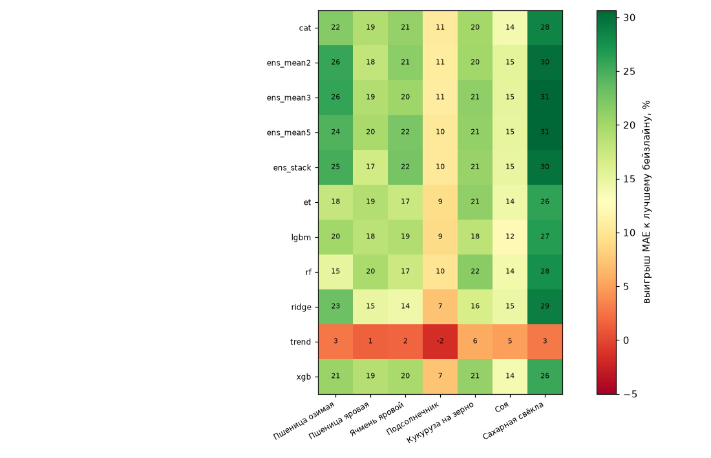
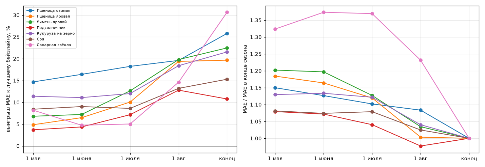
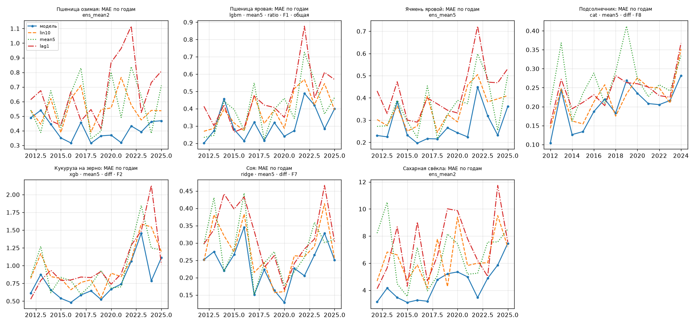
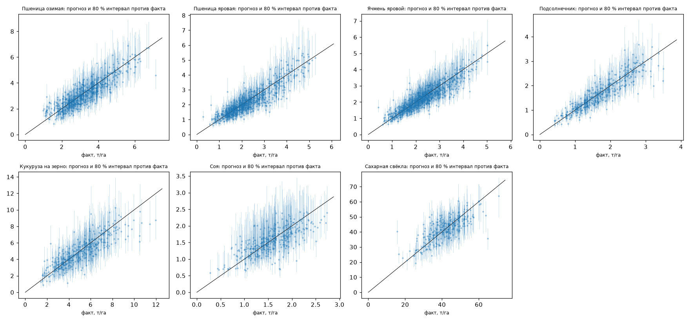

# Перебор моделей (v2: + спутник и рельеф)

*Сгенерировано `src/model/sweep.py` 28.10.2026 01:05. Результаты — `data/model/v2/sweep_results.csv` (1424 строк, конфигураций 1212, ошибок 26), лог — `sweep.log`. Анализ перед перебором — [pre_sweep_analysis.md](pre_sweep_analysis.md).*

**Проверка:** скользящий прогноз 2012–2025 (обучение, тренд и нормы погоды — только по годам < t), 2025 — урожайность, восстановленная по сбору. Выигрыш — снижение MAE против лучшего из бейзлайнов lin10 / mean5 / lag1 на тех же строках. Гиперпараметры Optuna подбирались только по 2012–2018, поэтому колонка «2019–25» — честная отложенная проверка для подбора гиперпараметров (выбор признаков и тренда видел все годы). Интервал — конформный 80 % по относительным ошибкам прошлых лет (с разогревом 2009–2011).

Конфигураций по этапам: coarse — 717, dates — 124, dates_tuned — 58, ensembles — 132, models — 76, models_default — 105.

## 1. Итог: конец сезона

| культура          |   регионов |   строк | лучший бейзлайн   | лучшая модель           |   MAE |   MAPE |   wMAPE |   выигрыш, % |   2019–25, % |   покрытие 80 |   ширина, % |   было (model_weather), % |
|:------------------|-----------:|--------:|:------------------|:------------------------|------:|-------:|--------:|-------------:|-------------:|--------------:|------------:|--------------------------:|
| Пшеница озимая    |         45 |     630 | lin10 0.550       | ens_mean3               | 0.408 | 14.615 |  12.823 |       25.795 |       29.814 |         0.875 |      57.893 |                        11 |
| Пшеница яровая    |         55 |     768 | lin10 0.389       | ens_mean5               | 0.313 | 14.654 |  13.793 |       19.663 |       17.639 |         0.846 |      54.187 |                         8 |
| Ячмень яровой     |         62 |     864 | lin10 0.348       | ens_stack               | 0.27  | 12.571 |  12.953 |       22.472 |       24.307 |         0.875 |      49.77  |                         7 |
| Подсолнечник      |         32 |     411 | lin10 0.225       | ens_mean3               | 0.201 | 12.381 |   9.882 |       10.772 |        9.172 |         0.886 |      54.348 |                         0 |
| Кукуруза на зерно |         29 |     406 | lin10 0.968       | rf · mean5 · diff · F2r | 0.76  | 15.96  |  14.405 |       21.552 |       17.671 |         0.884 |      68.867 |                         7 |
| Соя               |         26 |     364 | lin10 0.276       | ens_mean2               | 0.234 | 16.27  |  11.99  |       15.294 |       13.529 |         0.912 |      77.481 |                         4 |
| Сахарная свёкла   |         20 |     276 | lin10 6.356       | ens_mean5               | 4.408 | 11.464 |  11.027 |       30.644 |       26.324 |         0.87  |      43.832 |                        26 |

## 2. Что брать в прототип

Правило: из конфигураций в пределах 1 % от лучшей MAE берётся самая простая (ridge < enet < бустинги < леса < ансамбли).

| культура          | дата   | конфигурация                      |   MAE |   выигрыш, % |   2019–25, % |   покрытие 80 |   ширина, % | cfg_id       |
|:------------------|:-------|:----------------------------------|------:|-------------:|-------------:|--------------:|------------:|:-------------|
| Пшеница озимая    | 1 мая  | lgbm · mean5 · ratio · F1 · общая | 0.47  |       14.679 |       20.732 |         0.833 |      59.7   | fac717dcdc86 |
| Пшеница озимая    | 1 июня | et · mean5 · diff · F8            | 0.461 |       16.159 |       18.254 |         0.856 |      61.775 | a54e80967af2 |
| Пшеница озимая    | 1 июля | ens_mean2                         | 0.45  |       18.241 |       23.655 |         0.868 |      61.086 | a8c84c37baed |
| Пшеница озимая    | 1 авг  | lgbm · mean5 · ratio · F1 · общая | 0.442 |       19.606 |       27.374 |         0.849 |      60.488 | 351006488ac1 |
| Пшеница озимая    | конец  | ens_mean2                         | 0.409 |       25.754 |       29.661 |         0.859 |      56.616 | 104fc86baf9e |
| Пшеница яровая    | 1 мая  | ens_mean3                         | 0.37  |        4.868 |        2.359 |         0.857 |      63.265 | 509ab2237748 |
| Пшеница яровая    | 1 июня | ens_mean2                         | 0.364 |        6.34  |        6.54  |         0.839 |      61.132 | 38d295704e1f |
| Пшеница яровая    | 1 июля | ens_mean2                         | 0.35  |       10.06  |        9.009 |         0.846 |      57.994 | 34b4fc6c00a9 |
| Пшеница яровая    | 1 авг  | ens_mean2                         | 0.315 |       19.045 |       21.84  |         0.85  |      56.846 | 2c263bc9fd62 |
| Пшеница яровая    | конец  | lgbm · mean5 · ratio · F1 · общая | 0.313 |       19.589 |       22.33  |         0.863 |      58.292 | d9822fddc4fb |
| Ячмень яровой     | 1 мая  | lgbm · mean5 · ratio · F1         | 0.325 |        6.728 |        6.649 |         0.868 |      59.293 | 43f7df159ad6 |
| Ячмень яровой     | 1 июня | ens_mean5                         | 0.323 |        7.219 |        9.296 |         0.848 |      54.589 | 6a750ed7e0b8 |
| Ячмень яровой     | 1 июля | et · mean5 · ratio · F6           | 0.306 |       12.269 |       13.859 |         0.88  |      54     | 4aa1cd5b1e3b |
| Ячмень яровой     | 1 авг  | ens_mean2                         | 0.282 |       19.03  |       21.874 |         0.89  |      53.337 | f414b3d8d1e1 |
| Ячмень яровой     | конец  | ens_mean5                         | 0.271 |       22.309 |       24.255 |         0.882 |      50.621 | 0aef7c068ea8 |
| Подсолнечник      | 1 мая  | lgbm · mean5 · diff · F7          | 0.218 |        3.122 |        0.708 |         0.883 |      55.824 | 97dabf8b67e4 |
| Подсолнечник      | 1 июня | et · mean5 · diff · F7            | 0.215 |        4.363 |        3.777 |         0.9   |      58.836 | 7f4fedc3d67d |
| Подсолнечник      | 1 июля | et · mean5 · diff · F8            | 0.209 |        7.171 |        5.311 |         0.864 |      55.228 | 4e443e885563 |
| Подсолнечник      | 1 авг  | et · mean5 · diff · F8            | 0.196 |       12.796 |       11.11  |         0.866 |      52.743 | 26da93d27bf1 |
| Подсолнечник      | конец  | cat · mean5 · diff · F8           | 0.201 |       10.511 |        9.699 |         0.886 |      52.379 | 2783b13e7b74 |
| Кукуруза на зерно | 1 мая  | lgbm · mean5 · diff · F7          | 0.858 |       11.399 |        4.143 |         0.867 |      73.368 | 57ffa8218028 |
| Кукуруза на зерно | 1 июня | lgbm · mean5 · diff · F7          | 0.866 |       10.604 |        3.82  |         0.86  |      71.318 | 08ee0480e205 |
| Кукуруза на зерно | 1 июля | ens_mean2                         | 0.859 |       11.326 |        4.784 |         0.847 |      71.817 | e8b472e00dcc |
| Кукуруза на зерно | 1 авг  | et · mean5 · diff · F8            | 0.79  |       18.397 |       16.045 |         0.872 |      70.173 | 7bc34401311a |
| Кукуруза на зерно | конец  | xgb · mean5 · diff · F2           | 0.767 |       20.803 |       17.428 |         0.887 |      72.093 | c310d90891d2 |
| Соя               | 1 мая  | et · mean5 · diff · F0            | 0.253 |        8.42  |        7.516 |         0.926 |      79.875 | 919cb9f85f73 |
| Соя               | 1 июня | et · mean5 · diff · F7            | 0.251 |        9.034 |        9.275 |         0.915 |      80.636 | ada9a4a90b8d |
| Соя               | 1 июля | et · mean5 · diff · F7            | 0.252 |        8.613 |        6.811 |         0.918 |      83.998 | 265ffd04ed74 |
| Соя               | 1 авг  | ens_mean5                         | 0.24  |       13.202 |       17.906 |         0.931 |      85.433 | 0deea2e22e4c |
| Соя               | конец  | ridge · mean5 · diff · F7         | 0.236 |       14.622 |       12.836 |         0.909 |      76.837 | 4e43b42dcba5 |
| Сахарная свёкла   | 1 мая  | cat · mean5 · diff · F5           | 5.871 |        7.627 |        5.428 |         0.826 |      54.925 | 617e40e8098a |
| Сахарная свёкла   | 1 июня | ens_mean2                         | 6.054 |        4.758 |        3.9   |         0.88  |      61.255 | 1acb04f938dd |
| Сахарная свёкла   | 1 июля | ens_mean2                         | 6.088 |        4.216 |        1.616 |         0.851 |      56.937 | 881a301c1c90 |
| Сахарная свёкла   | 1 авг  | xgb · mean5 · diff · F2           | 5.428 |       14.603 |       21.502 |         0.848 |      50.365 | 18233cf76aaf |
| Сахарная свёкла   | конец  | ens_mean2                         | 4.451 |       29.976 |       22.702 |         0.851 |      42.122 | c67d7da40dbe |

## 3. Лидерборд по культурам (конец сезона, топ-10)

### Пшеница озимая

| конфигурация                | stage          |   mae |   mape |   wmape |   выигрыш |   2012–18 |   2019–25 |   cov80 |   width80_pct |
|:----------------------------|:---------------|------:|-------:|--------:|----------:|----------:|----------:|--------:|--------------:|
| ens_mean3                   | ensembles      | 0.408 | 14.615 |  12.823 |    25.795 |    21.473 |    29.814 |   0.875 |        57.893 |
| ens_mean2                   | ensembles      | 0.409 | 14.647 |  12.781 |    25.754 |    21.553 |    29.661 |   0.859 |        56.616 |
| ens_stack                   | ensembles      | 0.413 | 14.748 |  12.971 |    24.965 |    20.244 |    29.354 |   0.854 |        59.778 |
| ens_mean5                   | ensembles      | 0.416 | 14.754 |  13.172 |    24.422 |    20.37  |    28.189 |   0.867 |        58.605 |
| ridge · mean5 · diff · F8   | coarse         | 0.423 | 15.093 |  13.241 |    23.115 |    15.348 |    30.337 |   0.833 |        57.467 |
| ridge · mean5 · diff · F6   | coarse         | 0.43  | 15.355 |  13.365 |    21.871 |    12.554 |    30.534 |   0.838 |        58.372 |
| cat · mean5 · diff · F2     | models         | 0.431 | 15.172 |  13.998 |    21.756 |    16.217 |    26.906 |   0.878 |        63.664 |
| cat · mean5 · diff · F6     | models_default | 0.431 | 15.172 |  14.137 |    21.745 |    14.507 |    28.476 |   0.871 |        61.524 |
| ridge · mean5 · diff · F2   | coarse         | 0.431 | 15.286 |  13.242 |    21.661 |    12.601 |    30.085 |   0.833 |        58.803 |
| ridge · lin_all · diff · F8 | coarse         | 0.431 | 14.92  |  14.198 |    21.6   |    14.162 |    28.516 |   0.87  |        62.902 |

### Пшеница яровая

| конфигурация                      | stage          |   mae |   mape |   wmape |   выигрыш |   2012–18 |   2019–25 |   cov80 |   width80_pct |
|:----------------------------------|:---------------|------:|-------:|--------:|----------:|----------:|----------:|--------:|--------------:|
| ens_mean5                         | ensembles      | 0.313 | 14.654 |  13.793 |    19.663 |    22.359 |    17.639 |   0.846 |        54.187 |
| lgbm · mean5 · ratio · F1 · общая | models         | 0.313 | 14.926 |  15.35  |    19.589 |    15.939 |    22.33  |   0.863 |        58.292 |
| rf · mean5 · ratio · F6           | models         | 0.313 | 14.939 |  14.402 |    19.516 |    15.034 |    22.883 |   0.861 |        56.968 |
| ens_mean3                         | ensembles      | 0.315 | 14.764 |  13.769 |    19.178 |    23.388 |    16.015 |   0.841 |        53.505 |
| cat · lin_all · ratio · F8        | models         | 0.315 | 14.797 |  14.792 |    19.109 |    19.723 |    18.647 |   0.866 |        56.243 |
| et · mean5 · ratio · F8           | dates_tuned    | 0.315 | 15.027 |  14.844 |    19.073 |    14.542 |    22.477 |   0.857 |        56.889 |
| cat · mean5 · ratio · F6          | models_default | 0.315 | 14.966 |  14.254 |    19.026 |    15.903 |    21.373 |   0.859 |        56.891 |
| xgb · mean5 · ratio · F6          | models         | 0.316 | 14.956 |  14.312 |    18.916 |    16.38  |    20.821 |   0.857 |        58.282 |
| rf · mean5 · ratio · F6           | models_default | 0.316 | 14.957 |  14.402 |    18.864 |    14.098 |    22.443 |   0.859 |        57.551 |
| xgb · mean5 · ratio · F1 · общая  | models         | 0.316 | 15.024 |  15.807 |    18.846 |    16.964 |    20.259 |   0.855 |        58.894 |

### Ячмень яровой

| конфигурация                      | stage          |   mae |   mape |   wmape |   выигрыш |   2012–18 |   2019–25 |   cov80 |   width80_pct |
|:----------------------------------|:---------------|------:|-------:|--------:|----------:|----------:|----------:|--------:|--------------:|
| ens_stack                         | ensembles      | 0.27  | 12.571 |  12.953 |    22.472 |    20.1   |    24.307 |   0.875 |        49.77  |
| ens_mean5                         | ensembles      | 0.271 | 12.614 |  13.045 |    22.309 |    19.795 |    24.255 |   0.882 |        50.621 |
| ens_mean2                         | ensembles      | 0.274 | 12.84  |  13.384 |    21.363 |    17.394 |    24.434 |   0.876 |        52.107 |
| cat · mean5 · ratio · F1          | models         | 0.276 | 12.866 |  13.287 |    20.876 |    17.518 |    23.475 |   0.87  |        52.727 |
| ens_mean3                         | ensembles      | 0.278 | 12.939 |  13.421 |    20.336 |    17.261 |    22.715 |   0.881 |        52.751 |
| xgb · mean5 · ratio · F1          | models         | 0.279 | 13.115 |  13.716 |    19.775 |    15.512 |    23.073 |   0.877 |        52.52  |
| lgbm · mean5 · ratio · F4         | coarse         | 0.282 | 13.282 |  13.861 |    19.1   |    11.584 |    24.914 |   0.884 |        52.451 |
| lgbm · mean5 · ratio · F1 · общая | models         | 0.282 | 13.249 |  13.517 |    18.926 |    12.914 |    23.577 |   0.875 |        53.485 |
| cat · mean5 · ratio · F4          | models         | 0.283 | 13.071 |  12.992 |    18.823 |    14.49  |    22.175 |   0.868 |        51.201 |
| cat · mean5 · ratio · F2          | models_default | 0.283 | 13.265 |  13.627 |    18.788 |    11.448 |    24.467 |   0.872 |        51.85  |

### Подсолнечник

| конфигурация            | stage          |   mae |   mape |   wmape |   выигрыш |   2012–18 |   2019–25 |   cov80 |   width80_pct |
|:------------------------|:---------------|------:|-------:|--------:|----------:|----------:|----------:|--------:|--------------:|
| ens_mean3               | ensembles      | 0.201 | 12.381 |   9.882 |    10.772 |    12.599 |     9.172 |   0.886 |        54.348 |
| ens_mean2               | ensembles      | 0.201 | 12.407 |   9.908 |    10.696 |    13.163 |     8.537 |   0.881 |        54.625 |
| cat · mean5 · diff · F8 | models         | 0.201 | 12.368 |   9.913 |    10.511 |    11.438 |     9.699 |   0.886 |        52.379 |
| ens_stack               | ensembles      | 0.202 | 12.405 |   9.97  |    10.31  |    11.743 |     9.056 |   0.891 |        53.76  |
| ens_mean5               | ensembles      | 0.202 | 12.409 |   9.955 |    10.2   |    11.708 |     8.88  |   0.883 |        53.735 |
| rf · mean5 · diff · F8  | models         | 0.203 | 12.494 |   9.993 |     9.794 |    10.183 |     9.453 |   0.883 |        55.341 |
| cat · mean5 · diff · F6 | models         | 0.203 | 12.503 |  10.047 |     9.553 |    10.959 |     8.323 |   0.878 |        53.007 |
| cat · mean5 · diff · F5 | models         | 0.204 | 12.457 |   9.98  |     9.331 |    10.331 |     8.455 |   0.881 |        53.317 |
| rf · mean5 · diff · F8  | models_default | 0.204 | 12.553 |  10.214 |     9.312 |     9.032 |     9.557 |   0.881 |        54.842 |
| et · mean5 · diff · F7  | dates_tuned    | 0.204 | 12.725 |  10.334 |     9.168 |    12.315 |     6.414 |   0.895 |        57.523 |

### Кукуруза на зерно

| конфигурация            | stage          |   mae |   mape |   wmape |   выигрыш |   2012–18 |   2019–25 |   cov80 |   width80_pct |
|:------------------------|:---------------|------:|-------:|--------:|----------:|----------:|----------:|--------:|--------------:|
| rf · mean5 · diff · F2r | models         | 0.76  | 15.96  |  14.405 |    21.552 |    21.801 |    17.671 |   0.884 |        68.867 |
| et · mean5 · diff · F2  | models_default | 0.764 | 16.201 |  14.526 |    21.158 |    21.014 |    17.54  |   0.872 |        66.062 |
| ens_mean3               | ensembles      | 0.764 | 16.123 |  14.354 |    21.138 |    24.171 |    15.24  |   0.879 |        70.335 |
| rf · mean5 · diff · F2r | models_default | 0.765 | 16.063 |  14.506 |    20.996 |    21.281 |    17.063 |   0.882 |        69.569 |
| rf · mean5 · diff · F5  | models         | 0.766 | 16.085 |  14.69  |    20.942 |    21.326 |    16.934 |   0.877 |        68.78  |
| rf · mean5 · diff · F2  | models_default | 0.766 | 16.216 |  14.503 |    20.938 |    19.747 |    18.06  |   0.892 |        69.161 |
| ens_mean5               | ensembles      | 0.766 | 16.145 |  14.409 |    20.912 |    23.457 |    15.354 |   0.867 |        69.314 |
| et · mean5 · diff · F2r | dates_tuned    | 0.767 | 16.167 |  14.605 |    20.85  |    21.461 |    16.675 |   0.874 |        65.356 |
| xgb · mean5 · diff · F2 | models         | 0.767 | 16.386 |  14.212 |    20.803 |    20.296 |    17.428 |   0.887 |        72.093 |
| rf · mean5 · diff · F2  | models         | 0.767 | 16.121 |  14.711 |    20.76  |    21.424 |    16.543 |   0.899 |        70.012 |

### Соя

| конфигурация              | stage       |   mae |   mape |   wmape |   выигрыш |   2012–18 |   2019–25 |   cov80 |   width80_pct |
|:--------------------------|:------------|------:|-------:|--------:|----------:|----------:|----------:|--------:|--------------:|
| ens_mean2                 | ensembles   | 0.234 | 16.27  |  11.99  |    15.294 |    16.783 |    13.529 |   0.912 |        77.481 |
| ens_mean3                 | ensembles   | 0.234 | 16.217 |  11.76  |    15.139 |    16.846 |    13.124 |   0.92  |        78.574 |
| ens_mean5                 | ensembles   | 0.235 | 16.238 |  11.983 |    14.963 |    17.01  |    12.556 |   0.926 |        78.672 |
| ens_stack                 | ensembles   | 0.235 | 16.321 |  11.926 |    14.904 |    16.175 |    13.387 |   0.915 |        78.294 |
| ridge · mean5 · diff · F7 | coarse      | 0.236 | 16.358 |  12.027 |    14.622 |    16.127 |    12.836 |   0.909 |        76.837 |
| et · mean5 · diff · F7    | dates_tuned | 0.237 | 16.495 |  12.263 |    14.226 |    15.89  |    12.257 |   0.918 |        80.521 |
| rf · mean5 · diff · F6    | models      | 0.237 | 16.536 |  11.907 |    14.001 |    12.315 |    15.878 |   0.912 |        73.763 |
| cat · mean5 · diff · F6   | models      | 0.238 | 16.396 |  12.078 |    13.907 |    13.13  |    14.741 |   0.896 |        78.633 |
| rf · mean5 · diff · F5    | models      | 0.238 | 16.524 |  11.803 |    13.851 |    12.837 |    14.958 |   0.915 |        73.146 |
| xgb · mean5 · diff · F5   | models      | 0.238 | 16.417 |  11.439 |    13.768 |    12.102 |    15.621 |   0.912 |        75.197 |

### Сахарная свёкла

| конфигурация              | stage     |   mae |   mape |   wmape |   выигрыш |   2012–18 |   2019–25 |   cov80 |   width80_pct |
|:--------------------------|:----------|------:|-------:|--------:|----------:|----------:|----------:|--------:|--------------:|
| ens_mean5                 | ensembles | 4.408 | 11.464 |  11.027 |    30.644 |    35.637 |    26.324 |   0.87  |        43.832 |
| ens_mean3                 | ensembles | 4.413 | 11.471 |  11.042 |    30.568 |    36.615 |    25.337 |   0.862 |        42.803 |
| ens_mean2                 | ensembles | 4.451 | 11.542 |  11.103 |    29.976 |    38.385 |    22.702 |   0.851 |        42.122 |
| ens_stack                 | ensembles | 4.462 | 11.631 |  11.46  |    29.796 |    39.012 |    21.824 |   0.88  |        42.931 |
| ridge · mean5 · diff · F4 | coarse    | 4.519 | 11.81  |  11.663 |    28.911 |    37.374 |    21.589 |   0.873 |        42.164 |
| cat · mean5 · diff · F5   | models    | 4.548 | 11.666 |  10.794 |    28.443 |    34.321 |    23.358 |   0.841 |        43.116 |
| ridge · mean5 · diff · F5 | coarse    | 4.551 | 11.853 |  11.741 |    28.408 |    37.669 |    20.397 |   0.873 |        42.504 |
| cat · mean5 · diff · F2   | models    | 4.575 | 11.988 |  11.541 |    28.017 |    30.236 |    26.098 |   0.884 |        47.397 |
| ridge · mean5 · diff · F2 | coarse    | 4.58  | 11.912 |  11.78  |    27.948 |    34.204 |    22.536 |   0.884 |        42.722 |
| ridge · mean5 · diff · F6 | coarse    | 4.602 | 12.036 |  11.987 |    27.592 |    37.78  |    18.779 |   0.859 |        40.554 |

## 4. Лучший выигрыш каждой модели, % (конец сезона)

| model     |   Пшеница озимая |   Пшеница яровая |   Ячмень яровой |   Подсолнечник |   Кукуруза на зерно |   Соя |   Сахарная свёкла |
|:----------|-----------------:|-----------------:|----------------:|---------------:|--------------------:|------:|------------------:|
| cat       |             21.8 |             19.1 |            20.9 |           10.5 |                19.9 |  13.9 |              28.4 |
| ens_mean2 |             25.8 |             18.1 |            21.4 |           10.7 |                20.1 |  15.3 |              30   |
| ens_mean3 |             25.8 |             19.2 |            20.3 |           10.8 |                21.1 |  15.1 |              30.6 |
| ens_mean5 |             24.4 |             19.7 |            22.3 |           10.2 |                20.9 |  15   |              30.6 |
| ens_stack |             25   |             16.9 |            22.5 |           10.3 |                20.7 |  14.9 |              29.8 |
| et        |             17.8 |             19.1 |            17.5 |            9.2 |                21.2 |  14.2 |              25.9 |
| lgbm      |             20.1 |             18.4 |            19.1 |            9   |                18.3 |  12.2 |              26.5 |
| rf        |             14.9 |             19.5 |            17.4 |            9.8 |                21.6 |  14   |              27.5 |
| ridge     |             23.1 |             14.9 |            14.3 |            7.2 |                16.5 |  14.6 |              28.9 |
| trend     |              2.7 |              1.5 |             1.7 |           -1.6 |                 5.6 |   4.9 |               2.9 |
| xgb       |             20.6 |             18.9 |            19.8 |            7.4 |                20.8 |  13.8 |              25.6 |

## 5. Оси грубого отбора (лучший выигрыш по оси, %)

**trend**

| trend   |   Пшеница озимая |   Пшеница яровая |   Ячмень яровой |   Подсолнечник |   Кукуруза на зерно |   Соя |   Сахарная свёкла |
|:--------|-----------------:|-----------------:|----------------:|---------------:|--------------------:|------:|------------------:|
| lin15   |             19   |             14.1 |            15.4 |            4.2 |                15   |   9.5 |              26.5 |
| lin_all |             21.6 |             17.3 |            13.8 |            3.3 |                15   |  10.1 |              25.6 |
| mean5   |             23.1 |             17.3 |            19.1 |            7.2 |                18.3 |  14.6 |              28.9 |

**target**

| target   |   Пшеница озимая |   Пшеница яровая |   Ячмень яровой |   Подсолнечник |   Кукуруза на зерно |   Соя |   Сахарная свёкла |
|:---------|-----------------:|-----------------:|----------------:|---------------:|--------------------:|------:|------------------:|
| diff     |             23.1 |             15.3 |            17.2 |            7.2 |                18.3 |  14.6 |              28.9 |
| ratio    |             20.9 |             17.3 |            19.1 |            3.9 |                13.1 |   4.7 |              26.2 |

**feats**

| feats   |   Пшеница озимая |   Пшеница яровая |   Ячмень яровой |   Подсолнечник |   Кукуруза на зерно |   Соя |   Сахарная свёкла |
|:--------|-----------------:|-----------------:|----------------:|---------------:|--------------------:|------:|------------------:|
| F1      |             20.4 |             16.1 |            18.2 |            4.7 |                17.8 |  10.3 |              27.1 |
| F2      |             21.7 |             15.7 |            17.9 |            4.8 |                17.4 |  10.1 |              27.9 |
| F2r     |             20.8 |             15.1 |            15.8 |            6.2 |                18.3 |  10.7 |              27.4 |
| F4      |             20.7 |             15.2 |            19.1 |            3.2 |                15.5 |  12.2 |              28.9 |
| F5      |             20.7 |             16.6 |            16.6 |            5.2 |                17.5 |  12.5 |              28.4 |
| F6      |             21.9 |             17.3 |            17   |            5.6 |                17.2 |  12.1 |              27.6 |
| F7      |             14.7 |             13.4 |            12.8 |            4.6 |                12.7 |  14.6 |              13.5 |
| F8      |             23.1 |             16.8 |            17.4 |            7.2 |                16   |  11.7 |              26.4 |

**model**

| model   |   Пшеница озимая |   Пшеница яровая |   Ячмень яровой |   Подсолнечник |   Кукуруза на зерно |   Соя |   Сахарная свёкла |
|:--------|-----------------:|-----------------:|----------------:|---------------:|--------------------:|------:|------------------:|
| lgbm    |             20.1 |             17.3 |            19.1 |            4.1 |                18.3 |  12.2 |              26.5 |
| ridge   |             23.1 |             14.9 |            14.3 |            7.2 |                16.5 |  14.6 |              28.9 |

**Схема**

| index             |   по культуре |   общая |
|:------------------|--------------:|--------:|
| Пшеница озимая    |          23.1 |    19.5 |
| Пшеница яровая    |          17.3 |    17.2 |
| Ячмень яровой     |          19.1 |    17.9 |
| Подсолнечник      |           7.2 |    -5   |
| Кукуруза на зерно |          18.3 |    13.3 |
| Соя               |          14.6 |     6.2 |
| Сахарная свёкла   |          28.9 |    16.3 |

**Только тренд (без погоды)**

| trend   |   Пшеница озимая |   Пшеница яровая |   Ячмень яровой |   Подсолнечник |   Кукуруза на зерно |   Соя |   Сахарная свёкла |
|:--------|-----------------:|-----------------:|----------------:|---------------:|--------------------:|------:|------------------:|
| lin15   |              2.7 |              1.5 |             1.7 |           -1.6 |                 4.7 |   4.8 |               2.9 |
| lin_all |              0.5 |             -0.2 |            -0.8 |           -3.7 |                 5.6 |   4.9 |              -3   |
| mean5   |             -5.3 |             -4.3 |            -3.4 |          -20.1 |                -0.3 |  -2.5 |              -4.3 |

## 6. Дата прогноза → выигрыш к лучшему бейзлайну, % (лучшая конфигурация на дату)

| культура          |   1 мая |   1 июня |   1 июля |   1 авг |   конец |
|:------------------|--------:|---------:|---------:|--------:|--------:|
| Пшеница озимая    |    14.7 |     16.4 |     18.2 |    19.6 |    25.8 |
| Пшеница яровая    |     4.9 |      6.5 |     10.1 |    19.4 |    19.7 |
| Ячмень яровой     |     6.8 |      7.2 |     12.6 |    19.8 |    22.5 |
| Подсолнечник      |     3.7 |      4.4 |      7.2 |    12.8 |    10.8 |
| Кукуруза на зерно |    11.4 |     11.1 |     12   |    18.4 |    21.6 |
| Соя               |     8.4 |      9   |      8.6 |    13.2 |    15.3 |
| Сахарная свёкла   |     8.2 |      4.8 |      5   |    14.6 |    30.6 |

## 7. Калибровка 80 % интервала (2019–2025, среднее по датам)

Варианты: относительная (rel) или абсолютная (abs) ошибка, окно прошлых лет. Цель — покрытие около 0,80 при наименьшей ширине.

| ('kind', '')   | ('win', '')   |   ('cov80', 'barley') |   ('cov80', 'maize') |   ('cov80', 'soy') |   ('cov80', 'spring_wheat') |   ('cov80', 'sugar_beet') |   ('cov80', 'sunflower') |   ('cov80', 'winter_wheat') |   ('width80_pct', 'barley') |   ('width80_pct', 'maize') |   ('width80_pct', 'soy') |   ('width80_pct', 'spring_wheat') |   ('width80_pct', 'sugar_beet') |   ('width80_pct', 'sunflower') |   ('width80_pct', 'winter_wheat') |
|:---------------|:--------------|----------------------:|---------------------:|-------------------:|----------------------------:|--------------------------:|-------------------------:|----------------------------:|----------------------------:|---------------------------:|-------------------------:|----------------------------------:|--------------------------------:|-------------------------------:|----------------------------------:|
| abs            | 5 лет         |                  0.74 |                 0.64 |               0.75 |                        0.7  |                      0.65 |                     0.71 |                        0.73 |                       40.3  |                      49.74 |                    42.42 |                             48.1  |                           39.62 |                          37.45 |                             40.53 |
| abs            | 8 лет         |                  0.74 |                 0.63 |               0.8  |                        0.69 |                      0.7  |                     0.7  |                        0.74 |                       39.92 |                      48.41 |                    45.24 |                             46.77 |                           38.26 |                          35.05 |                             41.08 |
| abs            | все годы      |                  0.77 |                 0.67 |               0.85 |                        0.69 |                      0.73 |                     0.72 |                        0.78 |                       42.43 |                      52.65 |                    48.81 |                             47.33 |                           41.76 |                          37.05 |                             43.51 |
| rel            | 5 лет         |                  0.78 |                 0.67 |               0.8  |                        0.75 |                      0.66 |                     0.75 |                        0.78 |                       42.51 |                      50.97 |                    46.03 |                             49.02 |                           38.93 |                          40.23 |                             45.69 |
| rel            | 8 лет         |                  0.8  |                 0.68 |               0.87 |                        0.76 |                      0.74 |                     0.8  |                        0.81 |                       43.65 |                      51.44 |                    54.74 |                             50.44 |                           40.23 |                          41.78 |                             49.55 |
| rel            | все годы      |                  0.85 |                 0.79 |               0.93 |                        0.81 |                      0.84 |                     0.84 |                        0.89 |                       50.64 |                      62.37 |                    67.02 |                             55.61 |                           48.95 |                          50.29 |                             57.06 |

Лучший по сумме (|покрытие − 0,8| и ширина): **abs, 8 лет**.

## 8. Рекомендованные модели по годам

## 9. Сравнение с первой версией (v1, без спутника и рельефа)

Выигрыш к лучшему бейзлайну, %: v1 → новая версия (разница в п. п.). Бейзлайны те же, поэтому разница честная.

| культура          | 1 мая              | 1 июня             | 1 июля             | 1 авг              | конец              |
|:------------------|:-------------------|:-------------------|:-------------------|:-------------------|:-------------------|
| Пшеница озимая    | 15.0 → 14.7 (-0.3) | 17.0 → 16.4 (-0.6) | 19.7 → 18.2 (-1.5) | 23.3 → 19.6 (-3.7) | 25.0 → 25.8 (+0.8) |
| Пшеница яровая    | 4.5 → 4.9 (+0.4)   | 6.7 → 6.5 (-0.2)   | 9.9 → 10.1 (+0.1)  | 18.3 → 19.4 (+1.1) | 19.6 → 19.7 (+0.1) |
| Ячмень яровой     | 5.8 → 6.8 (+1.0)   | 6.9 → 7.2 (+0.3)   | 11.1 → 12.6 (+1.5) | 18.4 → 19.8 (+1.4) | 22.7 → 22.5 (-0.2) |
| Подсолнечник      | 3.9 → 3.7 (-0.1)   | 2.9 → 4.4 (+1.5)   | 5.3 → 7.2 (+1.8)   | 10.9 → 12.8 (+1.9) | 9.3 → 10.8 (+1.4)  |
| Кукуруза на зерно | 11.4 → 11.4 (-0.0) | 11.0 → 11.1 (+0.1) | 11.3 → 12.0 (+0.7) | 17.9 → 18.4 (+0.5) | 21.7 → 21.6 (-0.2) |
| Соя               | 8.5 → 8.4 (-0.1)   | 8.6 → 9.0 (+0.4)   | 8.4 → 8.6 (+0.2)   | 11.2 → 13.2 (+2.0) | 14.3 → 15.3 (+1.0) |
| Сахарная свёкла   | 10.0 → 8.2 (-1.8)  | 6.7 → 4.8 (-1.9)   | 5.6 → 5.0 (-0.5)   | 15.3 → 14.6 (-0.7) | 30.4 → 30.6 (+0.3) |

На отложенных годах 2019–2025:

| культура          | 1 мая              | 1 июня             | 1 июля             | 1 авг              | конец              |
|:------------------|:-------------------|:-------------------|:-------------------|:-------------------|:-------------------|
| Пшеница озимая    | 17.1 → 20.7 (+3.7) | 20.1 → 18.4 (-1.7) | 26.2 → 23.7 (-2.5) | 30.3 → 27.4 (-2.9) | 28.7 → 29.8 (+1.1) |
| Пшеница яровая    | 1.8 → 2.4 (+0.6)   | 5.7 → 6.4 (+0.8)   | 7.0 → 9.0 (+2.0)   | 18.2 → 21.8 (+3.5) | 22.3 → 17.6 (-4.7) |
| Ячмень яровой     | 4.8 → 7.3 (+2.5)   | 8.4 → 9.3 (+0.9)   | 10.8 → 13.4 (+2.6) | 21.7 → 23.8 (+2.1) | 24.4 → 24.3 (-0.1) |
| Подсолнечник      | 4.6 → 1.2 (-3.4)   | 4.1 → 3.8 (-0.4)   | 6.2 → 5.3 (-0.9)   | 10.0 → 11.1 (+1.1) | 8.3 → 9.2 (+0.8)   |
| Кукуруза на зерно | 7.3 → 4.1 (-3.2)   | 6.5 → 5.1 (-1.5)   | 6.5 → 6.0 (-0.6)   | 16.2 → 16.0 (-0.2) | 15.6 → 17.7 (+2.1) |
| Соя               | 7.7 → 7.5 (-0.2)   | 8.2 → 9.3 (+1.1)   | 7.5 → 6.8 (-0.7)   | 14.8 → 17.9 (+3.1) | 15.9 → 13.5 (-2.4) |
| Сахарная свёкла   | 2.9 → 2.6 (-0.3)   | 2.6 → 3.9 (+1.3)   | 3.1 → 4.6 (+1.5)   | 17.5 → 21.5 (+4.0) | 22.2 → 26.3 (+4.1) |

Лучшая одиночная конфигурация без спутника → со спутником (F6/F7/F8), та же версия:

| культура          | 1 мая               | 1 июня              | 1 июля              | 1 авг               | конец              |
|:------------------|:--------------------|:--------------------|:--------------------|:--------------------|:-------------------|
| Пшеница озимая    | 14.7 → 12.4 (-2.3)  | 15.5 → 16.2 (+0.6)  | 15.2 → 17.0 (+1.8)  | 19.6 → 18.1 (-1.6)  | 21.8 → 23.1 (+1.4) |
| Пшеница яровая    | 2.8 → 3.0 (+0.2)    | 3.8 → 4.1 (+0.3)    | 7.8 → 7.7 (-0.0)    | 16.9 → 17.9 (+1.1)  | 19.6 → 19.5 (-0.1) |
| Ячмень яровой     | nan                 | nan                 | 11.4 → 12.3 (+0.9)  | 17.2 → 18.0 (+0.7)  | 20.9 → 17.5 (-3.4) |
| Подсолнечник      | -12.2 → 3.1 (+15.3) | -19.2 → 4.4 (+23.5) | -18.6 → 7.2 (+25.8) | -5.8 → 12.8 (+18.6) | 9.3 → 10.5 (+1.2)  |
| Кукуруза на зерно | 9.2 → 11.4 (+2.1)   | 10.4 → 10.6 (+0.2)  | 10.4 → 10.1 (-0.3)  | 17.4 → 18.4 (+1.0)  | 21.6 → 17.2 (-4.4) |
| Соя               | 8.4 → 8.1 (-0.4)    | 8.4 → 9.0 (+0.6)    | 8.4 → 8.6 (+0.2)    | 11.3 → 11.5 (+0.3)  | 13.9 → 14.6 (+0.8) |
| Сахарная свёкла   | 7.6 → 4.3 (-3.3)    | nan                 | nan                 | 14.6 → 3.4 (-11.2)  | 28.9 → 27.6 (-1.3) |

## Ошибки

| stage   | model   |   n |
|:--------|:--------|----:|
| dates   | cat     |   4 |
| dates   | xgb     |   4 |
| models  | cat     |  17 |
| models  | xgb     |   1 |

Первые сообщения:

- `base=274a21290454 optuna: BrokenProcessPool: A process in the process pool was terminated abruptly while the future was running or pending.`
- `base=d467264c3af3 optuna: BrokenProcessPool: A process in the process pool was terminated abruptly while the future was running or pending.`
- `base=c170641bf871 optuna: BrokenProcessPool: A process in the process pool was terminated abruptly while the future was running or pending.`
- `base=548b55dc3580 optuna: BrokenProcessPool: A process in the process pool was terminated abruptly while the future was running or pending.`
- `base=8da212011d8e optuna: BrokenProcessPool: A process in the process pool was terminated abruptly while the future was running or pending.`
