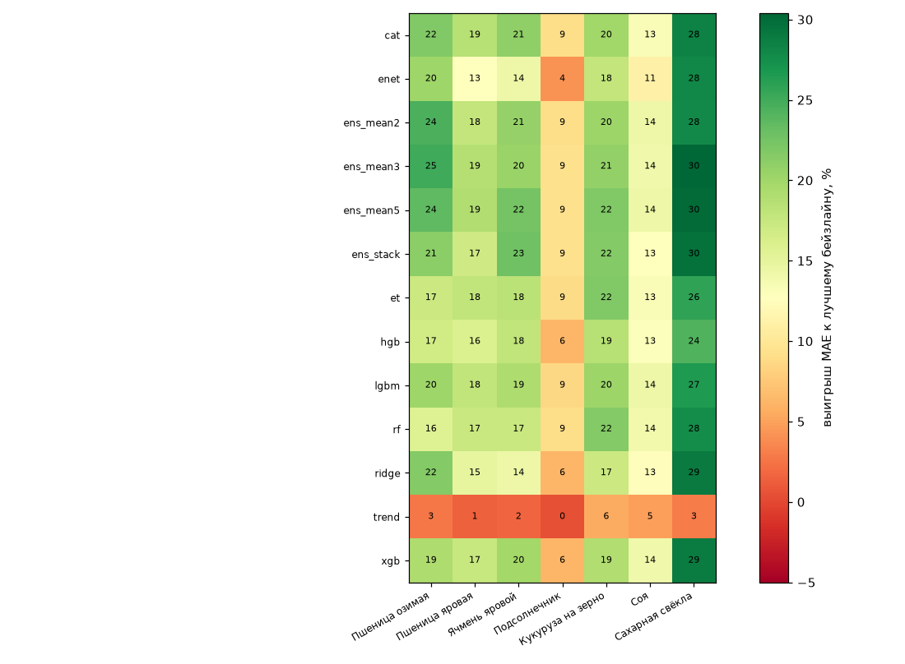
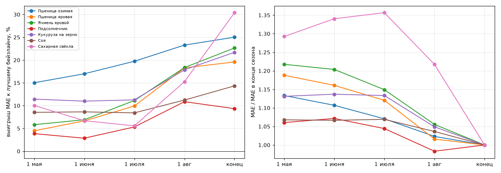
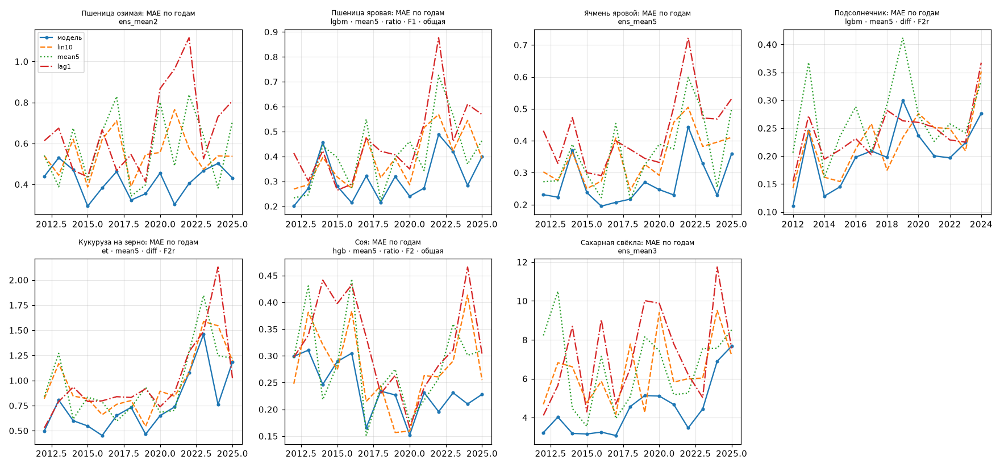
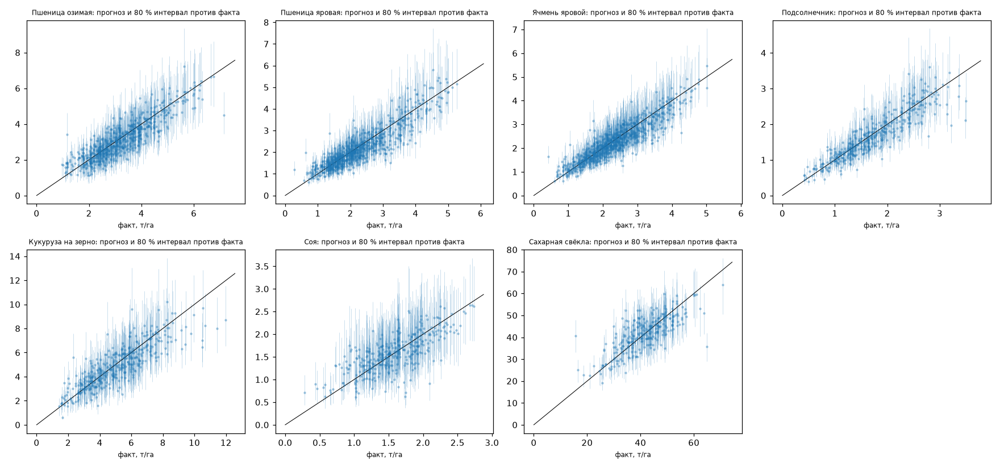

# Перебор моделей (v1: погода, почвы, NDVI)

*Сгенерировано `src/model/sweep.py` 27.10.2026 13:27. Результаты — `data/model/v1/sweep_results.csv` (2794 строк, конфигураций 2230, ошибок 0), лог — `sweep.log`. Анализ перед перебором — [pre_sweep_analysis.md](pre_sweep_analysis.md).*

**Проверка:** скользящий прогноз 2012–2025 (обучение, тренд и нормы погоды — только по годам < t), 2025 — урожайность, восстановленная по сбору. Выигрыш — снижение MAE против лучшего из бейзлайнов lin10 / mean5 / lag1 на тех же строках. Гиперпараметры Optuna подбирались только по 2012–2018, поэтому колонка «2019–25» — честная отложенная проверка для подбора гиперпараметров (выбор признаков и тренда видел все годы). Интервал — конформный 80 % по относительным ошибкам прошлых лет (с разогревом 2009–2011).

Конфигураций по этапам: coarse — 1626, dates — 132, dates_tuned — 70, ensembles — 140, models — 150, models_default — 112.

## 1. Итог: конец сезона

| культура          |   регионов |   строк | лучший бейзлайн   | лучшая модель                     |   MAE |   MAPE |   wMAPE |   выигрыш, % |   2019–25, % |   покрытие 80 |   ширина, % |   было (model_weather), % |
|:------------------|-----------:|--------:|:------------------|:----------------------------------|------:|-------:|--------:|-------------:|-------------:|--------------:|------------:|--------------------------:|
| Пшеница озимая    |         45 |     630 | lin10 0.550       | ens_mean3                         | 0.413 | 14.566 |  13.242 |       25.021 |       28.698 |         0.884 |      61.404 |                        11 |
| Пшеница яровая    |         55 |     768 | lin10 0.389       | lgbm · mean5 · ratio · F1 · общая | 0.313 | 14.926 |  15.35  |       19.589 |       22.33  |         0.863 |      58.292 |                         8 |
| Ячмень яровой     |         62 |     864 | lin10 0.348       | ens_stack                         | 0.269 | 12.534 |  12.863 |       22.652 |       24.367 |         0.873 |      50.115 |                         7 |
| Подсолнечник      |         32 |     411 | lin10 0.225       | ens_mean3                         | 0.204 | 12.442 |  10.004 |        9.342 |        8.349 |         0.895 |      54.276 |                         0 |
| Кукуруза на зерно |         29 |     406 | lin10 0.968       | ens_mean5                         | 0.758 | 15.969 |  14.355 |       21.707 |       15.587 |         0.874 |      69.627 |                         7 |
| Соя               |         26 |     364 | lin10 0.276       | ens_mean2                         | 0.236 | 16.447 |  11.701 |       14.341 |       15.902 |         0.918 |      76.026 |                         4 |
| Сахарная свёкла   |         20 |     276 | lin10 6.356       | ens_mean3                         | 4.424 | 11.464 |  11.136 |       30.393 |       22.245 |         0.841 |      39.225 |                        26 |

## 2. Что брать в прототип

Правило: из конфигураций в пределах 1 % от лучшей MAE берётся самая простая (ridge < enet < бустинги < леса < ансамбли).

| культура          | дата   | конфигурация                      |   MAE |   выигрыш, % |   2019–25, % |   покрытие 80 |   ширина, % | cfg_id       |
|:------------------|:-------|:----------------------------------|------:|-------------:|-------------:|--------------:|------------:|:-------------|
| Пшеница озимая    | 1 мая  | lgbm · mean5 · ratio · F1 · общая | 0.47  |       14.679 |       20.732 |         0.833 |      59.7   | fac717dcdc86 |
| Пшеница озимая    | 1 июня | ens_mean2                         | 0.457 |       16.995 |       20.063 |         0.846 |      61.281 | cb0584abdccb |
| Пшеница озимая    | 1 июля | ens_mean2                         | 0.444 |       19.242 |       23.863 |         0.868 |      62.373 | d4abab99609c |
| Пшеница озимая    | 1 авг  | ens_mean3                         | 0.422 |       23.289 |       30.251 |         0.841 |      57.767 | 18f342c99aa1 |
| Пшеница озимая    | конец  | ens_mean2                         | 0.416 |       24.478 |       26.939 |         0.881 |      60.937 | 6822b089110b |
| Пшеница яровая    | 1 мая  | ens_mean3                         | 0.374 |        3.991 |        0.897 |         0.855 |      64.094 | b25279bc836f |
| Пшеница яровая    | 1 июня | ens_mean5                         | 0.363 |        6.658 |        5.659 |         0.848 |      62.359 | ab8f6ef5ac1a |
| Пшеница яровая    | 1 июля | ens_mean2                         | 0.353 |        9.304 |        5.893 |         0.836 |      58.191 | 8ce08a19e4dd |
| Пшеница яровая    | 1 авг  | ens_mean2                         | 0.318 |       18.295 |       18.222 |         0.855 |      54.675 | d62b60a53bf7 |
| Пшеница яровая    | конец  | lgbm · mean5 · ratio · F1 · общая | 0.313 |       19.589 |       22.33  |         0.863 |      58.292 | d9822fddc4fb |
| Ячмень яровой     | 1 мая  | lgbm · mean5 · ratio · F1         | 0.328 |        5.83  |        4.752 |         0.862 |      58.815 | f19e2ad52818 |
| Ячмень яровой     | 1 июня | et · mean5 · ratio · F1           | 0.327 |        6.136 |       10.243 |         0.86  |      56.005 | ae84a7c32610 |
| Ячмень яровой     | 1 июля | ens_mean3                         | 0.312 |       10.469 |        9.611 |         0.863 |      54.593 | 1d4f25b07445 |
| Ячмень яровой     | 1 авг  | ens_mean3                         | 0.286 |       17.779 |       20.624 |         0.88  |      52.891 | 7cbc55490227 |
| Ячмень яровой     | конец  | ens_mean5                         | 0.27  |       22.419 |       23.805 |         0.877 |      50.892 | 5c7098b34c86 |
| Подсолнечник      | 1 мая  | ridge · mean5 · diff · F5         | 0.218 |        2.915 |        2.535 |         0.883 |      60.517 | 802893806c34 |
| Подсолнечник      | 1 июня | ridge · mean5 · diff · F5         | 0.218 |        2.816 |        3.719 |         0.891 |      55.834 | 4d00a19f4b2a |
| Подсолнечник      | 1 июля | et · mean5 · diff · F2r           | 0.214 |        4.891 |        4.722 |         0.893 |      56.591 | 20fcbbea5218 |
| Подсолнечник      | 1 авг  | et · mean5 · diff · F2r           | 0.201 |       10.393 |        9.706 |         0.883 |      56.014 | b4333bde1fb6 |
| Подсолнечник      | конец  | lgbm · mean5 · diff · F2r         | 0.205 |        8.588 |        8.446 |         0.891 |      56.038 | b131ad070d71 |
| Кукуруза на зерно | 1 мая  | ridge · mean5 · diff · F3         | 0.858 |       11.434 |        7.319 |         0.855 |      72.409 | 51ae3cc72edd |
| Кукуруза на зерно | 1 июня | ridge · mean5 · diff · F5         | 0.862 |       10.988 |        6.54  |         0.857 |      72.851 | f01dd233fe36 |
| Кукуруза на зерно | 1 июля | ridge · mean5 · diff · F0         | 0.868 |       10.413 |        5.724 |         0.855 |      72.799 | 153a2792b2cf |
| Кукуруза на зерно | 1 авг  | ridge · mean5 · diff · F3         | 0.803 |       17.048 |       15.179 |         0.874 |      71.38  | df7b85b2a601 |
| Кукуруза на зерно | конец  | et · mean5 · diff · F2r           | 0.758 |       21.684 |       17.585 |         0.887 |      67.716 | ec2d9e7befd6 |
| Соя               | 1 мая  | ridge · mean5 · diff · F0         | 0.253 |        8.42  |        7.516 |         0.926 |      79.875 | 2eeb97909271 |
| Соя               | 1 июня | ridge · mean5 · diff · F0         | 0.253 |        8.42  |        7.516 |         0.926 |      79.875 | 5085fd007058 |
| Соя               | 1 июля | ridge · mean5 · diff · F0         | 0.253 |        8.42  |        7.516 |         0.926 |      79.875 | a4995431a6b7 |
| Соя               | 1 авг  | xgb · mean5 · diff · F2r          | 0.245 |       11.224 |       14.758 |         0.92  |      86.992 | 03d26be933e3 |
| Соя               | конец  | hgb · mean5 · ratio · F2 · общая  | 0.237 |       13.939 |       17.965 |         0.923 |      76.343 | 9707de89dd74 |
| Сахарная свёкла   | 1 мая  | ens_mean2                         | 5.718 |       10.034 |        2.913 |         0.888 |      57.824 | 5c0c3b4e87e0 |
| Сахарная свёкла   | 1 июня | lgbm · mean5 · diff · F3          | 5.967 |        6.125 |       -0.376 |         0.859 |      56.651 | ef3fafe55c17 |
| Сахарная свёкла   | 1 июля | ens_mean3                         | 6.002 |        5.567 |        3.064 |         0.873 |      57.768 | 7c4152b88dd5 |
| Сахарная свёкла   | 1 авг  | ens_mean5                         | 5.386 |       15.264 |       17.477 |         0.866 |      52.53  | 52dc7156842d |
| Сахарная свёкла   | конец  | ens_mean3                         | 4.424 |       30.393 |       22.245 |         0.841 |      39.225 | 3047a31fc52e |

## 3. Лидерборд по культурам (конец сезона, топ-10)

### Пшеница озимая

| конфигурация               | stage       |   mae |   mape |   wmape |   выигрыш |   2012–18 |   2019–25 |   cov80 |   width80_pct |
|:---------------------------|:------------|------:|-------:|--------:|----------:|----------:|----------:|--------:|--------------:|
| ens_mean3                  | ensembles   | 0.413 | 14.566 |  13.242 |    25.021 |    21.066 |    28.698 |   0.884 |        61.404 |
| ens_mean2                  | ensembles   | 0.416 | 14.617 |  13.206 |    24.478 |    21.831 |    26.939 |   0.881 |        60.937 |
| ens_mean5                  | ensembles   | 0.421 | 14.783 |  13.485 |    23.533 |    20.041 |    26.779 |   0.879 |        61.216 |
| cat · mean5 · diff · F2    | models      | 0.431 | 15.172 |  13.998 |    21.756 |    16.217 |    26.906 |   0.878 |        63.664 |
| cat · mean5 · diff · F4    | models      | 0.431 | 15.148 |  13.804 |    21.732 |    13.139 |    29.722 |   0.873 |        63.588 |
| ridge · mean5 · diff · F2  | coarse      | 0.431 | 15.286 |  13.242 |    21.661 |    12.601 |    30.085 |   0.833 |        58.803 |
| ridge · mean5 · diff · F2  | models      | 0.433 | 15.383 |  13.155 |    21.373 |    12.902 |    29.25  |   0.84  |        58.38  |
| ridge · mean5 · diff · F2r | dates_tuned | 0.433 | 15.47  |  13.141 |    21.328 |    13.855 |    28.278 |   0.84  |        60.262 |
| ens_stack                  | ensembles   | 0.434 | 15.292 |  14.249 |    21.163 |    17.298 |    24.757 |   0.876 |        62.593 |
| ridge · mean5 · diff · F2r | models      | 0.434 | 15.572 |  13.078 |    21.068 |    13.894 |    27.74  |   0.838 |        60.247 |

### Пшеница яровая

| конфигурация                      | stage       |   mae |   mape |   wmape |   выигрыш |   2012–18 |   2019–25 |   cov80 |   width80_pct |
|:----------------------------------|:------------|------:|-------:|--------:|----------:|----------:|----------:|--------:|--------------:|
| lgbm · mean5 · ratio · F1 · общая | models      | 0.313 | 14.926 |  15.35  |    19.589 |    15.939 |    22.33  |   0.863 |        58.292 |
| ens_mean5                         | ensembles   | 0.315 | 14.664 |  14.245 |    19.053 |    19.707 |    18.563 |   0.848 |        54.906 |
| xgb · mean5 · ratio · F1 · общая  | models      | 0.316 | 15.024 |  15.807 |    18.846 |    16.964 |    20.259 |   0.855 |        58.894 |
| ens_mean3                         | ensembles   | 0.317 | 14.732 |  14.18  |    18.661 |    20.627 |    17.185 |   0.844 |        54.7   |
| cat · lin_all · ratio · F5        | models      | 0.317 | 14.672 |  14.484 |    18.571 |    17.522 |    19.359 |   0.859 |        56.868 |
| lgbm · lin_all · ratio · F5       | models      | 0.319 | 14.854 |  14.474 |    17.913 |    17.629 |    18.126 |   0.854 |        56.168 |
| et · lin_all · ratio · F5         | models      | 0.32  | 14.916 |  14.838 |    17.884 |    17.051 |    18.51  |   0.862 |        57.074 |
| ens_mean2                         | ensembles   | 0.32  | 14.947 |  14.21  |    17.749 |    21.18  |    15.173 |   0.84  |        53.8   |
| xgb · lin_all · ratio · F5        | models      | 0.321 | 14.881 |  14.413 |    17.491 |    17.086 |    17.795 |   0.861 |        56.424 |
| lgbm · lin_all · ratio · F5       | dates_tuned | 0.321 | 14.839 |  13.911 |    17.456 |    17.186 |    17.659 |   0.858 |        56.964 |

### Ячмень яровой

| конфигурация                      | stage     |   mae |   mape |   wmape |   выигрыш |   2012–18 |   2019–25 |   cov80 |   width80_pct |
|:----------------------------------|:----------|------:|-------:|--------:|----------:|----------:|----------:|--------:|--------------:|
| ens_stack                         | ensembles | 0.269 | 12.534 |  12.863 |    22.652 |    20.435 |    24.367 |   0.873 |        50.115 |
| ens_mean5                         | ensembles | 0.27  | 12.558 |  13.013 |    22.419 |    20.627 |    23.805 |   0.877 |        50.892 |
| cat · mean5 · ratio · F1          | models    | 0.276 | 12.866 |  13.287 |    20.876 |    17.518 |    23.475 |   0.87  |        52.727 |
| ens_mean2                         | ensembles | 0.276 | 12.893 |  13.418 |    20.665 |    18.158 |    22.605 |   0.878 |        53.045 |
| ens_mean3                         | ensembles | 0.277 | 12.922 |  13.588 |    20.413 |    18.507 |    21.887 |   0.888 |        53.562 |
| xgb · mean5 · ratio · F1          | models    | 0.279 | 13.115 |  13.716 |    19.775 |    15.512 |    23.073 |   0.877 |        52.52  |
| lgbm · mean5 · ratio · F4         | coarse    | 0.282 | 13.282 |  13.861 |    19.1   |    11.584 |    24.914 |   0.884 |        52.451 |
| lgbm · mean5 · ratio · F1 · общая | models    | 0.282 | 13.249 |  13.517 |    18.926 |    12.914 |    23.577 |   0.875 |        53.485 |
| cat · mean5 · ratio · F4          | models    | 0.283 | 13.071 |  12.992 |    18.823 |    14.49  |    22.175 |   0.868 |        51.201 |
| lgbm · mean5 · ratio · F2 · общая | models    | 0.283 | 13.381 |  14.348 |    18.659 |    14.685 |    21.734 |   0.867 |        52.636 |

### Подсолнечник

| конфигурация              | stage     |   mae |   mape |   wmape |   выигрыш |   2012–18 |   2019–25 |   cov80 |   width80_pct |
|:--------------------------|:----------|------:|-------:|--------:|----------:|----------:|----------:|--------:|--------------:|
| ens_mean3                 | ensembles | 0.204 | 12.442 |  10.004 |     9.342 |    10.477 |     8.349 |   0.895 |        54.276 |
| ens_mean5                 | ensembles | 0.204 | 12.399 |  10.017 |     9.314 |    10.527 |     8.252 |   0.891 |        54.916 |
| ens_stack                 | ensembles | 0.204 | 12.443 |  10.022 |     9.256 |    10.59  |     8.088 |   0.9   |        54.209 |
| cat · mean5 · diff · F2r  | models    | 0.204 | 12.461 |  10.063 |     9.04  |    10.59  |     7.683 |   0.883 |        53.208 |
| cat · mean5 · diff · F5   | models    | 0.204 | 12.51  |   9.96  |     9.035 |     9.838 |     8.332 |   0.886 |        53.687 |
| ens_mean2                 | ensembles | 0.204 | 12.489 |  10.033 |     9.034 |    10.44  |     7.803 |   0.888 |        53.689 |
| rf · mean5 · diff · F2r   | models    | 0.205 | 12.535 |  10.063 |     9.001 |     9.001 |     9     |   0.903 |        55.923 |
| et · mean5 · diff · F2r   | models    | 0.205 | 12.494 |   9.97  |     8.926 |     8.787 |     9.049 |   0.886 |        55.822 |
| cat · mean5 · diff · F2   | models    | 0.205 | 12.504 |   9.914 |     8.877 |     9.897 |     7.984 |   0.878 |        53.37  |
| lgbm · mean5 · diff · F2r | models    | 0.205 | 12.496 |  10.214 |     8.588 |     8.75  |     8.446 |   0.891 |        56.038 |

### Кукуруза на зерно

| конфигурация            | stage          |   mae |   mape |   wmape |   выигрыш |   2012–18 |   2019–25 |   cov80 |   width80_pct |
|:------------------------|:---------------|------:|-------:|--------:|----------:|----------:|----------:|--------:|--------------:|
| ens_mean5               | ensembles      | 0.758 | 15.969 |  14.355 |    21.707 |    25.087 |    15.587 |   0.874 |        69.627 |
| et · mean5 · diff · F2r | models         | 0.758 | 15.986 |  14.275 |    21.684 |    22.246 |    17.585 |   0.887 |        67.716 |
| ens_stack               | ensembles      | 0.759 | 15.994 |  14.288 |    21.644 |    22.246 |    17.513 |   0.892 |        69.773 |
| rf · mean5 · diff · F2r | models         | 0.76  | 15.96  |  14.405 |    21.552 |    21.801 |    17.671 |   0.884 |        68.867 |
| rf · mean5 · diff · F2r | models_default | 0.765 | 16.063 |  14.506 |    20.996 |    21.281 |    17.063 |   0.882 |        69.569 |
| rf · mean5 · diff · F5  | models         | 0.766 | 16.085 |  14.69  |    20.942 |    21.326 |    16.934 |   0.877 |        68.78  |
| ens_mean3               | ensembles      | 0.767 | 16.237 |  14.596 |    20.77  |    25.525 |    13.619 |   0.879 |        71.439 |
| et · mean5 · diff · F2r | models_default | 0.77  | 16.251 |  14.658 |    20.529 |    21.273 |    16.244 |   0.877 |        67.271 |
| rf · mean5 · diff · F5  | models_default | 0.772 | 16.282 |  14.748 |    20.295 |    20.217 |    16.588 |   0.879 |        69.963 |
| ens_mean2               | ensembles      | 0.772 | 16.39  |  14.705 |    20.262 |    25.709 |    12.592 |   0.877 |        73.767 |

### Соя

| конфигурация                     | stage     |   mae |   mape |   wmape |   выигрыш |   2012–18 |   2019–25 |   cov80 |   width80_pct |
|:---------------------------------|:----------|------:|-------:|--------:|----------:|----------:|----------:|--------:|--------------:|
| ens_mean2                        | ensembles | 0.236 | 16.447 |  11.701 |    14.341 |    12.931 |    15.902 |   0.918 |        76.026 |
| lgbm · mean5 · diff · F2r        | models    | 0.237 | 16.472 |  11.734 |    14.293 |    12.625 |    16.15  |   0.918 |        77.929 |
| ens_mean5                        | ensembles | 0.237 | 16.422 |  11.627 |    14.22  |    12.625 |    15.994 |   0.912 |        74.862 |
| ens_mean3                        | ensembles | 0.237 | 16.531 |  11.79  |    14.056 |    12.822 |    15.416 |   0.92  |        75.913 |
| xgb · mean5 · diff · F2r         | models    | 0.237 | 16.351 |  11.418 |    13.952 |    11.312 |    16.924 |   0.909 |        77.22  |
| hgb · mean5 · ratio · F2 · общая | models    | 0.237 | 17.29  |  14.113 |    13.939 |    10.382 |    17.965 |   0.923 |        76.343 |
| rf · mean5 · diff · F5           | models    | 0.238 | 16.524 |  11.803 |    13.851 |    12.837 |    14.958 |   0.915 |        73.146 |
| lgbm · mean5 · diff · F5         | models    | 0.238 | 16.592 |  11.864 |    13.822 |    12.426 |    15.366 |   0.918 |        76.33  |
| xgb · mean5 · diff · F5          | models    | 0.238 | 16.417 |  11.439 |    13.768 |    12.102 |    15.621 |   0.912 |        75.197 |
| rf · mean5 · diff · F4           | models    | 0.238 | 16.56  |  11.79  |    13.687 |    12.115 |    15.434 |   0.909 |        73.167 |

### Сахарная свёкла

| конфигурация              | stage     |   mae |   mape |   wmape |   выигрыш |   2012–18 |   2019–25 |   cov80 |   width80_pct |
|:--------------------------|:----------|------:|-------:|--------:|----------:|----------:|----------:|--------:|--------------:|
| ens_mean3                 | ensembles | 4.424 | 11.464 |  11.136 |    30.393 |    39.813 |    22.245 |   0.841 |        39.225 |
| ens_mean5                 | ensembles | 4.446 | 11.529 |  11.251 |    30.054 |    39.575 |    21.817 |   0.862 |        43.551 |
| ens_stack                 | ensembles | 4.472 | 11.662 |  11.43  |    29.643 |    39.071 |    21.487 |   0.866 |        42.162 |
| ridge · mean5 · diff · F4 | coarse    | 4.519 | 11.81  |  11.663 |    28.911 |    37.374 |    21.589 |   0.873 |        42.164 |
| xgb · mean5 · diff · F5   | models    | 4.523 | 11.8   |  11.38  |    28.838 |    34.24  |    24.165 |   0.859 |        44.071 |
| ridge · mean5 · diff · F4 | models    | 4.524 | 11.813 |  11.624 |    28.825 |    37.877 |    20.995 |   0.862 |        40.299 |
| ridge · mean5 · diff · F3 | models    | 4.532 | 11.787 |  11.579 |    28.705 |    37.431 |    21.156 |   0.866 |        41.203 |
| xgb · mean5 · diff · F4   | models    | 4.535 | 11.934 |  11.363 |    28.65  |    31.735 |    25.982 |   0.888 |        47.125 |
| ridge · mean5 · diff · F3 | coarse    | 4.54  | 11.821 |  11.634 |    28.582 |    36.442 |    21.783 |   0.891 |        43.421 |
| cat · mean5 · diff · F5   | models    | 4.548 | 11.666 |  10.794 |    28.443 |    34.321 |    23.358 |   0.841 |        43.116 |

## 4. Лучший выигрыш каждой модели, % (конец сезона)

| model     |   Пшеница озимая |   Пшеница яровая |   Ячмень яровой |   Подсолнечник |   Кукуруза на зерно |   Соя |   Сахарная свёкла |
|:----------|-----------------:|-----------------:|----------------:|---------------:|--------------------:|------:|------------------:|
| cat       |             21.8 |             18.6 |            20.9 |            9   |                19.9 |  13.2 |              28.4 |
| enet      |             20.1 |             12.8 |            14.3 |            4.2 |                17.8 |  11.2 |              28   |
| ens_mean2 |             24.5 |             17.7 |            20.7 |            9   |                20.3 |  14.3 |              27.8 |
| ens_mean3 |             25   |             18.7 |            20.4 |            9.3 |                20.8 |  14.1 |              30.4 |
| ens_mean5 |             23.5 |             19.1 |            22.4 |            9.3 |                21.7 |  14.2 |              30.1 |
| ens_stack |             21.2 |             17   |            22.7 |            9.3 |                21.6 |  12.7 |              29.6 |
| et        |             17.3 |             17.9 |            18.3 |            8.9 |                21.7 |  13.1 |              25.8 |
| hgb       |             16.8 |             16   |            17.8 |            6.3 |                18.6 |  12.9 |              24.3 |
| lgbm      |             20.1 |             17.9 |            19.1 |            8.6 |                20.2 |  14.3 |              26.5 |
| rf        |             15.6 |             17.3 |            17.4 |            9   |                21.6 |  13.9 |              27.5 |
| ridge     |             21.7 |             14.9 |            14.3 |            6.2 |                17.1 |  12.5 |              28.9 |
| trend     |              2.7 |              1.5 |             1.7 |            0.5 |                 5.6 |   4.9 |               2.9 |
| xgb       |             19.2 |             17.5 |            19.8 |            6.3 |                18.9 |  14   |              28.8 |

## 5. Оси грубого отбора (лучший выигрыш по оси, %)

**trend**

| trend   |   Пшеница озимая |   Пшеница яровая |   Ячмень яровой |   Подсолнечник |   Кукуруза на зерно |   Соя |   Сахарная свёкла |
|:--------|-----------------:|-----------------:|----------------:|---------------:|--------------------:|------:|------------------:|
| lin10   |             16.9 |             11   |            10.3 |            3.7 |                10.9 |   3.6 |              21.8 |
| lin15   |             19   |             14.1 |            15.4 |            4.6 |                15   |   6.6 |              26.5 |
| lin_all |             20.2 |             16.6 |            14   |            2.4 |                15   |   8.1 |              25.6 |
| mean5   |             21.7 |             16.1 |            19.1 |            6.2 |                18.3 |  12.5 |              28.9 |
| ts10    |             14.4 |              7.7 |             7   |            2   |                10.8 |   1.8 |              22   |
| ts15    |             18.2 |             11.5 |            12.6 |            3.7 |                16.4 |   3.7 |              21.7 |

**target**

| target   |   Пшеница озимая |   Пшеница яровая |   Ячмень яровой |   Подсолнечник |   Кукуруза на зерно |   Соя |   Сахарная свёкла |
|:---------|-----------------:|-----------------:|----------------:|---------------:|--------------------:|------:|------------------:|
| diff     |             21.7 |             14.6 |            17.2 |            6.2 |                18.3 |  12.5 |              28.9 |
| log      |             18.6 |             14.6 |            17.2 |            4.6 |                17.1 |   5.3 |              27.8 |
| ratio    |             20.1 |             16.6 |            19.1 |            3.9 |                13.1 |  -1   |              26.2 |

**feats**

| feats   |   Пшеница озимая |   Пшеница яровая |   Ячмень яровой |   Подсолнечник |   Кукуруза на зерно |   Соя |   Сахарная свёкла |
|:--------|-----------------:|-----------------:|----------------:|---------------:|--------------------:|------:|------------------:|
| F1      |             20.4 |             16.1 |            18.2 |            4.7 |                17.8 |  10.3 |              27.1 |
| F2      |             21.7 |             15.7 |            17.9 |            4.8 |                17.4 |  10.1 |              27.9 |
| F2r     |             20.8 |             15.1 |            15.8 |            6.2 |                18.3 |  10.7 |              27.4 |
| F3      |             20.3 |             15.7 |            17.1 |            2.6 |                16.1 |  10.5 |              28.6 |
| F4      |             20.7 |             15.2 |            19.1 |            3.2 |                16.9 |  12.2 |              28.9 |
| F5      |             20.7 |             16.6 |            16.6 |            5.2 |                17.5 |  12.5 |              28.4 |

**model**

| model   |   Пшеница озимая |   Пшеница яровая |   Ячмень яровой |   Подсолнечник |   Кукуруза на зерно |   Соя |   Сахарная свёкла |
|:--------|-----------------:|-----------------:|----------------:|---------------:|--------------------:|------:|------------------:|
| lgbm    |             20.1 |             16.6 |            19.1 |            3.4 |                18.3 |  10   |              26.5 |
| ridge   |             21.7 |             14.9 |            14.3 |            6.2 |                17.1 |  12.5 |              28.9 |

**Схема**

| index             |   по культуре |   общая |
|:------------------|--------------:|--------:|
| Пшеница озимая    |          21.7 |    19.5 |
| Пшеница яровая    |          16.6 |    17.2 |
| Ячмень яровой     |          19.1 |    17.9 |
| Подсолнечник      |           6.2 |    -5   |
| Кукуруза на зерно |          18.3 |    13.3 |
| Соя               |          12.5 |     6.5 |
| Сахарная свёкла   |          28.9 |    18.8 |

**Только тренд (без погоды)**

| trend   |   Пшеница озимая |   Пшеница яровая |   Ячмень яровой |   Подсолнечник |   Кукуруза на зерно |   Соя |   Сахарная свёкла |
|:--------|-----------------:|-----------------:|----------------:|---------------:|--------------------:|------:|------------------:|
| lin10   |              0.1 |              0.1 |             0   |            0.5 |                 2.4 |   1.9 |               0.1 |
| lin15   |              2.7 |              1.5 |             1.7 |           -1.6 |                 4.7 |   4.8 |               2.9 |
| lin_all |              0.5 |             -0.2 |            -0.8 |           -3.7 |                 5.6 |   4.9 |              -3   |
| mean5   |             -5.3 |             -4.3 |            -3.4 |          -20.1 |                -0.3 |  -2.5 |              -4.3 |
| ts10    |             -1.9 |             -3.5 |            -2.4 |           -1.1 |                 3.7 |  -3.1 |              -2.4 |
| ts15    |              1.4 |             -1.8 |            -2.1 |           -3.8 |                 5.4 |   0.9 |              -1.9 |

## 6. Дата прогноза → выигрыш к лучшему бейзлайну, % (лучшая конфигурация на дату)

| культура          |   1 мая |   1 июня |   1 июля |   1 авг |   конец |
|:------------------|--------:|---------:|---------:|--------:|--------:|
| Пшеница озимая    |    15   |     17   |     19.7 |    23.3 |    25   |
| Пшеница яровая    |     4.5 |      6.7 |      9.9 |    18.3 |    19.6 |
| Ячмень яровой     |     5.8 |      6.9 |     11.1 |    18.4 |    22.7 |
| Подсолнечник      |     3.9 |      2.9 |      5.3 |    10.9 |     9.3 |
| Кукуруза на зерно |    11.4 |     11   |     11.3 |    17.9 |    21.7 |
| Соя               |     8.5 |      8.6 |      8.4 |    11.2 |    14.3 |
| Сахарная свёкла   |    10   |      6.7 |      5.6 |    15.3 |    30.4 |

## 7. Калибровка 80 % интервала (2019–2025, среднее по датам)

Варианты: относительная (rel) или абсолютная (abs) ошибка, окно прошлых лет. Цель — покрытие около 0,80 при наименьшей ширине.

| ('kind', '')   | ('win', '')   |   ('cov80', 'barley') |   ('cov80', 'maize') |   ('cov80', 'soy') |   ('cov80', 'spring_wheat') |   ('cov80', 'sugar_beet') |   ('cov80', 'sunflower') |   ('cov80', 'winter_wheat') |   ('width80_pct', 'barley') |   ('width80_pct', 'maize') |   ('width80_pct', 'soy') |   ('width80_pct', 'spring_wheat') |   ('width80_pct', 'sugar_beet') |   ('width80_pct', 'sunflower') |   ('width80_pct', 'winter_wheat') |
|:---------------|:--------------|----------------------:|---------------------:|-------------------:|----------------------------:|--------------------------:|-------------------------:|----------------------------:|----------------------------:|---------------------------:|-------------------------:|----------------------------------:|--------------------------------:|-------------------------------:|----------------------------------:|
| abs            | 5 лет         |                  0.73 |                 0.64 |               0.77 |                        0.7  |                      0.67 |                     0.7  |                        0.74 |                       40.86 |                      46.85 |                    43.07 |                             48.7  |                           38.21 |                          37.64 |                             41.5  |
| abs            | 8 лет         |                  0.72 |                 0.66 |               0.81 |                        0.7  |                      0.7  |                     0.7  |                        0.75 |                       40.09 |                      45.84 |                    46.04 |                             46.47 |                           36.79 |                          35.38 |                             41.85 |
| abs            | все годы      |                  0.75 |                 0.7  |               0.86 |                        0.69 |                      0.72 |                     0.73 |                        0.79 |                       42.4  |                      51.78 |                    50.01 |                             46.44 |                           40.5  |                          38.1  |                             44.31 |
| rel            | 5 лет         |                  0.77 |                 0.67 |               0.82 |                        0.73 |                      0.7  |                     0.73 |                        0.8  |                       42.94 |                      49.93 |                    47.84 |                             51.92 |                           38.68 |                          38.52 |                             47.53 |
| rel            | 8 лет         |                  0.78 |                 0.69 |               0.88 |                        0.74 |                      0.74 |                     0.79 |                        0.82 |                       44    |                      51.18 |                    55.11 |                             52.04 |                           38.86 |                          40.53 |                             51.1  |
| rel            | все годы      |                  0.83 |                 0.81 |               0.94 |                        0.79 |                      0.81 |                     0.85 |                        0.89 |                       50.44 |                      62.38 |                    66.72 |                             56.31 |                           47.44 |                          51.07 |                             57.76 |

Лучший по сумме (|покрытие − 0,8| и ширина): **abs, все годы**.

## 8. Рекомендованные модели по годам

